*[English](README.md) ∙ [日本語](README-ja.md) ∙ [简体中文](README-zh-Hans.md) ∙ [繁體中文](README-zh-TW.md) ∙ [Қазақша](README-kk.md) | [العَرَبِيَّة‎](https://github.com/donnemartin/system-design-primer/issues/170) ∙ [বাংলা](https://github.com/donnemartin/system-design-primer/issues/220) ∙ [Português do Brasil](https://github.com/donnemartin/system-design-primer/issues/40) ∙ [Deutsch](https://github.com/donnemartin/system-design-primer/issues/186) ∙ [ελληνικά](https://github.com/donnemartin/system-design-primer/issues/130) ∙ [עברית](https://github.com/donnemartin/system-design-primer/issues/272) ∙ [Italiano](https://github.com/donnemartin/system-design-primer/issues/104) ∙ [한국어](https://github.com/donnemartin/system-design-primer/issues/102) ∙ [فارسی](https://github.com/donnemartin/system-design-primer/issues/110) ∙ [Polski](https://github.com/donnemartin/system-design-primer/issues/68) ∙ [русский язык](https://github.com/donnemartin/system-design-primer/issues/87) ∙ [Español](https://github.com/donnemartin/system-design-primer/issues/136) ∙ [ภาษาไทย](https://github.com/donnemartin/system-design-primer/issues/187) ∙ [Türkçe](https://github.com/donnemartin/system-design-primer/issues/39) ∙ [tiếng Việt](https://github.com/donnemartin/system-design-primer/issues/127) ∙ [Français](https://github.com/donnemartin/system-design-primer/issues/250) | [Add Translation](https://github.com/donnemartin/system-design-primer/issues/28)*

**Осы нұсқаулықты [аударуға](TRANSLATIONS.md) көмектесіңіз!**

# Жүйені жобалау негіздері

<p align="center">
  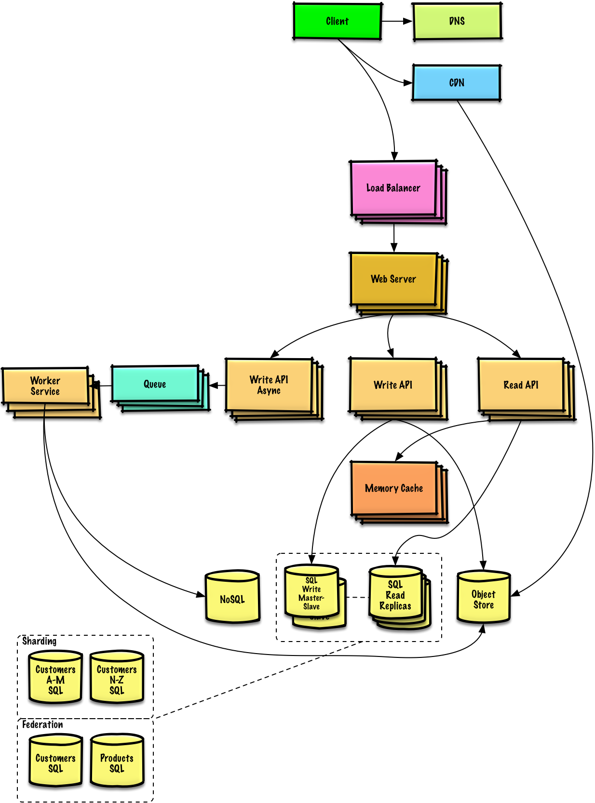
  <br/>
</p>

## Мотивация

> Ауқымды жүйелерді қалай жобалауды үйрену.
>
> Жүйені жобалау сұхбатына дайындалу.

### Ауқымды жүйелерді жобалауды үйрену

Масштабталатын жүйелерді жобалауды үйрену сізді жақсы инженер болуға көмектеседі.

Жүйені жобалау кең тақырып. Интернетте жүйені жобалау принциптері бойынша **өте көп ресурстар шашырап жатыр**.

Бұл репозиторий — жүйелерді масштабта құруды үйренуге көмектесетін ресурстардың **ұйымдастырылған жинағы**.

### Ашық бастапқы кодты қауымдастықтан үйрену

Бұл үнемі жаңартылып отыратын ашық бастапқы код жобасы.

[Үлестер](#үлес-қосу) қабылданады!

### Жүйені жобалау сұхбатына дайындалу

Кодтау сұхбаттарынан басқа, жүйені жобалау көптеген технологиялық компанияларда **техникалық сұхбат үрдісінің** **міндетті компоненті** болып табылады.

**Жалпы жүйені жобалау сұхбат сұрақтарын жаттығып**, нәтижелеріңізді **үлгі шешімдерімен салыстырыңыз**: талқылаулар, код және диаграммалар.

Сұхбатқа дайындалуға арналған қосымша тақырыптар:

* [Оқу нұсқаулығы](#оқу-нұсқаулығы)
* [Жүйені жобалау сұхбат сұрағына қалай кірісу](#жүйені-жобалау-сұхбат-сұрағына-қалай-кірісу)
* [Жүйені жобалау сұхбат сұрақтары, **шешімдерімен**](#шешімдері-бар-жүйені-жобалау-сұхбат-сұрақтары)
* [Объектіге бағытталған жобалау сұхбат сұрақтары, **шешімдерімен**](#шешімдері-бар-объектіге-бағытталған-жобалау-сұхбат-сұрақтары)
* [Қосымша жүйені жобалау сұхбат сұрақтары](#қосымша-жүйені-жобалау-сұхбат-сұрақтары)

## Anki флэш-карталары

<p align="center">
  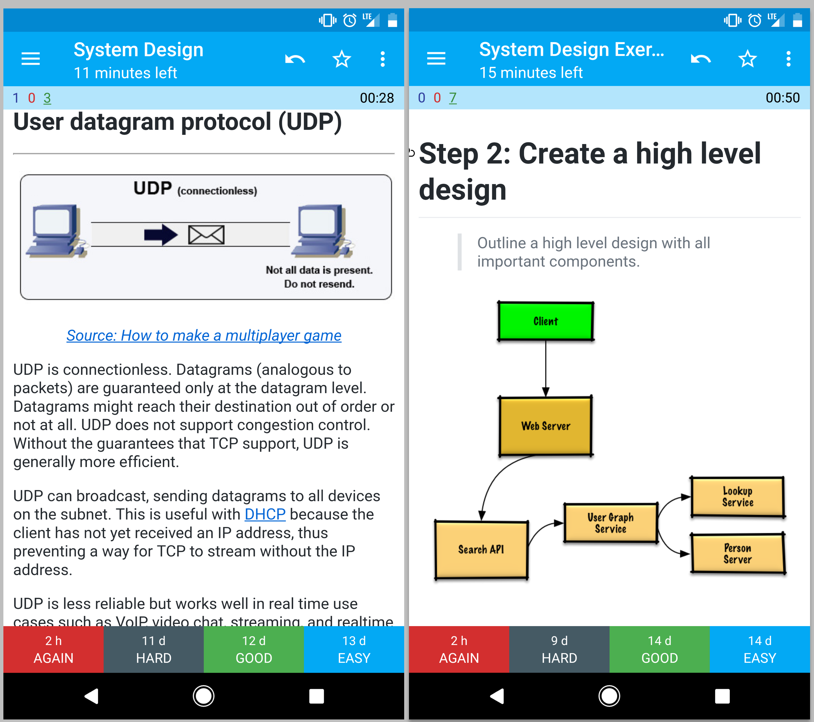
  <br/>
</p>

Берілген [Anki флэш-карта жинақтары](https://apps.ankiweb.net/) жүйені жобалаудың негізгі тұжырымдамаларын есте сақтауға көмектесу үшін аралықпен қайталау әдісін қолданады.

* [Жүйені жобалау жинағы](https://github.com/donnemartin/system-design-primer/tree/master/resources/flash_cards/System%20Design.apkg)
* [Жүйені жобалау жаттығулары жинағы](https://github.com/donnemartin/system-design-primer/tree/master/resources/flash_cards/System%20Design%20Exercises.apkg)
* [Объектіге бағытталған жобалау жаттығулары жинағы](https://github.com/donnemartin/system-design-primer/tree/master/resources/flash_cards/OO%20Design.apkg)

Жолда жүрген кезде пайдалануға өте ыңғайлы.

### Кодтау ресурсы: Интерактивті кодтау тапсырмалары

[**Кодтау сұхбатына**](https://github.com/donnemartin/interactive-coding-challenges) дайындалуға арналған ресурстарды іздеп жүрсіз бе?

<p align="center">
  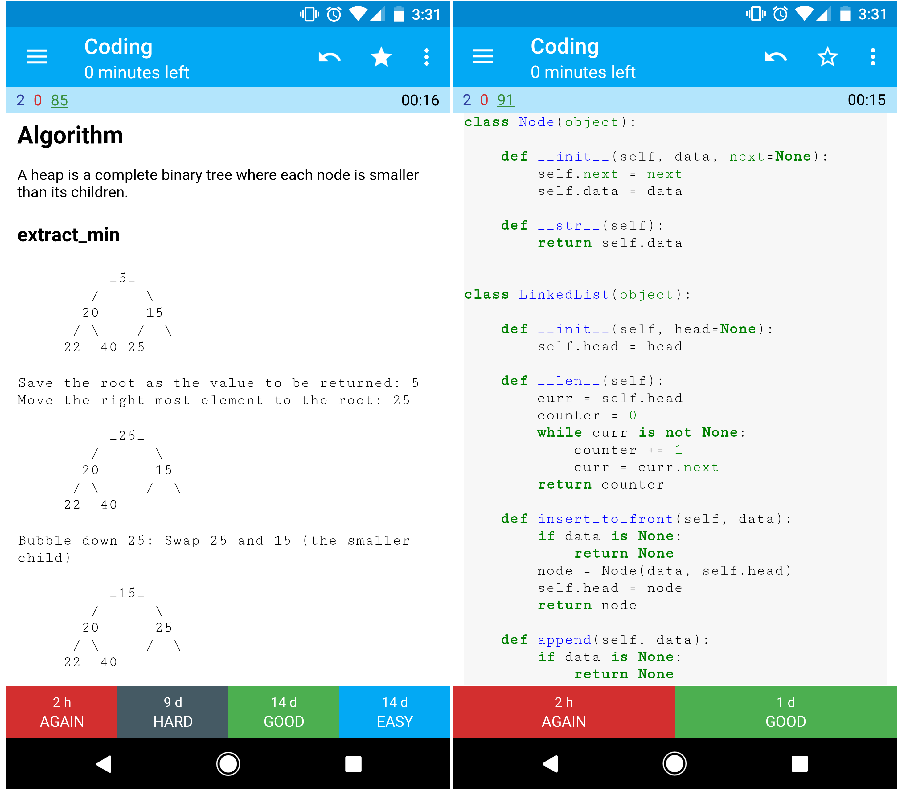
  <br/>
</p>

Қосымша Anki жинағын қамтитын туыс репозиторийді қараңыз — [**Интерактивті кодтау тапсырмалары**](https://github.com/donnemartin/interactive-coding-challenges):

* [Кодтау жинағы](https://github.com/donnemartin/interactive-coding-challenges/tree/master/anki_cards/Coding.apkg)

## Үлес қосу

> Қауымдастықтан үйреніңіз.

Келесілерге көмектесу үшін pull request жіберіңіз:

* Қателерді түзету
* Бөлімдерді жетілдіру
* Жаңа бөлімдер қосу
* [Аудару](https://github.com/donnemartin/system-design-primer/issues/28)

Жетілдіруді қажет ететін мазмұн [дамуда](#дамуда) деп белгіленген.

[Үлес қосу нұсқаулығын](CONTRIBUTING.md) қараңыз.

## Жүйені жобалау тақырыптарының индексі

> Артықшылықтары мен кемшіліктерін қоса алғанда, жүйені жобалаудың әртүрлі тақырыптарының қысқаша мазмұны. **Бәрі — ымыраласу**.
>
> Әр бөлім тереңірек ресурстарға сілтемелер қамтиды.

<p align="center">
  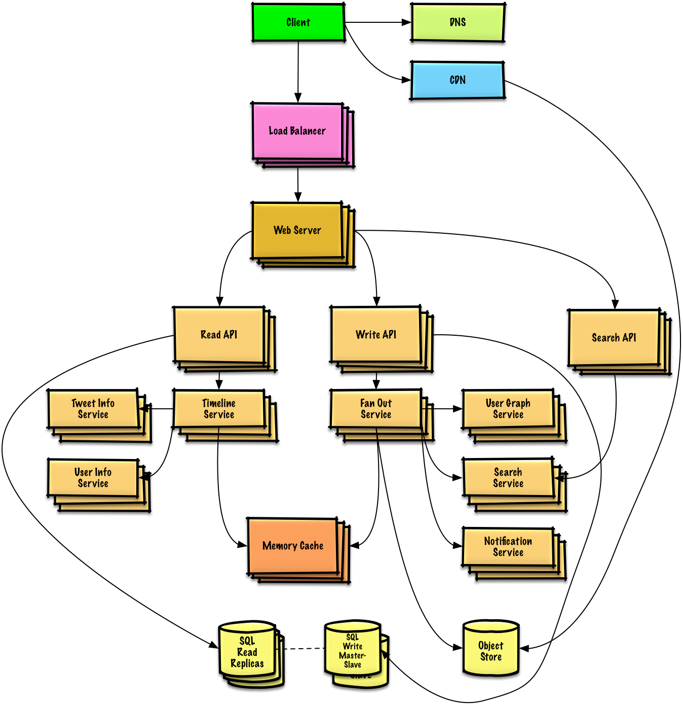
  <br/>
</p>

* [Жүйені жобалау тақырыптары: осыдан бастаңыз](#жүйені-жобалау-тақырыптары-осыдан-бастаңыз)
    * [1-қадам: Масштабталушылық бойынша бейне дәрісті қарау](#1-қадам-масштабталушылық-бойынша-бейне-дәрісті-қарау)
    * [2-қадам: Масштабталушылық бойынша мақаланы қарау](#2-қадам-масштабталушылық-бойынша-мақаланы-қарау)
    * [Келесі қадамдар](#келесі-қадамдар)
* [Өнімділік пен масштабталушылық](#өнімділік-пен-масштабталушылық)
* [Кідіріс пен өткізу қабілеті](#кідіріс-пен-өткізу-қабілеті)
* [Қолжетімділік пен дәйектілік](#қолжетімділік-пен-дәйектілік)
    * [CAP теоремасы](#cap-теоремасы)
        * [CP - дәйектілік және бөлімге төзімділік](#cp---дәйектілік-және-бөлімге-төзімділік)
        * [AP - қолжетімділік және бөлімге төзімділік](#ap---қолжетімділік-және-бөлімге-төзімділік)
* [Дәйектілік үлгілері](#дәйектілік-үлгілері)
    * [Әлсіз дәйектілік](#әлсіз-дәйектілік)
    * [Ақырғы дәйектілік](#ақырғы-дәйектілік)
    * [Күшті дәйектілік](#күшті-дәйектілік)
* [Қолжетімділік үлгілері](#қолжетімділік-үлгілері)
    * [Fail-over](#fail-over)
    * [Репликация](#репликация)
    * [Сандарда қолжетімділік](#сандарда-қолжетімділік)
* [Домендік атау жүйесі](#домендік-атау-жүйесі)
* [Контентті жеткізу желісі](#контентті-жеткізу-желісі)
    * [Push CDN](#push-cdn)
    * [Pull CDN](#pull-cdn)
* [Жүктеме теңестіргіш](#жүктеме-теңестіргіш)
    * [Белсенді-пассивті](#белсенді-пассивті)
    * [Белсенді-белсенді](#белсенді-белсенді)
    * [4-деңгейлі жүктемені теңестіру](#4-деңгейлі-жүктемені-теңестіру)
    * [7-деңгейлі жүктемені теңестіру](#7-деңгейлі-жүктемені-теңестіру)
    * [Горизонтал масштабтау](#горизонтал-масштабтау)
* [Кері прокси (веб-сервер)](#кері-прокси-веб-сервер)
    * [Жүктеме теңестіргіш пен кері проксиді салыстыру](#жүктеме-теңестіргіш-пен-кері-проксиді-салыстыру)
* [Қолданба деңгейі](#қолданба-деңгейі)
    * [Микросервистер](#микросервистер)
    * [Қызметті табу](#қызметті-табу)
* [Дерекқор](#дерекқор)
    * [Реляциялық дерекқорды басқару жүйесі (РДБЖ)](#реляциялық-дерекқорды-басқару-жүйесі-рдбж)
        * [Master-slave репликациясы](#master-slave-репликациясы)
        * [Master-master репликациясы](#master-master-репликациясы)
        * [Федерация](#федерация)
        * [Шардтау](#шардтау)
        * [Денормализация](#денормализация)
        * [SQL баптау](#sql-баптау)
    * [NoSQL](#nosql)
        * [Кілт-мән қоймасы](#кілт-мән-қоймасы)
        * [Құжат қоймасы](#құжат-қоймасы)
        * [Кең баған қоймасы](#кең-баған-қоймасы)
        * [Граф дерекқоры](#граф-дерекқоры)
    * [SQL немесе NoSQL](#sql-немесе-nosql)
* [Кэш](#кэш)
    * [Клиенттік кэштеу](#клиенттік-кэштеу)
    * [CDN кэштеу](#cdn-кэштеу)
    * [Веб-серверде кэштеу](#веб-серверде-кэштеу)
    * [Дерекқорда кэштеу](#дерекқорда-кэштеу)
    * [Қолданбада кэштеу](#қолданбада-кэштеу)
    * [Дерекқор сұраныс деңгейінде кэштеу](#дерекқор-сұраныс-деңгейінде-кэштеу)
    * [Объект деңгейінде кэштеу](#объект-деңгейінде-кэштеу)
    * [Кэшті қашан жаңарту керек](#кэшті-қашан-жаңарту-керек)
        * [Cache-aside](#cache-aside)
        * [Write-through](#write-through)
        * [Write-behind (write-back)](#write-behind-write-back)
        * [Refresh-ahead](#refresh-ahead)
* [Асинхрондылық](#асинхрондылық)
    * [Хабарлама кезектері](#хабарлама-кезектері)
    * [Тапсырма кезектері](#тапсырма-кезектері)
    * [Кері қысым](#кері-қысым)
* [Байланыс](#байланыс)
    * [Деректерді беруді басқару хаттамасы (TCP)](#деректерді-беруді-басқару-хаттамасы-tcp)
    * [Пайдаланушы датаграмма хаттамасы (UDP)](#пайдаланушы-датаграмма-хаттамасы-udp)
    * [Қашықтан процедураны шақыру (RPC)](#қашықтан-процедураны-шақыру-rpc)
    * [Өкілдік күй беру (REST)](#өкілдік-күй-беру-rest)
* [Қауіпсіздік](#қауіпсіздік)
* [Қосымша](#қосымша)
    * [Екінің дәрежелері кестесі](#екінің-дәрежелері-кестесі)
    * [Әр бағдарламашы білуі тиіс кідіріс сандары](#әр-бағдарламашы-білуі-тиіс-кідіріс-сандары)
    * [Қосымша жүйені жобалау сұхбат сұрақтары](#қосымша-жүйені-жобалау-сұхбат-сұрақтары)
    * [Нақты әлем архитектуралары](#нақты-әлем-архитектуралары)
    * [Компания архитектуралары](#компания-архитектуралары)
    * [Компанияның инженерлік блогтары](#компанияның-инженерлік-блогтары)
* [Дамуда](#дамуда)
* [Алғыс](#алғыс)
* [Байланыс ақпараты](#байланыс-ақпараты)
* [Лицензия](#лицензия)

## Оқу нұсқаулығы

> Сұхбат уақытыңызға (қысқа, орта, ұзақ) байланысты қарастырылатын тақырыптар ұсынылады.

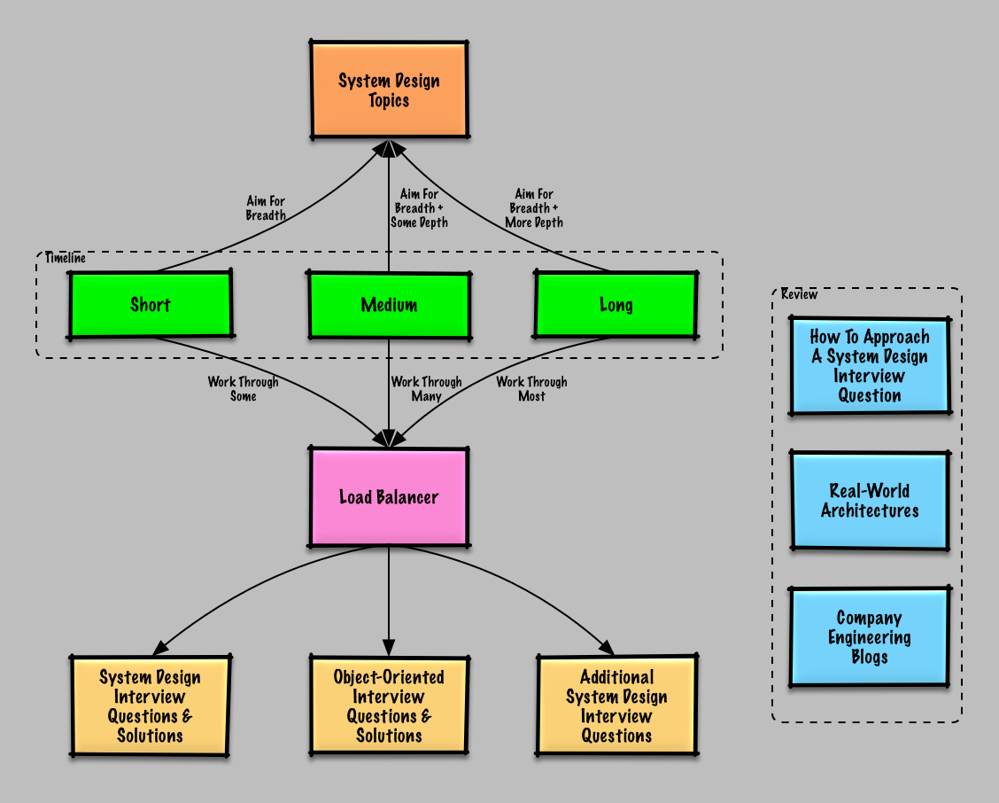

**С: Сұхбат үшін осындағының бәрін білу керек пе?**

**Ж: Жоқ, сұхбатқа дайындалу үшін осындағының бәрін білудің қажеті жоқ**.

Сұхбатта не сұралатыны келесі айнымалыларға байланысты:

* Сіздің қанша тәжірибеңіз бар
* Техникалық дайындығыңыз қандай
* Қандай лауазымдарға сұхбат беріп жатырсыз
* Қандай компанияларда сұхбат беріп жатырсыз
* Сәт

Тәжірибелі үміткерлерден жүйені жобалау туралы көбірек білу күтіледі. Архитекторлар немесе команда жетекшілерінен жеке үлесшілерге қарағанда көбірек білу күтілуі мүмкін. Ірі технологиялық компанияларда бір немесе бірнеше жобалау сұхбаты раунды болуы ықтимал.

Кең бастаңыз, бірнеше бағытта тереңдеңіз. Жүйені жобалаудың әртүрлі негізгі тақырыптары туралы біраз білу пайдалы. Келесі нұсқаулықты уақыт кестесіне, тәжірибеге, қандай лауазымдарға сұхбат беріп жатқаныңызға және қандай компанияларда сұхбат беретіндігіңізге байланысты реттеңіз.

* **Қысқа уақыт кестесі** — жүйені жобалау тақырыптарында **кеңдікті** мақсат етіңіз. **Бірнеше** сұхбат сұрақтарын шешу арқылы жаттығыңыз.
* **Орта уақыт кестесі** — жүйені жобалау тақырыптарында **кеңдік** пен **белгілі тереңдікті** мақсат етіңіз. **Көп** сұхбат сұрақтарын шешу арқылы жаттығыңыз.
* **Ұзақ уақыт кестесі** — жүйені жобалау тақырыптарында **кеңдік** пен **көбірек тереңдікті** мақсат етіңіз. **Көпшілік** сұхбат сұрақтарын шешу арқылы жаттығыңыз.

| | Қысқа | Орта | Ұзақ |
|---|---|---|---|
| Жүйелердің қалай жұмыс істейтінін жалпы түсіну үшін [Жүйені жобалау тақырыптарын](#жүйені-жобалау-тақырыптарының-индексі) оқып шығыңыз | :+1: | :+1: | :+1: |
| Сұхбат беретін компаниялардың [Компания инженерлік блогтарынан](#компанияның-инженерлік-блогтары) бірнеше мақала оқыңыз | :+1: | :+1: | :+1: |
| Бірнеше [Нақты әлем архитектурасын](#нақты-әлем-архитектуралары) оқып шығыңыз | :+1: | :+1: | :+1: |
| [Жүйені жобалау сұхбат сұрағына қалай кірісуді](#жүйені-жобалау-сұхбат-сұрағына-қалай-кірісу) қараңыз | :+1: | :+1: | :+1: |
| [Шешімдері бар жүйені жобалау сұхбат сұрақтарын](#шешімдері-бар-жүйені-жобалау-сұхбат-сұрақтары) орындаңыз | Бірнеше | Көп | Көпшілігін |
| [Шешімдері бар объектіге бағытталған жобалау сұхбат сұрақтарын](#шешімдері-бар-объектіге-бағытталған-жобалау-сұхбат-сұрақтары) орындаңыз | Бірнеше | Көп | Көпшілігін |
| [Қосымша жүйені жобалау сұхбат сұрақтарын](#қосымша-жүйені-жобалау-сұхбат-сұрақтары) қараңыз | Бірнеше | Көп | Көпшілігін |

## Жүйені жобалау сұхбат сұрағына қалай кірісу

> Жүйені жобалау сұхбат сұрағын қалай шешуге болады.

Жүйені жобалау сұхбаты — **ашық диалог**. Оны сіз жетекшілік етуге тиіссіз.

Талқылауды бағыттау үшін келесі қадамдарды пайдалануға болады. Осы үрдісті нығайтуға көмектесу үшін [Шешімдері бар жүйені жобалау сұхбат сұрақтары](#шешімдері-бар-жүйені-жобалау-сұхбат-сұрақтары) бөлімін осы қадамдарды пайдаланып орындаңыз.

### 1-қадам: Қолдану жағдайларын, шектеулерді және болжамдарды белгілеу

Талаптарды жинаңыз және мәселенің ауқымын анықтаңыз. Қолдану жағдайлары мен шектеулерді нақтылау үшін сұрақтар қойыңыз. Болжамдарды талқылаңыз.

* Кім пайдаланатын болады?
* Олар қалай пайдаланатын болады?
* Қанша пайдаланушы бар?
* Жүйе не істейді?
* Жүйенің кірістері мен шығыстары қандай?
* Қанша деректерді өңдеуді күтеміз?
* Секундына қанша сұраныс күтеміз?
* Оқу мен жазудың күтілетін арақатынасы қандай?

### 2-қадам: Жоғары деңгейлі жобалау жасау

Барлық маңызды компоненттермен жоғары деңгейлі жобаны белгілеңіз.

* Негізгі компоненттер мен байланыстарды схема түрінде сызыңыз
* Идеяларыңызды негіздеңіз

### 3-қадам: Негізгі компоненттерді жобалау

Әр негізгі компоненттің бөлшектеріне үңіліңіз. Мысалы, [URL қысқарту қызметін жобалауды](solutions/system_design/pastebin/README.md) сұрасаңыз, талқылаңыз:

* Толық URL хэшін жасау және сақтау
    * [MD5](solutions/system_design/pastebin/README.md) және [Base62](solutions/system_design/pastebin/README.md)
    * Хэш қақтығыстары
    * SQL немесе NoSQL
    * Дерекқор схемасы
* Хэшталған URL-ді толық URL-ге аудару
    * Дерекқорда іздеу
* API және объектіге бағытталған жобалау

### 4-қадам: Жобаны масштабтау

Шектеулерді ескере отырып, тарлықтарды анықтаңыз және шешіңіз. Мысалы, масштабталушылық мәселелерін шешу үшін мыналар қажет пе?

* Жүктеме теңестіргіш
* Горизонтал масштабтау
* Кэштеу
* Дерекқорды шардтау

Ықтимал шешімдер мен ымыраласуларды талқылаңыз. Бәрі — ымыраласу. Тарлықтарды [масштабталатын жүйені жобалаудың принциптерін](#жүйені-жобалау-тақырыптарының-индексі) пайдаланып шешіңіз.

### Шамалы есептеулер

Сізден қолмен кейбір бағалауларды жасауды сұрауы мүмкін. Келесі ресурстар үшін [Қосымшаға](#қосымша) жүгініңіз:

* [Шамалы есептеулерді пайдалану](http://highscalability.com/blog/2011/1/26/google-pro-tip-use-back-of-the-envelope-calculations-to-choo.html)
* [Екінің дәрежелері кестесі](#екінің-дәрежелері-кестесі)
* [Әр бағдарламашы білуі тиіс кідіріс сандары](#әр-бағдарламашы-білуі-тиіс-кідіріс-сандары)

### Дереккөз(дер) және қосымша оқу

Не күтетінін жақсырақ түсіну үшін келесі сілтемелерді қараңыз:

* [How to ace a systems design interview](https://web.archive.org/web/20210505130322/https://www.palantir.com/2011/10/how-to-rock-a-systems-design-interview/)
* [The system design interview](http://www.hiredintech.com/system-design)
* [Intro to Architecture and Systems Design Interviews](https://www.youtube.com/watch?v=ZgdS0EUmn70)
* [System design template](https://leetcode.com/discuss/career/229177/My-System-Design-Template)

## Шешімдері бар жүйені жобалау сұхбат сұрақтары

> Үлгі талқылаулар, код және диаграммалармен жалпы жүйені жобалау сұхбат сұрақтары.
>
> Шешімдер `solutions/` қалтасындағы мазмұнға сілтелген.

| Сұрақ | |
|---|---|
| Pastebin.com (немесе Bit.ly) жобалаңыз | [Шешім](solutions/system_design/pastebin/README.md) |
| Twitter уақыт белгісі мен іздеуді (немесе Facebook жаңалықтар ағыны мен іздеуін) жобалаңыз | [Шешім](solutions/system_design/twitter/README.md) |
| Веб-шолғышты жобалаңыз | [Шешім](solutions/system_design/web_crawler/README.md) |
| Mint.com жобалаңыз | [Шешім](solutions/system_design/mint/README.md) |
| Әлеуметтік желінің деректер құрылымдарын жобалаңыз | [Шешім](solutions/system_design/social_graph/README.md) |
| Іздеу жүйесіне арналған кілт-мән қоймасын жобалаңыз | [Шешім](solutions/system_design/query_cache/README.md) |
| Amazon-ның санат бойынша сату рейтингі мүмкіндігін жобалаңыз | [Шешім](solutions/system_design/sales_rank/README.md) |
| AWS-те миллиондаған пайдаланушыларға дейін масштабталатын жүйені жобалаңыз | [Шешім](solutions/system_design/scaling_aws/README.md) |
| Жүйені жобалау сұрағын қосу | [Үлес қосу](#үлес-қосу) |

### Pastebin.com (немесе Bit.ly) жобалаңыз

[Жаттығу мен шешімді қараңыз](solutions/system_design/pastebin/README.md)

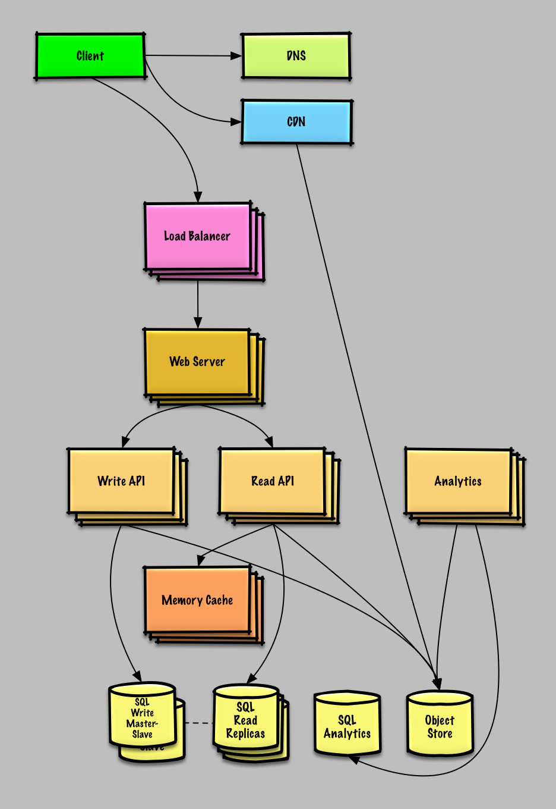

### Twitter уақыт белгісі мен іздеуді (немесе Facebook жаңалықтар ағыны мен іздеуін) жобалаңыз

[Жаттығу мен шешімді қараңыз](solutions/system_design/twitter/README.md)


### Веб-шолғышты жобалаңыз

[Жаттығу мен шешімді қараңыз](solutions/system_design/web_crawler/README.md)

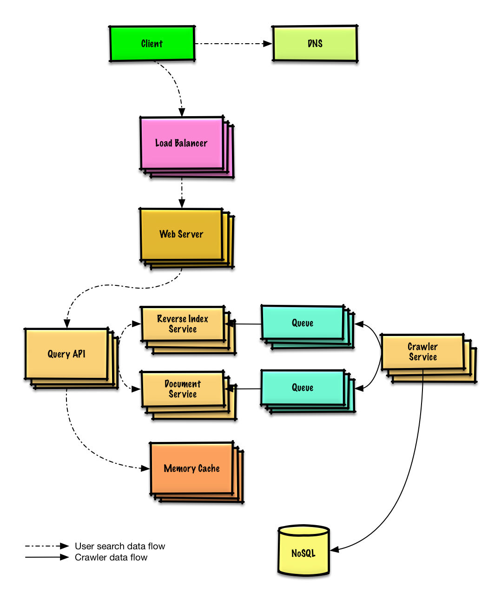

### Mint.com жобалаңыз

[Жаттығу мен шешімді қараңыз](solutions/system_design/mint/README.md)

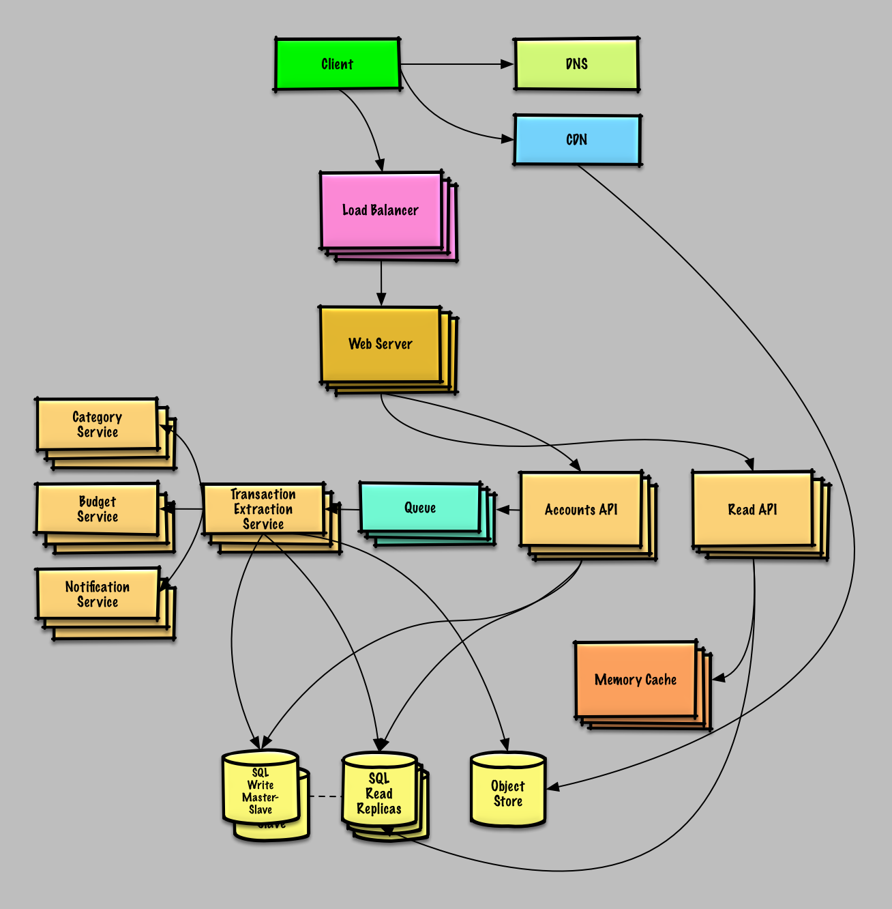

### Әлеуметтік желінің деректер құрылымдарын жобалаңыз

[Жаттығу мен шешімді қараңыз](solutions/system_design/social_graph/README.md)

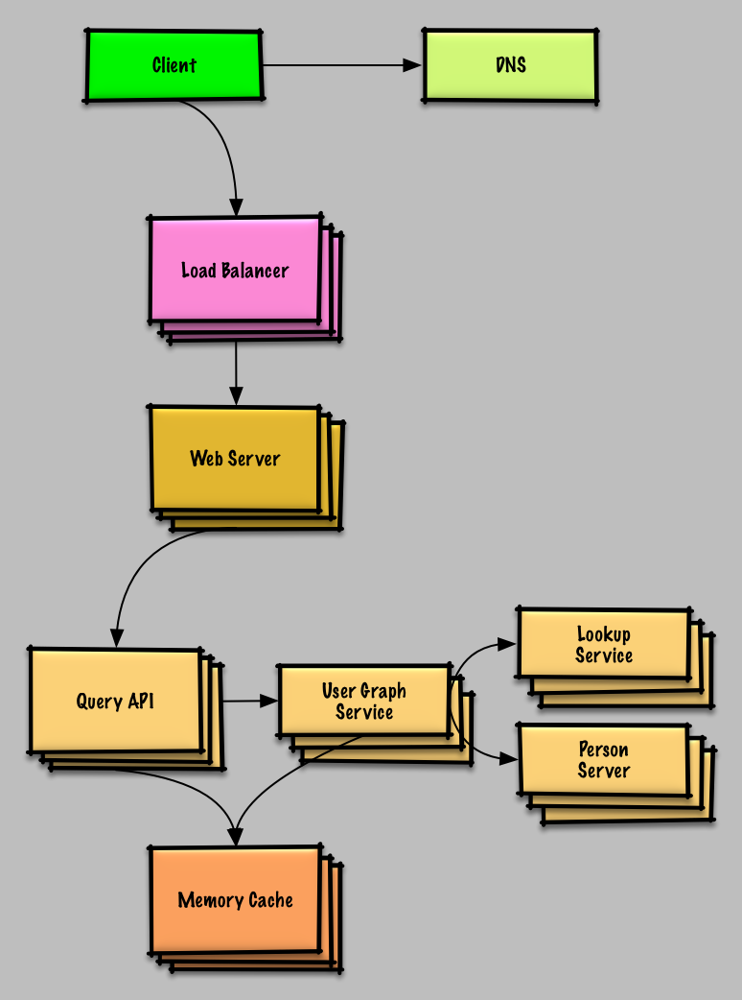

### Іздеу жүйесіне арналған кілт-мән қоймасын жобалаңыз

[Жаттығу мен шешімді қараңыз](solutions/system_design/query_cache/README.md)

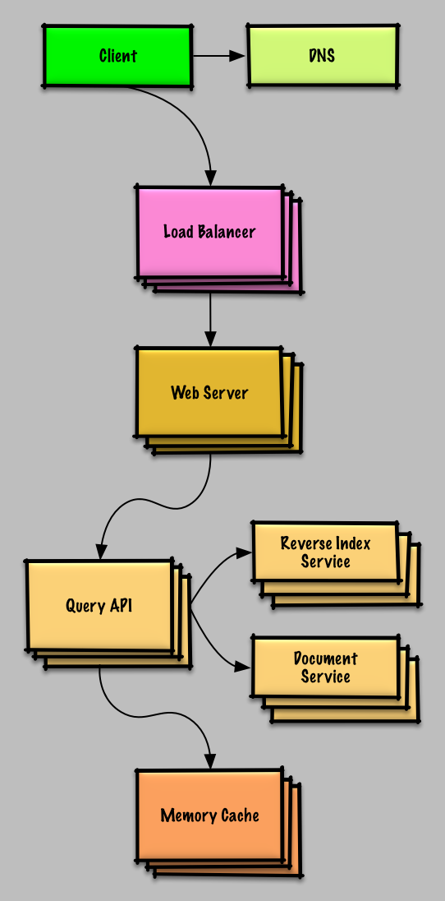

### Amazon-ның санат бойынша сату рейтингі мүмкіндігін жобалаңыз

[Жаттығу мен шешімді қараңыз](solutions/system_design/sales_rank/README.md)

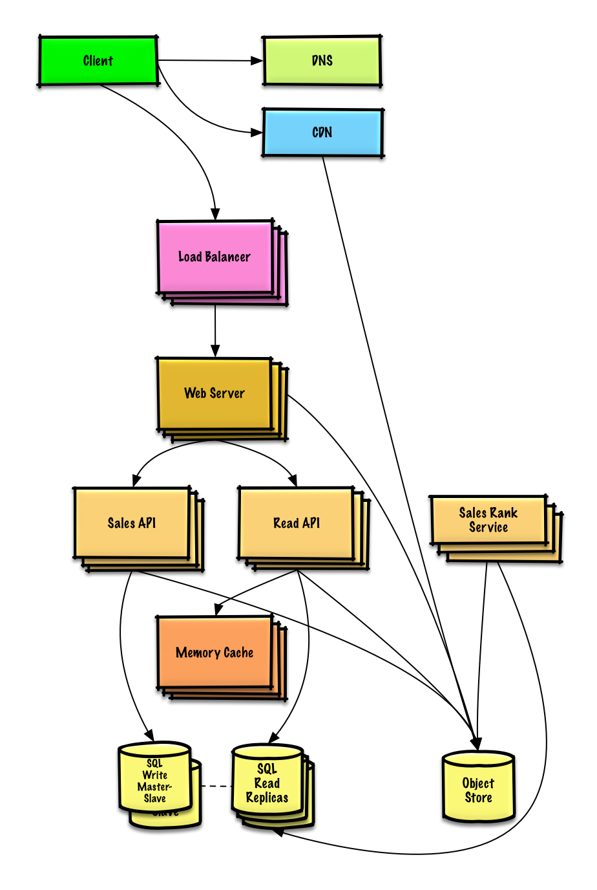

### AWS-те миллиондаған пайдаланушыларға дейін масштабталатын жүйені жобалаңыз

[Жаттығу мен шешімді қараңыз](solutions/system_design/scaling_aws/README.md)


## Шешімдері бар объектіге бағытталған жобалау сұхбат сұрақтары

> Үлгі талқылаулар, код және диаграммалармен жалпы объектіге бағытталған жобалау сұхбат сұрақтары.
>
> Шешімдер `solutions/` қалтасындағы мазмұнға сілтелген.

>**Ескерту: Бұл бөлім дамуда**

| Сұрақ | |
|---|---|
| Хэш картасын жобалаңыз | [Шешім](solutions/object_oriented_design/hash_table/hash_map.ipynb)  |
| Ең соңғы пайдаланылған кэшті жобалаңыз | [Шешім](solutions/object_oriented_design/lru_cache/lru_cache.ipynb)  |
| Қоңырау орталығын жобалаңыз | [Шешім](solutions/object_oriented_design/call_center/call_center.ipynb)  |
| Карта дестесін жобалаңыз | [Шешім](solutions/object_oriented_design/deck_of_cards/deck_of_cards.ipynb)  |
| Тұрақ орнын жобалаңыз | [Шешім](solutions/object_oriented_design/parking_lot/parking_lot.ipynb)  |
| Чат серверін жобалаңыз | [Шешім](solutions/object_oriented_design/online_chat/online_chat.ipynb)  |
| Дөңгелек массивті жобалаңыз | [Үлес қосу](#үлес-қосу)  |
| Объектіге бағытталған жобалау сұрағын қосу | [Үлес қосу](#үлес-қосу) |

## Жүйені жобалау тақырыптары: осыдан бастаңыз

Жүйені жобалауда жаңасыз ба?

Алдымен жалпы принциптердің негізгі түсінігі қажет: олардың не екенін, қалай қолданылатынын және артықшылықтары мен кемшіліктерін үйрену.

### 1-қадам: Масштабталушылық бойынша бейне дәрісті қарау

[Гарвардтағы масштабталушылық дәрісі](https://www.youtube.com/watch?v=-W9F__D3oY4)

* Қамтылған тақырыптар:
    * Тік масштабтау
    * Горизонтал масштабтау
    * Кэштеу
    * Жүктемені теңестіру
    * Дерекқорды репликациялау
    * Дерекқорды бөлу

### 2-қадам: Масштабталушылық бойынша мақаланы қарау

[Масштабталушылық](https://web.archive.org/web/20221030091841/http://www.lecloud.net/tagged/scalability/chrono)

* Қамтылған тақырыптар:
    * [Клондар](https://web.archive.org/web/20220530193911/https://www.lecloud.net/post/7295452622/scalability-for-dummies-part-1-clones)
    * [Дерекқорлар](https://web.archive.org/web/20220602114024/https://www.lecloud.net/post/7994751381/scalability-for-dummies-part-2-database)
    * [Кэштер](https://web.archive.org/web/20230126233752/https://www.lecloud.net/post/9246290032/scalability-for-dummies-part-3-cache)
    * [Асинхрондылық](https://web.archive.org/web/20220926171507/https://www.lecloud.net/post/9699762917/scalability-for-dummies-part-4-asynchronism)

### Келесі қадамдар

Келесіде жоғары деңгейлі ымыраласуларды қарастырамыз:

* **Өнімділік** пен **масштабталушылық**
* **Кідіріс** пен **өткізу қабілеті**
* **Қолжетімділік** пен **дәйектілік**

**Бәрі — ымыраласу** екенін есте сақтаңыз.

Содан кейін DNS, CDN және жүктеме теңестіргіштер сияқты нақтырақ тақырыптарға үңілеміз.

## Өнімділік пен масштабталушылық

Қосылған ресурстарға пропорционал **өнімділіктің** артуына әкелсе, қызмет **масштабталатын** болып саналады. Жалпы, өнімділікті арттыру дегеніміз — жұмыс бірліктерін көбірек орындау, бірақ деректер жинақтары өскен сайын үлкен жұмыс бірліктерін өңдеу де болуы мүмкін.<sup><a href=http://www.allthingsdistributed.com/2006/03/a_word_on_scalability.html>1</a></sup>

Өнімділік пен масштабталушылықты салыстырудың тағы бір жолы:

* **Өнімділік** мәселесі болса, жүйеңіз бір пайдаланушы үшін баяу жұмыс істейді.
* **Масштабталушылық** мәселесі болса, жүйеңіз бір пайдаланушы үшін жылдам, бірақ ауыр жүктеме кезінде баяу болады.

### Дереккөз(дер) және қосымша оқу

* [A word on scalability](http://www.allthingsdistributed.com/2006/03/a_word_on_scalability.html)
* [Scalability, availability, stability, patterns](http://www.slideshare.net/jboner/scalability-availability-stability-patterns/)

## Кідіріс пен өткізу қабілеті

**Кідіріс** — белгілі бір іс-әрекетті орындауға немесе нәтиже шығаруға кететін уақыт.

**Өткізу қабілеті** — уақыт бірлігіндегі осындай іс-әрекеттер немесе нәтижелер саны.

Жалпы, **қолайлы кідіріспен** **ең жоғары өткізу қабілетін** мақсат ету керек.

### Дереккөз(дер) және қосымша оқу

* [Understanding latency vs throughput](https://community.cadence.com/cadence_blogs_8/b/fv/posts/understanding-latency-vs-throughput)

## Қолжетімділік пен дәйектілік

### CAP теоремасы

<p align="center">
  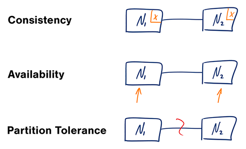
  <br/>
  <i><a href="https://robertgreiner.com/cap-theorem-revisited">Дереккөз: CAP теоремасы қайта қаралды</a></i>
</p>

Таратылған компьютерлік жүйеде келесі кепілдіктердің тек екеуін ғана қамтамасыз ете аласыз:

* **Дәйектілік** — әр оқу ең соңғы жазуды немесе қатені алады
* **Қолжетімділік** — әр сұраныс жауап алады, бірақ бұл жауаптың ақпараттың ең соңғы нұсқасын қамтитынына кепілдік жоқ
* **Бөлімге төзімділік** — желі ақауларынан туындаған ерікті бөлімге қарамастан жүйе жұмыс істей береді

*Желілер сенімді емес, сондықтан бөлімге төзімділікті қамтамасыз ету қажет. Дәйектілік пен қолжетімділік арасында бағдарламалық ымыраласу жасауыңыз керек болады.*

#### CP — дәйектілік және бөлімге төзімділік

Бөлінген түйіннен жауап күту уақыт шегінен асу қатесіне әкелуі мүмкін. Бизнес қажеттіліктері атомарлы оқу мен жазуды талап етсе, CP жақсы таңдау болып табылады.

#### AP — қолжетімділік және бөлімге төзімділік

Жауаптар кез келген түйіндегі деректердің ең оңай қолжетімді нұсқасын қайтарады, ол ең соңғы нұсқа болмауы мүмкін. Бөлім шешілгенде жазулар таратылуына біраз уақыт кетуі мүмкін.

Бизнес [ақырғы дәйектілікке](#ақырғы-дәйектілік) жол беруі қажет болса немесе жүйе сыртқы қателерге қарамастан жұмыс істеуін жалғастыруы керек болса, AP жақсы таңдау болып табылады.

### Дереккөз(дер) және қосымша оқу

* [CAP theorem revisited](https://robertgreiner.com/cap-theorem-revisited/)
* [A plain english introduction to CAP theorem](http://ksat.me/a-plain-english-introduction-to-cap-theorem)
* [CAP FAQ](https://github.com/henryr/cap-faq)
* [The CAP theorem](https://www.youtube.com/watch?v=k-Yaq8AHlFA)

## Дәйектілік үлгілері

Бір деректің бірнеше көшірмесі болғанда, клиенттердің деректерге дәйекті көрінісі болуы үшін оларды қалай синхрондау керектігі туралы таңдаулармен бетпе-бет келеміз. [CAP теоремасының](#cap-теоремасы) дәйектілік анықтамасын еске алыңыз: әр оқу ең соңғы жазуды немесе қатені алады.

### Әлсіз дәйектілік

Жазудан кейін оқулар оны көруі де, көрмеуі де мүмкін. Мүмкіндігінше жақсы орындау тәсілі қолданылады.

Бұл тәсіл memcached сияқты жүйелерде кездеседі. Әлсіз дәйектілік VoIP, бейне чат және нақты уақыттағы көп ойыншылы ойындар сияқты нақты уақыт жағдайларында жақсы жұмыс істейді. Мысалы, телефон қоңырауы кезінде бірнеше секундқа байланыс үзілсе, байланыс қалпына келгенде байланыс үзілісі кезінде айтылғандарды естімейсіз.

### Ақырғы дәйектілік

Жазудан кейін оқулар ақыр соңында оны көреді (әдетте миллисекундтар ішінде). Деректер асинхронды түрде репликацияланады.

Бұл тәсіл DNS және электрондық пошта сияқты жүйелерде кездеседі. Ақырғы дәйектілік жоғары қолжетімді жүйелерде жақсы жұмыс істейді.

### Күшті дәйектілік

Жазудан кейін оқулар оны көреді. Деректер синхронды түрде репликацияланады.

Бұл тәсіл файлдық жүйелер мен РДБЖ-де кездеседі. Күшті дәйектілік транзакцияларды қажет ететін жүйелерде жақсы жұмыс істейді.

### Дереккөз(дер) және қосымша оқу

* [Transactions across data centers](http://snarfed.org/transactions_across_datacenters_io.html)

## Қолжетімділік үлгілері

Жоғары қолжетімділікті қамтамасыз ету үшін екі толықтырушы үлгі бар: **fail-over** және **репликация**.

### Fail-over

#### Белсенді-пассивті

Белсенді-пассивті fail-over кезінде белсенді және резервтегі пассивті сервер арасында «жүрек соғысы» сигналдары жіберіледі. «Жүрек соғысы» үзілсе, пассивті сервер белсендінің IP мекенжайын алады және қызметті жалғастырады.

Істен шығу ұзақтығы пассивті сервердің «ыстық» резервте жұмыс істеп тұрғанына немесе «суық» резервтен іске қосылуы керектігіне байланысты. Тек белсенді сервер ғана трафикті өңдейді.

Белсенді-пассивті failover master-slave failover деп те аталуы мүмкін.

#### Белсенді-белсенді

Белсенді-белсенді режимде екі сервер де трафикті басқарады, жүктемені олардың арасына бөліп тарату.

Серверлер жалпыға ашық болса, DNS екі сервердің де жалпы IP-адрестерін білуі керек. Серверлер ішкі болса, қолданба логикасы екі сервер туралы да білуі керек.

Белсенді-белсенді failover master-master failover деп те аталуы мүмкін.

### Кемшілік(тер): failover

* Fail-over қосымша жабдық пен күрделілік қосады.
* Жаңадан жазылған деректер пассивке репликацияланғанға дейін белсенді жүйе істен шықса, деректер жоғалу қаупі бар.

### Репликация

#### Master-slave және master-master

Бұл тақырып [Дерекқор](#дерекқор) бөлімінде толығырақ талқыланады:

* [Master-slave репликациясы](#master-slave-репликациясы)
* [Master-master репликациясы](#master-master-репликациясы)

### Сандарда қолжетімділік

Қолжетімділік жиі жұмыс уақытымен (немесе тоқтап қалу уақытымен) қызмет қолжетімді болатын уақыт пайызы ретінде өлшенеді. Қолжетімділік жалпы «9-дар» санымен өлшенеді — 99.99% қолжетімділікті қызмет «төрт 9» деп сипатталады.

#### 99.9% қолжетімділік — үш 9

| Ұзақтық               | Қолайлы тоқтап қалу уақыты |
|-----------------------|----------------------------|
| Жылдық тоқтап қалу   | 8 сағ 45 мин 57 с          |
| Айлық тоқтап қалу    | 43 мин 49.7 с              |
| Апталық тоқтап қалу  | 10 мин 4.8 с               |
| Күндік тоқтап қалу   | 1 мин 26.4 с               |

#### 99.99% қолжетімділік — төрт 9

| Ұзақтық               | Қолайлы тоқтап қалу уақыты |
|-----------------------|----------------------------|
| Жылдық тоқтап қалу   | 52 мин 35.7 с              |
| Айлық тоқтап қалу    | 4 мин 23 с                 |
| Апталық тоқтап қалу  | 1 мин 5 с                  |
| Күндік тоқтап қалу   | 8.6 с                      |

#### Параллель және дәйекті қолжетімділік

Егер қызмет ақауға бейім бірнеше компоненттен тұрса, қызметтің жалпы қолжетімділігі компоненттердің дәйекті немесе параллель орналасқанына байланысты.

###### Дәйектіде

Қолжетімділігі < 100% екі компонент дәйекті болғанда жалпы қолжетімділік төмендейді:

```
Қолжетімділік (Барлығы) = Қолжетімділік (Foo) * Қолжетімділік (Bar)
```

`Foo` және `Bar` екеуінің де 99.9% қолжетімділігі болса, дәйектідегі жалпы қолжетімділіктері 99.8% болар еді.

###### Параллельде

Қолжетімділігі < 100% екі компонент параллель болғанда жалпы қолжетімділік артады:

```
Қолжетімділік (Барлығы) = 1 - (1 - Қолжетімділік (Foo)) * (1 - Қолжетімділік (Bar))
```

`Foo` және `Bar` екеуінің де 99.9% қолжетімділігі болса, параллельдегі жалпы қолжетімділіктері 99.9999% болар еді.

## Домендік атау жүйесі

<p align="center">
  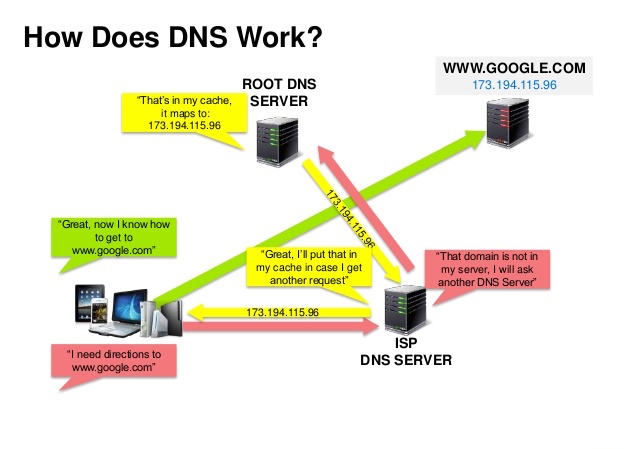
  <br/>
  <i><a href=http://www.slideshare.net/srikrupa5/dns-security-presentation-issa>Дереккөз: DNS қауіпсіздігі презентациясы</a></i>
</p>

Домендік атау жүйесі (DNS) www.example.com сияқты домен атын IP мекенжайына аударады.

DNS иерархиялық болып табылады, жоғарғы деңгейде бірнеше уәкілетті серверлер бар. Маршрутизаторыңыз немесе интернет провайдеріңіз іздеу кезінде қандай DNS сервер(лер)іне хабарласу керектігі туралы ақпарат береді. Төменгі деңгейдегі DNS серверлері салыстырмаларды кэштейді, бұл DNS таралу кешігулері себебінен ескіруі мүмкін. DNS нәтижелері де браузеріңізбен немесе ОЖ-мен белгілі бір уақыт аралығында кэштелуі мүмкін, оны [өмір сүру уақыты (TTL)](https://en.wikipedia.org/wiki/Time_to_live) анықтайды.

* **NS жазбасы (атау сервері)** — доменіңіз/субдоменіңіз үшін DNS серверлерін көрсетеді.
* **MX жазбасы (пошта алмасу)** — хабарламаларды қабылдауға арналған пошта серверлерін көрсетеді.
* **A жазбасы (мекенжай)** — атауды IP мекенжайына нұсқайды.
* **CNAME (канондық)** — атауды басқа атауға немесе `CNAME`-ге (example.com-ды www.example.com-ға) немесе `A` жазбасына нұсқайды.

[CloudFlare](https://www.cloudflare.com/dns/) және [Route 53](https://aws.amazon.com/route53/) сияқты қызметтер басқарылатын DNS қызметтерін ұсынады. Кейбір DNS қызметтері трафикті әртүрлі әдістермен бағыттай алады:

* [Салмақты дөңгелек жолмен](https://www.jscape.com/blog/load-balancing-algorithms)
    * Техникалық қызмет көрсетудегі серверлерге трафиктің баруын болдырмау
    * Әртүрлі кластер өлшемдері арасындағы теңгерім
    * A/B тестілеу
* [Кідірісіне негізделген](https://docs.aws.amazon.com/Route53/latest/DeveloperGuide/routing-policy-latency.html)
* [Геоорналасуға негізделген](https://docs.aws.amazon.com/Route53/latest/DeveloperGuide/routing-policy-geo.html)

### Кемшілік(тер): DNS

* DNS серверіне қол жеткізу аздап кешігу енгізеді, дегенмен жоғарыда сипатталған кэштеу арқылы азайтылады.
* DNS серверін басқару күрделі болуы мүмкін және жалпы [үкіметтер, интернет провайдерлер және ірі компаниялар](http://superuser.com/questions/472695/who-controls-the-dns-servers/472729) тарапынан басқарылады.
* DNS қызметтері жақында [DDoS шабуылына](http://dyn.com/blog/dyn-analysis-summary-of-friday-october-21-attack/) ұшырады, бұл пайдаланушыларды Twitter IP мекенжайын білмей Twitter сияқты веб-сайттарға кіруге кедергі жасады.

### Дереккөз(дер) және қосымша оқу

* [DNS architecture](https://technet.microsoft.com/en-us/library/dd197427(v=ws.10).aspx)
* [Wikipedia](https://en.wikipedia.org/wiki/Domain_Name_System)
* [DNS articles](https://support.dnsimple.com/categories/dns/)

## Контентті жеткізу желісі

<p align="center">
  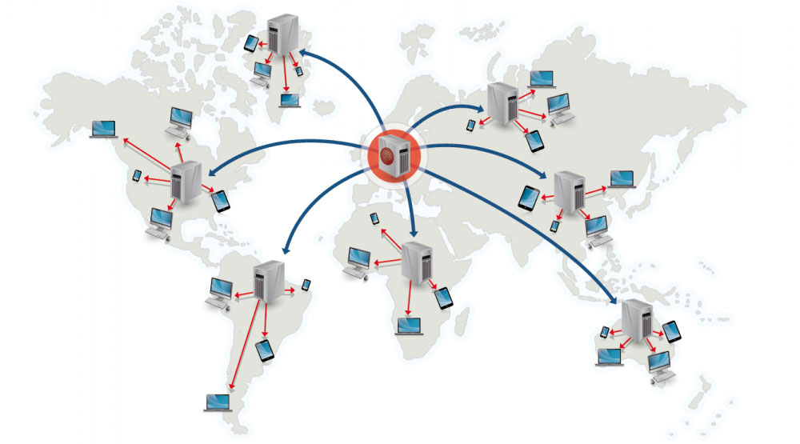
  <br/>
  <i><a href=https://www.creative-artworks.eu/why-use-a-content-delivery-network-cdn/>Дереккөз: CDN неге пайдалану керек</a></i>
</p>

Контентті жеткізу желісі (CDN) — пайдаланушыға жақын орындардан контент беретін прокси серверлердің жаһандық таратылған желісі. Жалпы, HTML/CSS/JS, фотосуреттер және бейнелер сияқты статикалық файлдар CDN-нан беріледі, дегенмен Amazon CloudFront сияқты кейбір CDN-дар динамикалық контентті де қолдайды. Сайттың DNS ажыратымдылығы клиенттерге қандай серверге хабарласу керектігін айтады.

CDN-дан контент беру өнімділікті екі жолмен айтарлықтай жақсарта алады:

* Пайдаланушылар өздеріне жақын деректер орталықтарынан контент алады
* Серверлеріңізге CDN орындайтын сұраныстарды өңдеудің қажеті жоқ

### Push CDN

Push CDN серверіңізде өзгерістер болған сайын жаңа контент алады. Контентті ұсыну, тікелей CDN-ға жүктеп салу және CDN-ға нұсқайтын URL-дерді қайта жазу үшін толық жауапкершілік өзіңізде болады. Контенттің қашан мерзімі өтетінін және қашан жаңартылатынын конфигурациялауға болады. Контент тек жаңа немесе өзгерген кезде жүктеледі, трафикті азайтады, бірақ сақтау орнын барынша пайдаланады.

Аз трафикі бар сайттар немесе контенті жиі жаңартылмайтын сайттар push CDN-дармен жақсы жұмыс істейді. Контент тұрақты аралықтармен қайтадан тартылудың орнына CDN-дарға бір рет орналастырылады.

### Pull CDN

Pull CDN бірінші пайдаланушы контентті сұраған кезде серверіңізден жаңа контентті тартып алады. Контентті серверіңізде қалдырасыз және URL-дерді CDN-ға нұсқайтын етіп қайта жазасыз. Контент CDN-да кэштелгенге дейін бұл баяуырақ сұранысқа әкеледі.

[Өмір сүру уақыты (TTL)](https://en.wikipedia.org/wiki/Time_to_live) контенттің қанша уақыт кэштелетінін анықтайды. Pull CDN CDN-дағы сақтау орнын азайтады, бірақ файлдар іс жүзінде өзгермей тұрып мерзімі өтіп, тартылса, артық трафик жасауы мүмкін.

Трафигі жоғары сайттар pull CDN-дармен жақсы жұмыс істейді, өйткені трафик CDN-да тек жақында сұралған контент қалуымен бірге біркелкірек таралады.

### Кемшілік(тер): CDN

* CDN шығындары трафикке байланысты айтарлықтай болуы мүмкін, дегенмен CDN пайдаланбаудан туындайтын қосымша шығындармен теңестіру керек.
* TTL мерзімі өткенге дейін контент жаңартылса, контент ескіруі мүмкін.
* CDN-дар статикалық контент үшін URL-дерді CDN-ға нұсқайтын етіп өзгертуді талап етеді.

### Дереккөз(дер) және қосымша оқу

* [Globally distributed content delivery](https://figshare.com/articles/Globally_distributed_content_delivery/6605972)
* [The differences between push and pull CDNs](https://www.geeksforgeeks.org/system-design/pull-cdn-vs-push-cdn/)
* [Wikipedia](https://en.wikipedia.org/wiki/Content_delivery_network)

## Жүктеме теңестіргіш

<p align="center">
  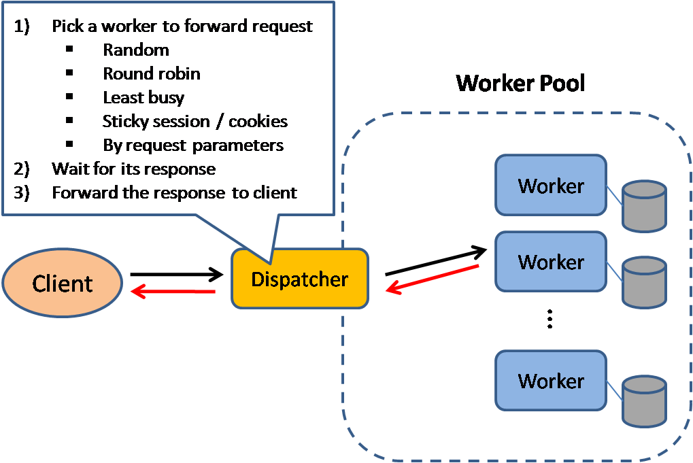
  <br/>
  <i><a href=http://horicky.blogspot.com/2010/10/scalable-system-design-patterns.html>Дереккөз: Масштабталатын жүйені жобалау үлгілері</a></i>
</p>

Жүктеме теңестіргіштер клиенттен келетін сұраныстарды қолданба серверлері мен дерекқорлар сияқты есептеу ресурстарына таратады. Әр жағдайда жүктеме теңестіргіш есептеу ресурсынан жауапты тиісті клиентке қайтарады. Жүктеме теңестіргіштер мыналарда тиімді:

* Сұраныстардың жұмыс істемейтін серверлерге баруын болдырмау
* Ресурстардың шамадан тыс жүктелуін болдырмау
* Жалғыз ақаулық нүктесін жоюға көмектесу

Жүктеме теңестіргіштерді жабдықпен (қымбат) немесе HAProxy сияқты бағдарламалық жасақтамамен іске асыруға болады.

Қосымша артықшылықтар:

* **SSL аяқтау** — бэкенд серверлері осы ықтимал қымбат операцияларды орындамауы үшін кіріс сұраныстарды шифрды ашу және сервер жауаптарын шифрлау
    * Әр серверге [X.509 сертификаттарын](https://en.wikipedia.org/wiki/X.509) орнату қажеттілігін жояды
* **Сессияны сақтау** — веб-қолданбалар сессияларды бақыламаса, белгілі бір клиенттің сұраныстарын бір данаға бағыттау үшін куки беру

Ақаулыктарға қарсы қорғану үшін [белсенді-пассивті](#белсенді-пассивті) немесе [белсенді-белсенді](#белсенді-белсенді) режимде бірнеше жүктеме теңестіргіш орнату жалпы тәжірибе болып табылады.

Жүктеме теңестіргіштер трафикті әртүрлі метриктер негізінде бағыттай алады:

* Кездейсоқ
* Ең аз жүктелген
* Сессия/куки
* [Дөңгелек жолмен немесе салмақты дөңгелек жолмен](https://www.g33kinfo.com/info/round-robin-vs-weighted-round-robin-lb)
* [4-деңгей](#4-деңгейлі-жүктемені-теңестіру)
* [7-деңгей](#7-деңгейлі-жүктемені-теңестіру)

### 4-деңгейлі жүктемені теңестіру

4-деңгейлі жүктеме теңестіргіштер сұраныстарды қалай таратуды шешу үшін [тасымалдау деңгейіндегі](#байланыс) ақпаратқа қарайды. Жалпы, бұл тақырыпшадағы бастапқы, тағайындалу IP мекенжайлары мен порттарды қамтиды, бірақ пакет мазмұнын қамтымайды. 4-деңгейлі жүктеме теңестіргіштер [Желілік мекенжайды аудару (NAT)](https://web.archive.org/web/20240117134735/https://www.nginx.com/resources/glossary/layer-4-load-balancing/) орындай отырып, желілік пакеттерді жоғарыдағы серверге және одан тасымалдайды.

### 7-деңгейлі жүктемені теңестіру

7-деңгейлі жүктеме теңестіргіштер сұраныстарды қалай таратуды шешу үшін [қолданба деңгейіне](#байланыс) қарайды. Бұл тақырыпша, хабарлама және куки мазмұнын қамтуы мүмкін. 7-деңгейлі жүктеме теңестіргіштер желілік трафикті аяқтайды, хабарламаны оқиды, жүктеме теңестіру шешімін қабылдайды, содан кейін таңдалған серверге байланыс ашады. Мысалы, 7-деңгейлі жүктеме теңестіргіш бейне трафигін бейне орналастыратын серверлерге, ал пайдаланушының есепшотын есептеуге байланысты сезімтал трафигін қауіпсіздігі күшейтілген серверлерге бағыттай алады.

Икемділік құнына қарамастан, 4-деңгейлі жүктемені теңестіру 7-деңгейге қарағанда аз уақыт пен есептеу ресурстарын қажет етеді, дегенмен өнімділікке әсері қазіргі жалпы мақсаттағы жабдықта минималды болуы мүмкін.

### Горизонтал масштабтау

Жүктеме теңестіргіштер өнімділік пен қолжетімділікті жақсарта отырып, горизонтал масштабтауға да көмектесе алады. Жалпы мақсаттағы машиналарды пайдаланып кеңейту **Тік масштабтау** деп аталатын қымбатырақ жабдықта бір серверді кеңейтуге қарағанда шығынды тиімдірек және жоғары қолжетімділікке алып келеді. Сондай-ақ мамандандырылған кәсіпорын жүйелеріне қарағанда жалпы мақсаттағы жабдықта жұмыс істейтін мамандарды жалдау оңайырақ.

#### Кемшілік(тер): горизонтал масштабтау

* Горизонтал масштабтау күрделілік енгізеді және серверлерді клондауды талап етеді
    * Серверлер күйсіз болуы керек: олар сессиялар немесе профиль суреттері сияқты пайдаланушыға қатысты деректерді қамтымауы керек
    * Сессиялар [дерекқор](#дерекқор) (SQL, NoSQL) немесе тұрақты [кэш](#кэш) (Redis, Memcached) сияқты орталықтандырылған деректер қоймасында сақталуы мүмкін
* Кэштер мен дерекқорлар сияқты төменгі серверлер жоғарыдағы серверлер кеңейген сайын көбірек бір мезгілдегі байланыстарды өңдеуі керек

### Кемшілік(тер): жүктеме теңестіргіш

* Жүктеме теңестіргіш жеткілікті ресурстар болмаса немесе дұрыс конфигурацияланбаса, өнімділік тарлығына айналуы мүмкін.
* Жалғыз ақаулық нүктесін жоюға көмектесу үшін жүктеме теңестіргіш енгізу күрделілікті арттырады.
* Жалғыз жүктеме теңестіргіш — жалғыз ақаулық нүктесі, бірнеше жүктеме теңестіргіш конфигурациялау күрделілікті одан әрі арттырады.

### Дереккөз(дер) және қосымша оқу

* [NGINX architecture](https://www.nginx.com/blog/inside-nginx-how-we-designed-for-performance-scale/)
* [HAProxy architecture guide](http://www.haproxy.org/download/1.2/doc/architecture.txt)
* [Scalability](https://web.archive.org/web/20220530193911/https://www.lecloud.net/post/7295452622/scalability-for-dummies-part-1-clones)
* [Wikipedia](https://en.wikipedia.org/wiki/Load_balancing_(computing))
* [Layer 4 load balancing](https://www.nginx.com/resources/glossary/layer-4-load-balancing/)
* [Layer 7 load balancing](https://www.nginx.com/resources/glossary/layer-7-load-balancing/)
* [ELB listener config](http://docs.aws.amazon.com/elasticloadbalancing/latest/classic/elb-listener-config.html)

## Кері прокси (веб-сервер)

<p align="center">
  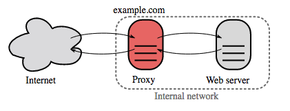
  <br/>
  <i><a href=https://upload.wikimedia.org/wikipedia/commons/6/67/Reverse_proxy_h2g2bob.svg>Дереккөз: Wikipedia</a></i>
  <br/>
</p>

Кері прокси — ішкі қызметтерді орталықтандыратын және жалпыға бірыңғай интерфейстер ұсынатын веб-сервер. Клиенттерден келетін сұраныстар оны орындай алатын серверге жіберіледі, содан кейін кері прокси сервер жауабын клиентке қайтарады.

Қосымша артықшылықтар:

* **Жоғарылатылған қауіпсіздік** — бэкенд серверлер туралы ақпаратты жасыру, IP-дерді бұғаттау, клиент бастауына байланыстар санын шектеу
* **Жоғарылатылған масштабталушылық пен икемділік** — клиенттер тек кері проксидің IP-ін көреді, бұл серверлерді масштабтауға немесе конфигурациясын өзгертуге мүмкіндік береді
* **SSL аяқтау** — бэкенд серверлері осы ықтимал қымбат операцияларды орындамауы үшін кіріс сұраныстарды шифрды ашу және сервер жауаптарын шифрлау
    * Әр серверге [X.509 сертификаттарын](https://en.wikipedia.org/wiki/X.509) орнату қажеттілігін жояды
* **Қысу** — сервер жауаптарын қысу
* **Кэштеу** — кэшталған сұраныстар үшін жауап қайтару
* **Статикалық контент** — статикалық контентті тікелей беру
    * HTML/CSS/JS
    * Фотосуреттер
    * Бейнелер
    * Т.б.

### Жүктеме теңестіргіш пен кері проксиді салыстыру

* Жүктеме теңестіргішті орналастыру бірнеше сервер болғанда пайдалы. Жиі жүктеме теңестіргіштер трафикті бір функцияны атқаратын серверлер жинағына бағыттайды.
* Кері прокси тек бір веб-сервер немесе қолданба сервері болса да, алдыңғы бөлімде сипатталған артықшылықтарды ашып пайдалы болуы мүмкін.
* NGINX және HAProxy сияқты шешімдер 7-деңгейлі кері проксиді де, жүктемені теңестіруді де қолдай алады.

### Кемшілік(тер): кері прокси

* Кері проксиді енгізу күрделілікті арттырады.
* Жалғыз кері прокси — жалғыз ақаулық нүктесі, бірнеше кері прокси конфигурациялау ([failover](https://en.wikipedia.org/wiki/Failover)) күрделілікті одан әрі арттырады.

### Дереккөз(дер) және қосымша оқу

* [Reverse proxy vs load balancer](https://www.nginx.com/resources/glossary/reverse-proxy-vs-load-balancer/)
* [NGINX architecture](https://www.nginx.com/blog/inside-nginx-how-we-designed-for-performance-scale/)
* [HAProxy architecture guide](http://www.haproxy.org/download/1.2/doc/architecture.txt)
* [Wikipedia](https://en.wikipedia.org/wiki/Reverse_proxy)

## Қолданба деңгейі

<p align="center">
  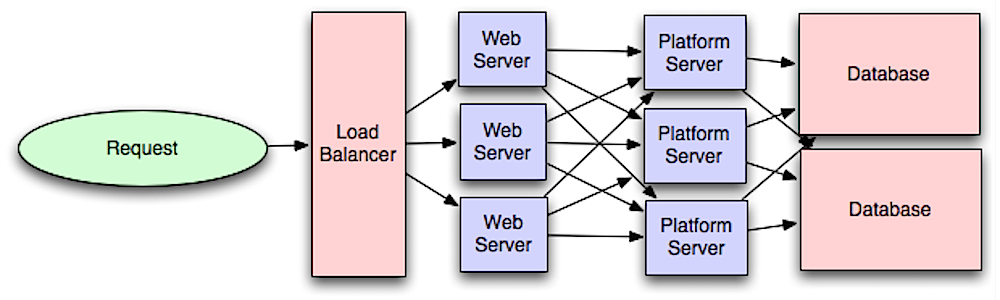
  <br/>
  <i><a href=http://lethain.com/introduction-to-architecting-systems-for-scale/#platform_layer>Дереккөз: Масштабта жүйелерді жобалауға кіріспе</a></i>
</p>

Веб деңгейін қолданба деңгейінен (платформа деңгейі деп те аталады) бөлу екі деңгейді де дербес масштабтауға және конфигурациялауға мүмкіндік береді. Жаңа API қосу міндетті түрде қосымша веб-серверлер қоспай-ақ қолданба серверлерін қосуға әкеледі. **Жалғыз жауапкершілік принципі** бірге жұмыс істейтін шағын және дербес қызметтерді жақтайды. Шағын қызметтермен шағын командалар жылдам өсуді неғұрлым батыл жоспарлай алады.

Қолданба деңгейіндегі жұмысшылар [асинхрондылықты](#асинхрондылық) қосуға да көмектеседі.

### Микросервистер

Осы талқылауға байланысты — [микросервистер](https://en.wikipedia.org/wiki/Microservices), оларды дербес орналастырылатын, шағын, модульдік қызметтер жинағы ретінде сипаттауға болады. Әр қызмет бизнес мақсатына қызмет ету үшін бірегей процесс жүргізіп, жақсы анықталған, жеңіл механизм арқылы байланысады.<sup><a href=https://smartbear.com/learn/api-design/what-are-microservices>1</a></sup>

Pinterest, мысалы, мынадай микросервистерге ие болуы мүмкін: пайдаланушы профилі, ізбасарлар, жаңалықтар ағыны, іздеу, фотосурет жүктеу, т.б.

### Қызметті табу

[Consul](https://www.consul.io/docs/index.html), [Etcd](https://coreos.com/etcd/docs/latest) және [Zookeeper](http://www.slideshare.net/sauravhaloi/introduction-to-apache-zookeeper) сияқты жүйелер тіркелген атауларды, мекенжайларды және порттарды бақылай отырып, қызметтердің бір-бірін табуына көмектеседі. [Денсаулықты тексеру](https://www.consul.io/intro/getting-started/checks.html) қызмет тұтастығын тексеруге көмектеседі және жиі [HTTP](#гипермәтінді-тасымалдау-хаттамасы-http) соқпасы арқылы жасалады. Consul және Etcd екеуінде де конфигурация мәндері мен басқа ортақ деректерді сақтауға пайдалы [кілт-мән қоймасы](#кілт-мән-қоймасы) бар.

### Кемшілік(тер): қолданба деңгейі

* Тығыз байланыспаған қызметтер бар қолданба деңгейін қосу монолитті жүйемен салыстырғанда архитектуралық, операциялық және үрдіс тұрғысынан басқа тәсілді қажет етеді.
* Микросервистер орналастыру мен операциялар тұрғысынан күрделілік қосуы мүмкін.

### Дереккөз(дер) және қосымша оқу

* [Intro to architecting systems for scale](http://lethain.com/introduction-to-architecting-systems-for-scale)
* [Crack the system design interview](http://www.puncsky.com/blog/2016-02-13-crack-the-system-design-interview)
* [Service oriented architecture](https://en.wikipedia.org/wiki/Service-oriented_architecture)
* [Introduction to Zookeeper](http://www.slideshare.net/sauravhaloi/introduction-to-apache-zookeeper)
* [Here's what you need to know about building microservices](https://cloudncode.wordpress.com/2016/07/22/msa-getting-started/)

## Дерекқор

<p align="center">
  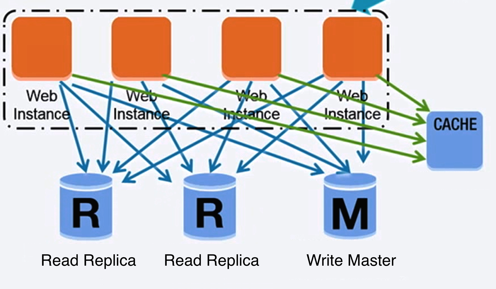
  <br/>
  <i><a href=https://www.youtube.com/watch?v=kKjm4ehYiMs>Дереккөз: Алғашқы 10 миллион пайдаланушыға дейін масштабтау</a></i>
</p>

### Реляциялық дерекқорды басқару жүйесі (РДБЖ)

SQL сияқты реляциялық дерекқор — кестелерде ұйымдастырылған деректер элементтерінің жинағы.

**ACID** — реляциялық дерекқор [транзакцияларының](https://en.wikipedia.org/wiki/Database_transaction) қасиеттер жиыны.

* **Атомарлылық** — әр транзакция не толық орындалады, не мүлде орындалмайды
* **Дәйектілік** — кез келген транзакция дерекқорды бір жарамды күйден екіншісіне ауыстырады
* **Оқшаулану** — транзакцияларды бір мезгілде орындау оларды дәйекті орындаумен бірдей нәтиже береді
* **Тұрақтылық** — транзакция бекітілгеннен кейін ол солай қалады

Реляциялық дерекқорды масштабтаудың көптеген тәсілдері бар: **master-slave репликациясы**, **master-master репликациясы**, **федерация**, **шардтау**, **денормализация** және **SQL баптау**.

#### Master-slave репликациясы

Master оқу мен жазуға қызмет етеді, тек оқуға қызмет ететін бір немесе бірнеше slave-ке жазуларды репликациялайды. Slave-дер де ағаш тәрізді тәсілмен қосымша slave-дерге репликациялай алады. Master желіден шықса, slave master-ге жоғарылатылғанша немесе жаңа master орнатылғанша жүйе тек оқу режимінде жұмыс істей алады.

<p align="center">
  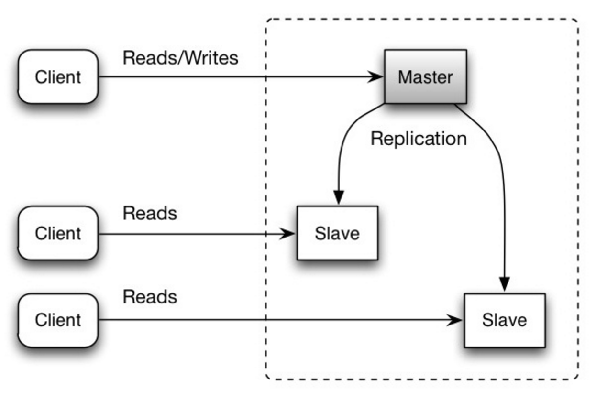
  <br/>
  <i><a href=http://www.slideshare.net/jboner/scalability-availability-stability-patterns/>Дереккөз: Масштабталушылық, қолжетімділік, тұрақтылық үлгілері</a></i>
</p>

##### Кемшілік(тер): master-slave репликациясы

* Slave-ді master-ге жоғарылату үшін қосымша логика қажет.
* Master-slave де, master-master-ге де қатысты тармақтарды [Кемшілік(тер): репликация](#кемшіліктер-репликация) бөлімінен қараңыз.

#### Master-master репликациясы

Екі master-де оқу мен жазуға қызмет етеді және жазулар бойынша бір-бірімен үйлеседі. Кез келген master жұмысын тоқтатса, жүйе оқу мен жазумен де жұмысын жалғастыра алады.

<p align="center">
  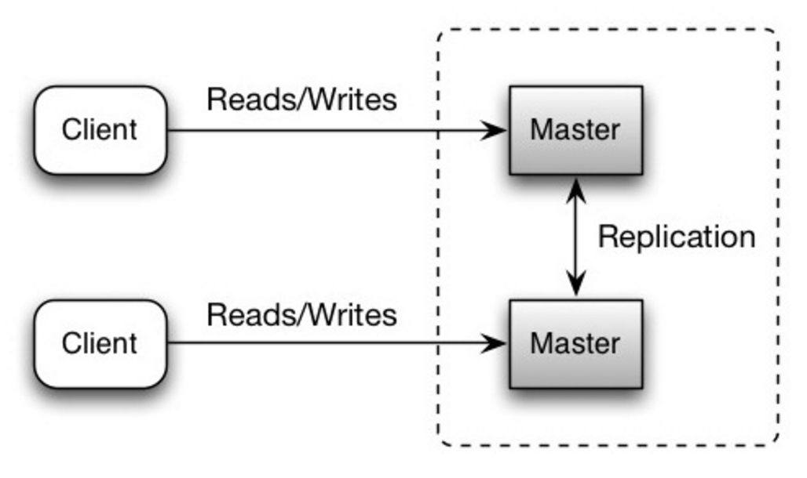
  <br/>
  <i><a href=http://www.slideshare.net/jboner/scalability-availability-stability-patterns/>Дереккөз: Масштабталушылық, қолжетімділік, тұрақтылық үлгілері</a></i>
</p>

##### Кемшілік(тер): master-master репликациясы

* Жүктеме теңестіргіш қажет немесе қайда жазу керектігін анықтау үшін қолданба логикасын өзгертуіңіз керек болады.
* Көпшілік master-master жүйелері я тығыз байланыспаған (ACID бұзу), я синхрондау себебінен жазу кідірісі артқан болады.
* Жазу түйіндері қосылған сайын және кідіріс артқан сайын қайшылықтарды шешу маңыздырақ болады.
* Master-slave де, master-master-ге де қатысты тармақтарды [Кемшілік(тер): репликация](#кемшіліктер-репликация) бөлімінен қараңыз.

##### Кемшіліктер: репликация

* Жаңадан жазылған деректер басқа түйіндерге репликацияланғанға дейін master ақаулық тапса, деректер жоғалу қаупі бар.
* Жазулар оқу репликаларына қайталанады. Жазулар көп болса, оқу репликалары жазуларды қайталаумен шұғылданып, аз оқуды орындай алады.
* Оқу slave-дері қаншалықты көп болса, соншалықты репликациялау қажет, бұл репликация кешігуінің артуына алып келеді.
* Кейбір жүйелерде master-ге жазу параллель жазуға арналған бірнеше ағын тудыруы мүмкін, ал оқу репликалары жалғыз ағынмен дәйекті жазуды ғана қолдайды.
* Репликация қосымша жабдық пен күрделілік қосады.

##### Дереккөз(дер) және қосымша оқу: репликация

* [Scalability, availability, stability, patterns](http://www.slideshare.net/jboner/scalability-availability-stability-patterns/)
* [Multi-master replication](https://en.wikipedia.org/wiki/Multi-master_replication)

#### Федерация

<p align="center">
  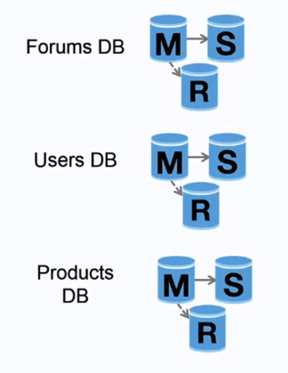
  <br/>
  <i><a href=https://www.youtube.com/watch?v=kKjm4ehYiMs>Дереккөз: Алғашқы 10 миллион пайдаланушыға дейін масштабтау</a></i>
</p>

Федерация (немесе функционалдық бөлу) дерекқорларды функция бойынша бөледі. Мысалы, жалғыз монолитті дерекқордың орнына үш дерекқор болуы мүмкін: **форумдар**, **пайдаланушылар** және **өнімдер**, бұл әр дерекқорға оқу мен жазу трафигін азайтады, сондықтан репликация кешігуін де азайтады. Кішірек дерекқорлар жадта сыятын деректерді көбейтеді, бұл кэш жайылымын жақсарту арқылы кэш иелерінің санын арттырады. Жазуларды бірізділендіретін жалғыз орталық master болмаса, параллель жазуға болады, өткізу қабілетін арттырады.

##### Кемшілік(тер): федерация

* Схема үлкен функцияларды немесе кестелерді талап етсе, федерация тиімді емес.
* Қай дерекқорға оқу мен жазуды анықтау үшін қолданба логикасын жаңартуыңыз керек болады.
* Екі дерекқордан деректерді біріктіру [сервер сілтемесімен](http://stackoverflow.com/questions/5145637/querying-data-by-joining-two-tables-in-two-database-on-different-servers) күрделірек болады.
* Федерация қосымша жабдық пен күрделілік қосады.

##### Дереккөз(дер) және қосымша оқу: федерация

* [Scaling up to your first 10 million users](https://www.youtube.com/watch?v=kKjm4ehYiMs)

#### Шардтау

<p align="center">
  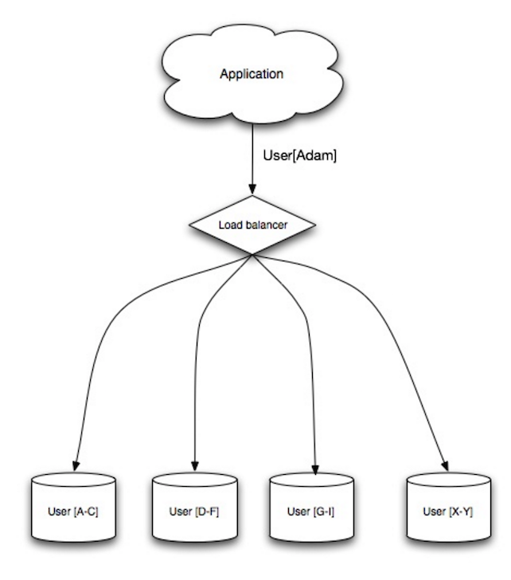
  <br/>
  <i><a href=http://www.slideshare.net/jboner/scalability-availability-stability-patterns/>Дереккөз: Масштабталушылық, қолжетімділік, тұрақтылық үлгілері</a></i>
</p>

Шардтау деректерді әртүрлі дерекқорларға тарата отырып, әр дерекқор деректердің тек бір бөлігін ғана басқара алады. Пайдаланушылар дерекқорын мысал ретінде алсақ, пайдаланушылар саны өскен сайын кластерге қосымша шардтар қосылады.

[Федерация](#федерация) артықшылықтарына ұқсас, шардтау оқу мен жазу трафигін, репликацияны азайтады және кэш иелерін арттырады. Индекс өлшемі де азаяды, бұл жалпы жылдамырақ сұраныстармен өнімділікті жақсартады. Бір шард жұмысын тоқтатса, басқа шардтар әлі жұмыс істейді, дегенмен деректер жоғалтуды болдырмау үшін репликацияның бір түрін қосқыңыз келеді. Федерация сияқты, жазуларды бірізділендіретін жалғыз орталық master жоқ, бұл арттырылған өткізу қабілетімен параллель жазуға мүмкіндік береді.

Пайдаланушылар кестесін шардтаудың жалпы жолдары — пайдаланушының тегінің бас әрпі немесе пайдаланушының географиялық орналасуы.

##### Кемшілік(тер): шардтау

* Күрделі SQL сұраныстарға алып келуі мүмкін шардтармен жұмыс істеу үшін қолданба логикасын жаңартуыңыз керек болады.
* Шардтағы деректер таралуы теңсіз болуы мүмкін. Мысалы, шардтағы белсенді пайдаланушылар жинағы басқаларға қарағанда сол шардқа жүктемені арттыруы мүмкін.
    * Қайта теңдестіру қосымша күрделілік қосады. [Тұрақты хэштеуге](http://www.paperplanes.de/2011/12/9/the-magic-of-consistent-hashing.html) негізделген шардтау функциясы тасымалданатын деректер мөлшерін азайтуы мүмкін.
* Бірнеше шардтан деректерді біріктіру күрделірек.
* Шардтау қосымша жабдық пен күрделілік қосады.

##### Дереккөз(дер) және қосымша оқу: шардтау

* [The coming of the shard](http://highscalability.com/blog/2009/8/6/an-unorthodox-approach-to-database-design-the-coming-of-the.html)
* [Shard database architecture](https://en.wikipedia.org/wiki/Shard_(database_architecture))
* [Consistent hashing](http://www.paperplanes.de/2011/12/9/the-magic-of-consistent-hashing.html)

#### Денормализация

Денормализация қымбат біріктірулерді болдырмау үшін деректердің артық көшірмелерін бірнеше кестеге жазу арқылы жазу өнімділігін кейбір деңгейде азайту есебінен оқу өнімділігін жақсартуға тырысады. [PostgreSQL](https://en.wikipedia.org/wiki/PostgreSQL) және Oracle сияқты кейбір РДБЖ артық ақпаратты сақтау мен артық көшірмелерді дәйекті ұстауды орындайтын [материалдандырылған көріністерді](https://en.wikipedia.org/wiki/Materialized_view) қолдайды.

[Федерация](#федерация) және [шардтау](#шардтау) сияқты тәсілдермен деректер таратылғаннан кейін деректер орталықтары арқылы біріктірулерді басқару күрделілікті одан әрі арттырады. Денормализация мұндай күрделі біріктірулер қажеттілігін айналып өтуі мүмкін.

Көптеген жүйелерде оқулар жазуларды 100:1 немесе тіпті 1000:1 қатынасында айтарлықтай басым болуы мүмкін. Күрделі дерекқор біріктіруіне алып келетін оқу диск операцияларына айтарлықтай уақыт жұмсай отырып өте қымбат болуы мүмкін.

##### Кемшілік(тер): денормализация

* Деректер қайталанады.
* Шектеулер ақпараттың артық көшірмелерін синхронда ұстауға көмектесе алады, бұл дерекқор жобалауының күрделілігін арттырады.
* Ауыр жазу жүктемесіндегі денормализацияланған дерекқор нормализацияланған аналогынан нашар жұмыс істеуі мүмкін.

###### Дереккөз(дер) және қосымша оқу: денормализация

* [Denormalization](https://en.wikipedia.org/wiki/Denormalization)

#### SQL баптау

SQL баптау кең тақырып болып табылады және анықтамалық ретінде көптеген [кітаптар](https://www.amazon.com/s/ref=nb_sb_noss_2?url=search-alias%3Daps&field-keywords=sql+tuning) жазылған.

Тарлықтарды модельдеп ашу үшін **бенчмаркинг** және **профильдеу** маңызды.

* **Бенчмаркинг** — [ab](http://httpd.apache.org/docs/2.2/programs/ab.html) сияқты құралдармен жоғары жүктелу жағдайларын модельдеу.
* **Профильдеу** — өнімділік мәселелерін бақылауға көмектесетін [баяу сұраныс журналы](http://dev.mysql.com/doc/refman/5.7/en/slow-query-log.html) сияқты құралдарды қосу.

Бенчмаркинг пен профильдеу сізді келесі оңтайландыруларға бағыттауы мүмкін.

##### Схеманы тарылту

* MySQL жылдам қол жеткізу үшін дискіге үздіксіз блоктарда жазады.
* Тіркелген ұзындықтағы өрістер үшін `VARCHAR` орнына `CHAR` пайдаланыңыз.
    * `CHAR` жылдам, кездейсоқ қол жеткізуге тиімді мүмкіндік береді, ал `VARCHAR` кезінде келесіге өтер алдында жолдың соңын табу керек.
* Блог жазбалары сияқты мәтіннің үлкен блоктары үшін `TEXT` пайдаланыңыз. `TEXT` логикалық іздеулерге де мүмкіндік береді. `TEXT` өрісін пайдалану мәтін блогын орнын табу үшін пайдаланылатын дискідегі нұсқағышты сақтауға алып келеді.
* 2^32 немесе 4 миллиардқа дейінгі үлкен сандар үшін `INT` пайдаланыңыз.
* Өзгермелі нүкте ұсынымдағы қателерді болдырмау үшін валюта үшін `DECIMAL` пайдаланыңыз.
* Үлкен `BLOB` файлдарды сақтаудан аулақ болыңыз, оның орнына объект алатын орынның орналасуын сақтаңыз.
* `VARCHAR(255)` — 8 биттік санда санауға болатын таңбалардың ең үлкен саны, кейбір РДБЖ-де байтты пайдалануды жиі барынша арттырады.
* [Іздеу өнімділігін жақсарту](http://stackoverflow.com/questions/1017239/how-do-null-values-affect-performance-in-a-database-search) үшін қолданылса `NOT NULL` шектеуін орнатыңыз.

##### Жақсы индекстер пайдаланыңыз

* Сұрайтын бағандар (`SELECT`, `GROUP BY`, `ORDER BY`, `JOIN`) индекстермен жылдамырақ болуы мүмкін.
* Индекстер жалпы деректерді сорттаулы ұстайтын және логарифмдік уақытта іздеулерге, дәйекті қол жеткізуге, кірістірулерге және жоюларға мүмкіндік беретін өзін-өзі теңдестіретін [B-ағаш](https://en.wikipedia.org/wiki/B-tree) ретінде ұсынылады.
* Индексті орналастыру деректерді жадта ұстауы мүмкін, қосымша орын қажет.
* Жазулар да баяуырақ болуы мүмкін, өйткені индекс те жаңартылуы керек.
* Үлкен мөлшердегі деректерді жүктегенде, индекстерді өшіріп, деректерді жүктеп, содан кейін индекстерді қайта жасаған жылдамырақ болуы мүмкін.

##### Қымбат біріктірулерден аулақ болыңыз

* Өнімділік талап еткен жерде [денормализациялаңыз](#денормализация).

##### Кестелерді бөлу

* Жылы нүктелерді жеке кестеге орналастыра отырып, оны жадта ұстауға көмектесу үшін кестені бөліңіз.

##### Сұраныс кэшін баптаңыз

* Кейбір жағдайларда [сұраныс кэші](https://dev.mysql.com/doc/refman/5.7/en/query-cache.html) [өнімділік мәселелеріне](https://www.percona.com/blog/2016/10/12/mysql-5-7-performance-tuning-immediately-after-installation/) алып келуі мүмкін.

##### Дереккөз(дер) және қосымша оқу: SQL баптау

* [Tips for optimizing MySQL queries](http://aiddroid.com/10-tips-optimizing-mysql-queries-dont-suck/)
* [Is there a good reason i see VARCHAR(255) used so often?](http://stackoverflow.com/questions/1217466/is-there-a-good-reason-i-see-varchar255-used-so-often-as-opposed-to-another-l)
* [How do null values affect performance?](http://stackoverflow.com/questions/1017239/how-do-null-values-affect-performance-in-a-database-search)
* [Slow query log](http://dev.mysql.com/doc/refman/5.7/en/slow-query-log.html)

### NoSQL

NoSQL — **кілт-мән қоймасында**, **құжат қоймасында**, **кең баған қоймасында** немесе **граф дерекқорында** ұсынылған деректер элементтерінің жинағы. Деректер денормализацияланған, ал біріктірулер жалпы қолданба кодында жасалады. Көптеген NoSQL қоймаларында шынайы ACID транзакциялары жоқ және [ақырғы дәйектілікті](#ақырғы-дәйектілік) артық санайды.

**BASE** жиі NoSQL дерекқорларының қасиеттерін сипаттау үшін пайдаланылады. [CAP теоремасымен](#cap-теоремасы) салыстырғанда, BASE дәйектіліктен қолжетімділікті таңдайды.

* **Негізінен қолжетімді** — жүйе қолжетімділікке кепілдік береді.
* **Жұмсақ күй** — жүйенің күйі уақыт өте өзгеруі мүмкін, тіпті кіріссіз де.
* **Ақырғы дәйектілік** — жүйе белгілі бір уақыт аралығында дәйекті болады, жүйе сол кезеңде кіріс алмаса.

[SQL немесе NoSQL](#sql-немесе-nosql) арасындағы таңдауға қосымша, NoSQL дерекқорының қай түрі сіздің қолдану жағдайыңызға ең жақсы сәйкес келетінін түсіну пайдалы. Келесі бөлімде **кілт-мән қоймаларын**, **құжат қоймаларын**, **кең баған қоймаларын** және **граф дерекқорларын** қарастырамыз.

#### Кілт-мән қоймасы

> Абстракция: хэш кестесі

Кілт-мән қоймасы жалпы O(1) оқу мен жазуға мүмкіндік береді және жиі жад немесе SSD-пен қамтамасыз етіледі. Деректер қоймалары кілт диапазондарын тиімді алуға мүмкіндік беретін [лексикографиялық тәртіпте](https://en.wikipedia.org/wiki/Lexicographical_order) кілттерді сақтай алады. Кілт-мән қоймалары метадеректерді мәнмен бірге сақтауға мүмкіндік береді.

Кілт-мән қоймалары жоғары өнімділікті ұсынады және жиі жад ішіндегі кэш деңгейі сияқты қарапайым деректер модельдері немесе жылдам өзгеретін деректер үшін пайдаланылады. Олар тек шектеулі операциялар жинағын ұсынатындықтан, қосымша операциялар қажет болса, күрделілік қолданба деңгейіне ауысады.

Кілт-мән қоймасы — құжат қоймасы сияқты және кейбір жағдайларда граф дерекқоры сияқты күрделірек жүйелердің негізі.

##### Дереккөз(дер) және қосымша оқу: кілт-мән қоймасы

* [Key-value database](https://en.wikipedia.org/wiki/Key-value_database)
* [Disadvantages of key-value stores](http://stackoverflow.com/questions/4056093/what-are-the-disadvantages-of-using-a-key-value-table-over-nullable-columns-or)
* [Redis architecture](http://qnimate.com/overview-of-redis-architecture/)
* [Memcached architecture](https://adayinthelifeof.nl/2011/02/06/memcache-internals/)

#### Құжат қоймасы

> Абстракция: мәндер ретінде сақталған құжаттары бар кілт-мән қоймасы

Құжат қоймасы құжаттарға (XML, JSON, бинарлық, т.б.) негізделеді, мұнда бір құжат берілген объектінің барлық ақпаратын сақтайды. Құжат қоймалары құжаттың ішкі құрылымына негізделген сұрауға арналған API немесе сұраныс тілін ұсынады. *Ескерту: көптеген кілт-мән қоймалары мән метадеректерімен жұмыс жасауға арналған мүмкіндіктерді қамтиды, бұл екі сақтау түрінің арасындағы шекараны бұлдырады.*

Базалық іске асыруға байланысты құжаттар коллекциялар, тегтер, метадеректер немесе каталогтар бойынша ұйымдастырылады. Құжаттарды ұйымдастыруға немесе топтауға болатынымен, құжаттардың бір-бірінен мүлде өзгеше өрістері болуы мүмкін.

[MongoDB](https://www.mongodb.com/mongodb-architecture) және [CouchDB](https://blog.couchdb.org/2016/08/01/couchdb-2-0-architecture/) сияқты кейбір құжат қоймалары күрделі сұрауларды орындауға арналған SQL тәрізді тіл де ұсынады. [DynamoDB](http://www.read.seas.harvard.edu/~kohler/class/cs239-w08/decandia07dynamo.pdf) кілт-мәндерді де, құжаттарды да қолдайды.

Құжат қоймалары жоғары икемділікті ұсынады және жиі кездейсоқ өзгеретін деректермен жұмыс жасауға пайдаланылады.

##### Дереккөз(дер) және қосымша оқу: құжат қоймасы

* [Document-oriented database](https://en.wikipedia.org/wiki/Document-oriented_database)
* [MongoDB architecture](https://www.mongodb.com/mongodb-architecture)
* [CouchDB architecture](https://blog.couchdb.org/2016/08/01/couchdb-2-0-architecture/)
* [Elasticsearch architecture](https://www.elastic.co/blog/found-elasticsearch-from-the-bottom-up)

#### Кең баған қоймасы

<p align="center">
  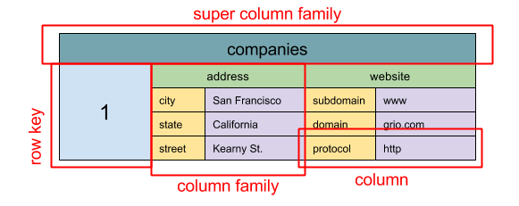
  <br/>
  <i><a href=http://blog.grio.com/2015/11/sql-nosql-a-brief-history.html>Дереккөз: SQL және NoSQL, қысқаша тарих</a></i>
</p>

> Абстракция: кірістірілген карта `ColumnFamily<RowKey, Columns<ColKey, Value, Timestamp>>`

Кең баған қоймасының деректердің негізгі бірлігі — баған (ат/мән жұбы). Баған баған тобына (SQL кестесіне ұқсас) топтастырылуы мүмкін. Супер баған топтары баған топтарын одан әрі топтастырады. Жол кілтімен әр бағанға дербес қол жеткізуге болады, ал бірдей жол кілті бар бағандар жол қалыптастырады. Әр мән нұсқалар мен қайшылықтарды шешуге арналған уақыт белгісін қамтиды.

Google бірінші кең баған қоймасы ретінде [Bigtable](http://www.read.seas.harvard.edu/~kohler/class/cs239-w08/chang06bigtable.pdf) ұсынды, ол Hadoop экожүйесінде жиі пайдаланылатын ашық бастапқы [HBase-ке](https://www.edureka.co/blog/hbase-architecture/) және Facebook-тен [Cassandra-ға](http://docs.datastax.com/en/cassandra/3.0/cassandra/architecture/archIntro.html) ықпал жасады. BigTable, HBase және Cassandra сияқты қоймалар таңдамалы кілт диапазондарын тиімді алуға мүмкіндік беретін лексикографиялық тәртіпте кілттерді сақтайды.

Кең баған қоймалары жоғары қолжетімділік пен жоғары масштабталушылықты ұсынады. Олар жиі өте үлкен деректер жинақтары үшін пайдаланылады.

##### Дереккөз(дер) және қосымша оқу: кең баған қоймасы

* [SQL & NoSQL, a brief history](http://blog.grio.com/2015/11/sql-nosql-a-brief-history.html)
* [Bigtable architecture](http://www.read.seas.harvard.edu/~kohler/class/cs239-w08/chang06bigtable.pdf)
* [HBase architecture](https://www.edureka.co/blog/hbase-architecture/)
* [Cassandra architecture](http://docs.datastax.com/en/cassandra/3.0/cassandra/architecture/archIntro.html)

#### Граф дерекқоры

<p align="center">
  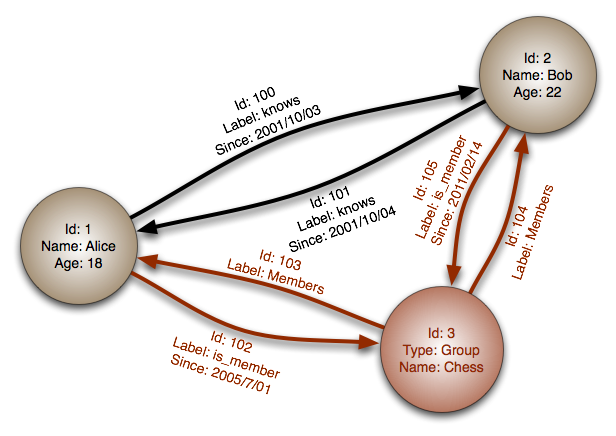
  <br/>
  <i><a href=https://en.wikipedia.org/wiki/File:GraphDatabase_PropertyGraph.png>Дереккөз: Граф дерекқоры</a></i>
</p>

> Абстракция: граф

Граф дерекқорында әр түйін — жазба, ал әр доға — екі түйін арасындағы байланыс. Граф дерекқорлары көп сыртқы кілттері немесе көп-көпке байланыстары бар күрделі байланыстарды ұсынуды оңтайландырылған.

Граф дерекқорлары әлеуметтік желі сияқты күрделі байланыстары бар деректер модельдері үшін жоғары өнімділікті ұсынады. Олар салыстырмалы түрде жаңа және әлі кеңінен қолданылмайды; даму құралдары мен ресурстарын табу қиынырақ болуы мүмкін. Көптеген граф дерекқорларына тек [REST API-дер](#өкілдік-күй-беру-rest) арқылы қол жеткізуге болады.

##### Дереккөз(дер) және қосымша оқу: граф

* [Graph database](https://en.wikipedia.org/wiki/Graph_database)
* [Neo4j](https://neo4j.com/)
* [FlockDB](https://blog.twitter.com/2010/introducing-flockdb)

#### Дереккөз(дер) және қосымша оқу: NoSQL

* [Explanation of base terminology](http://stackoverflow.com/questions/3342497/explanation-of-base-terminology)
* [NoSQL databases a survey and decision guidance](https://medium.com/baqend-blog/nosql-databases-a-survey-and-decision-guidance-ea7823a822d#.wskogqenq)
* [Scalability](https://web.archive.org/web/20220602114024/https://www.lecloud.net/post/7994751381/scalability-for-dummies-part-2-database)
* [Introduction to NoSQL](https://www.youtube.com/watch?v=qI_g07C_Q5I)
* [NoSQL patterns](http://horicky.blogspot.com/2009/11/nosql-patterns.html)

### SQL немесе NoSQL

<p align="center">
  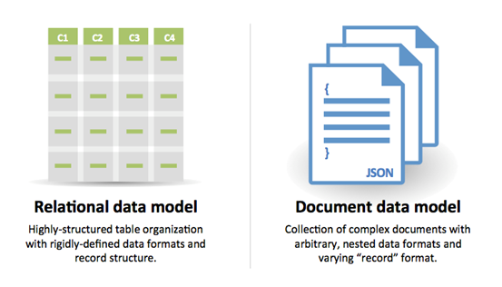
  <br/>
  <i><a href=https://www.infoq.com/articles/Transition-RDBMS-NoSQL/>Дереккөз: РДБЖ-дан NoSQL-ге өту</a></i>
</p>

**SQL** таңдауға себептер:

* Құрылымдалған деректер
* Қатаң схема
* Реляциялық деректер
* Күрделі біріктірулер қажет
* Транзакциялар
* Масштабтаудың нақты үлгілері
* Жетілдірілген: әзірлеушілер, қауымдастық, код, құралдар, т.б.
* Индекс бойынша іздеу өте жылдам

**NoSQL** таңдауға себептер:

* Жартылай құрылымдалған деректер
* Динамикалық немесе икемді схема
* Реляциялық емес деректер
* Күрделі біріктірулер қажет емес
* Деректердің көп ТБ (немесе ПБ) сақтау
* Өте деректерге қарқынды жұмыс жүктемесі
* IOPS үшін өте жоғары өткізу қабілеті

NoSQL үшін жақсы сәйкес келетін үлгі деректер:

* Кликтер ағыны мен журнал деректерін жылдам жинау
* Рейтинг немесе бағалау деректері
* Сатып алу себеті сияқты уақытша деректер
* Жиі қолжетімді ('ыстық') кестелер
* Метадеректер/іздеу кестелері

##### Дереккөз(дер) және қосымша оқу: SQL немесе NoSQL

* [Scaling up to your first 10 million users](https://www.youtube.com/watch?v=kKjm4ehYiMs)
* [SQL vs NoSQL differences](https://www.sitepoint.com/sql-vs-nosql-differences/)

## Кэш

<p align="center">
  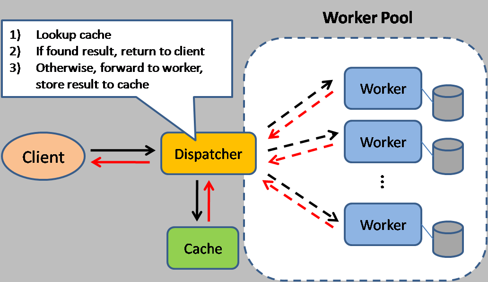
  <br/>
  <i><a href=http://horicky.blogspot.com/2010/10/scalable-system-design-patterns.html>Дереккөз: Масштабталатын жүйені жобалау үлгілері</a></i>
</p>

Кэштеу бет жүктелу уақытын жақсартады және серверлер мен дерекқорлардағы жүктемені азайтуы мүмкін. Бұл үлгіде диспетчер алдымен сұраныс бұрын жасалған-жасалмағанын тексереді және нақты орындауды үнемдеу үшін алдыңғы нәтижені қайтаруға тырысады.

Дерекқорлар жиі бөлімдер бойынша оқу мен жазудың біркелкі таралуынан пайда алады. Танымал элементтер таралуды бұрмалап, тарлықтарға алып келуі мүмкін. Дерекқордың алдына кэш орналастыру теңсіз жүктемелер мен трафик шыңдарын сіңіруге көмектеседі.

### Клиенттік кэштеу

Кэштер клиент тарапында (ОЖ немесе браузер), [сервер тарапында](#кері-прокси-веб-сервер) немесе бөлек кэш деңгейінде орналасуы мүмкін.

### CDN кэштеу

[CDN-дар](#контентті-жеткізу-желісі) кэш түрі болып саналады.

### Веб-серверде кэштеу

[Кері проксилер](#кері-прокси-веб-сервер) және [Varnish](https://www.varnish-cache.org/) сияқты кэштер статикалық және динамикалық контентті тікелей бере алады. Веб-серверлер де сұраныстарды кэштеп, қолданба серверлеріне хабарласпай жауап қайтара алады.

### Дерекқорда кэштеу

Дерекқор жалпы жалпы қолдану жағдайына оңтайландырылған әдепкі конфигурацияда кэштеудің белгілі бір деңгейін қамтиды. Белгілі қолдану үлгілері үшін осы параметрлерді реттеу өнімділікті одан әрі арттыруы мүмкін.

### Қолданбада кэштеу

Memcached және Redis сияқты жад ішіндегі кэштер — қолданба мен деректер қоймасы арасындағы кілт-мән қоймалары. Деректер RAM-да сақталатындықтан, деректер дискіде сақталатын типтік дерекқорларға қарағанда әлдеқайда жылдам. RAM дискіден шектеулірек, сондықтан [кэш жарамсыздандыру](https://en.wikipedia.org/wiki/Cache_algorithms) алгоритмдері, мысалы [ең сирек пайдаланылған (LRU)](https://en.wikipedia.org/wiki/Cache_replacement_policies#Least_recently_used_(LRU)), 'суық' жазбаларды жарамсыздандырып, 'ыстық' деректерді RAM-да ұстауға көмектеседі.

Redis-те мынадай қосымша мүмкіндіктер бар:

* Сақтандыру опциясы
* Сорттаулы жинақтар мен тізімдер сияқты кірістірілген деректер құрылымдары

Екі жалпы санатқа жататын кэштеудің бірнеше деңгейі бар: **дерекқор сұраныстары** және **объектілер**:

* Жол деңгейі
* Сұраныс деңгейі
* Толық қалыптасқан сериализацияланатын объектілер
* Толық салынған HTML

Жалпы, файлға негізделген кэштеуден аулақ болуға тырысу керек, өйткені ол клондауды және автоматты масштабтауды қиындатады.

### Дерекқор сұраныс деңгейінде кэштеу

Дерекқорды сұраған сайын сұранысты кілт ретінде хэштеңіз және нәтижені кэшке сақтаңыз. Бұл тәсіл мерзім өту мәселелеріне тап болады:

* Күрделі сұраныстармен кэшталған нәтижені жою қиын
* Кесте ұяшығы сияқты деректердің бір бөлігі өзгерсе, өзгерген ұяшықты қамтуы мүмкін барлық кэшталған сұраныстарды жою керек

### Объект деңгейінде кэштеу

Деректеріңізді қолданба кодыңызда жасайтыныңыздай объект ретінде қараңыз. Қолданба дерекқордан деректер жинағын класс данасына немесе деректер құрылымына жиналасын:

* Базалық деректер өзгерсе, объектіні кэштен алып тастаңыз
* Асинхронды өңдеуге мүмкіндік береді: жұмысшылар ең соңғы кэшталған объектіні тұтыну арқылы объектілерді жинастырады

Кэштеуге ұсынылатындар:

* Пайдаланушы сессиялары
* Толық салынған веб-беттер
* Белсенділік ағындары
* Пайдаланушы граф деректері

### Кэшті қашан жаңарту керек

Кэште тек шектеулі мөлшерде деректер сақтай алатындықтан, қолдану жағдайыңызға ең жақсы сәйкес келетін кэш жаңарту стратегиясын анықтау қажет.

#### Cache-aside

<p align="center">
  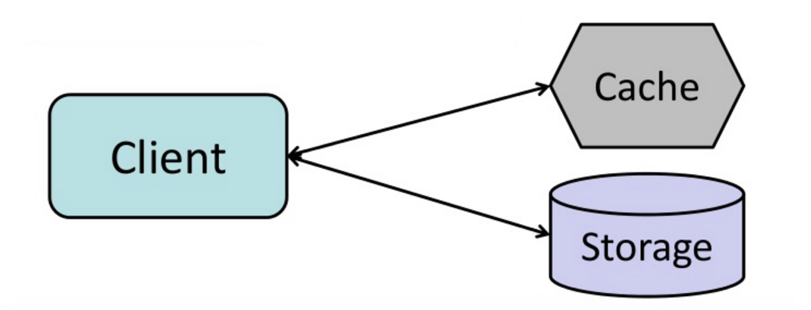
  <br/>
  <i><a href=http://www.slideshare.net/tmatyashovsky/from-cache-to-in-memory-data-grid-introduction-to-hazelcast>Дереккөз: Кэштен жад ішіндегі деректер торына</a></i>
</p>

Қолданба сақтаудан оқу мен жазуға жауапты. Кэш сақтаумен тікелей байланыспайды. Қолданба мыналарды жасайды:

* Кэштен жазбаны іздеу, нәтижесінде кэш жіберіп алу болады
* Дерекқордан жазбаны жүктеу
* Жазбаны кэшке қосу
* Жазбаны қайтару

```python
def get_user(self, user_id):
    user = cache.get("user.{0}", user_id)
    if user is None:
        user = db.query("SELECT * FROM users WHERE user_id = {0}", user_id)
        if user is not None:
            key = "user.{0}".format(user_id)
            cache.set(key, json.dumps(user))
    return user
```

[Memcached](https://memcached.org/) жалпы осылай пайдаланылады.

Кэшке қосылған деректердің кейінгі оқулары жылдам. Cache-aside сонымен бірге жалқау жүктеу деп те аталады. Тек сұралған деректер кэшке орналасады, бұл сұралмаған деректермен кэшті толтырудан сақтайды.

##### Кемшілік(тер): cache-aside

* Әр кэш жіберіп алу үш сапарға алып келеді, бұл байқалатын кешігуге алып келуі мүмкін.
* Деректер дерекқорда жаңартылса ескіруі мүмкін. Бұл мәселе кэш жазбасының жаңартылуын мәжбүрлейтін өмір сүру уақытын (TTL) орнату немесе write-through пайдалану арқылы азайтылады.
* Түйін ақаулық тапса, оны жаңа, бос түйін алмастырады, кідірісті арттырады.

#### Write-through

<p align="center">
  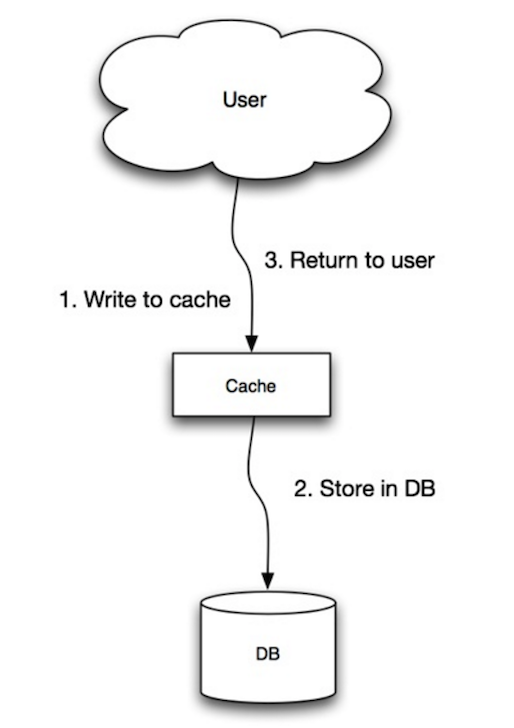
  <br/>
  <i><a href=http://www.slideshare.net/jboner/scalability-availability-stability-patterns/>Дереккөз: Масштабталушылық, қолжетімділік, тұрақтылық үлгілері</a></i>
</p>

Қолданба кэшті негізгі деректер қоймасы ретінде пайдаланады, деректерді оған оқып жазады, ал кэш дерекқорға оқу мен жазуға жауапты:

* Қолданба кэштегі жазбаны қосады/жаңартады
* Кэш жазбаны деректер қоймасына синхронды жазады
* Қайтару

Қолданба коды:

```python
set_user(12345, {"foo":"bar"})
```

Кэш коды:

```python
def set_user(user_id, values):
    user = db.query("UPDATE Users WHERE id = {0}", user_id, values)
    cache.set(user_id, user)
```

Write-through жазу операциясына байланысты жалпы баяу операция, бірақ жаңадан жазылған деректердің кейінгі оқулары жылдам. Пайдаланушылар жалпы деректерді оқуға қарағанда жаңарту кезіндегі кідіріске шыдамдырақ. Кэштегі деректер ескірмейді.

##### Кемшілік(тер): write-through

* Ақаулық немесе масштабтау себебінен жаңа түйін жасалғанда, жазба дерекқорда жаңартылғанша жаңа түйін жазбаларды кэштемейді. Cache-aside-ды write-through-мен бірге пайдалану бұл мәселені азайтуы мүмкін.
* Жазылған деректердің көпшілігі ешқашан оқылмауы мүмкін, бұл TTL арқылы азайтылуы мүмкін.

#### Write-behind (write-back)

<p align="center">
  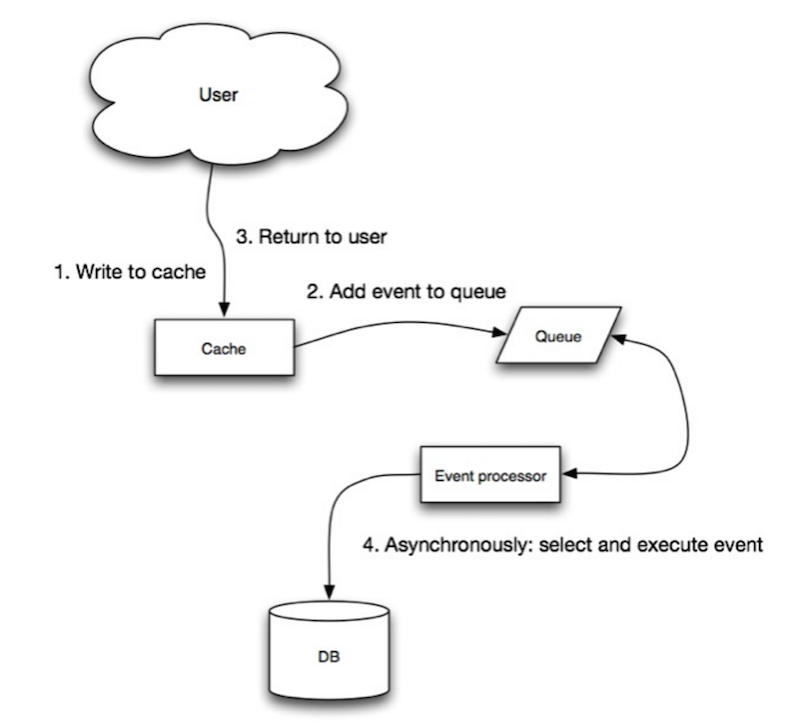
  <br/>
  <i><a href=http://www.slideshare.net/jboner/scalability-availability-stability-patterns/>Дереккөз: Масштабталушылық, қолжетімділік, тұрақтылық үлгілері</a></i>
</p>

Write-behind кезінде қолданба мыналарды жасайды:

* Кэштегі жазбаны қосу/жаңарту
* Жазу өнімділігін жақсарта отырып, жазбаны деректер қоймасына асинхронды жазу

##### Кемшілік(тер): write-behind

* Кэш мазмұны деректер қоймасына жетер алдында жұмысын тоқтатса, деректер жоғалуы мүмкін.
* Write-behind-ды cache-aside немесе write-through-ға қарағанда іске асыру күрделірек.

#### Refresh-ahead

<p align="center">
  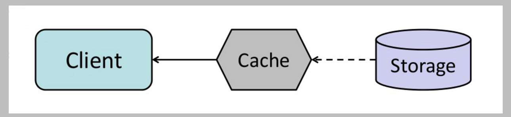
  <br/>
  <i><a href=http://www.slideshare.net/tmatyashovsky/from-cache-to-in-memory-data-grid-introduction-to-hazelcast>Дереккөз: Кэштен жад ішіндегі деректер торына</a></i>
</p>

Кэшті жақында қолжетімді болған кэш жазбасын мерзімі өткенге дейін автоматты түрде жаңартатындай конфигурациялауға болады.

Кэш болашақта қандай элементтер қажет болуы мүмкін екенін дәл болжай алса, Refresh-ahead read-through-ға қарағанда кідірісті азайтуы мүмкін.

##### Кемшілік(тер): refresh-ahead

* Болашақта қандай элементтер қажет болуы мүмкін екенін дәл болжай алмау refresh-ahead-сіз жағдайдан гөрі нашар өнімділікке алып келуі мүмкін.

### Кемшілік(тер): кэш

* [Кэш жарамсыздандыру](https://en.wikipedia.org/wiki/Cache_algorithms) арқылы кэштер мен дерекқор сияқты шындық дереккөзі арасындағы дәйектілікті сақтау қажет.
* Кэш жарамсыздандыру — күрделі мәселе, кэшті қашан жаңарту керектігіне байланысты қосымша күрделілік бар.
* Redis немесе memcached қосу сияқты қолданба өзгертулері жасау қажет.

### Дереккөз(дер) және қосымша оқу

* [From cache to in-memory data grid](http://www.slideshare.net/tmatyashovsky/from-cache-to-in-memory-data-grid-introduction-to-hazelcast)
* [Scalable system design patterns](http://horicky.blogspot.com/2010/10/scalable-system-design-patterns.html)
* [Introduction to architecting systems for scale](http://lethain.com/introduction-to-architecting-systems-for-scale/)
* [Scalability, availability, stability, patterns](http://www.slideshare.net/jboner/scalability-availability-stability-patterns/)
* [Scalability](https://web.archive.org/web/20230126233752/https://www.lecloud.net/post/9246290032/scalability-for-dummies-part-3-cache)
* [AWS ElastiCache strategies](http://docs.aws.amazon.com/AmazonElastiCache/latest/UserGuide/Strategies.html)
* [Wikipedia](https://en.wikipedia.org/wiki/Cache_(computing))

## Асинхрондылық

<p align="center">
  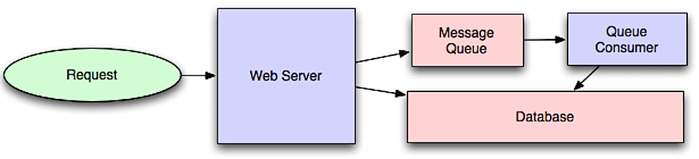
  <br/>
  <i><a href=http://lethain.com/introduction-to-architecting-systems-for-scale/#platform_layer>Дереккөз: Масштабта жүйелерді жобалауға кіріспе</a></i>
</p>

Асинхронды жұмыс ағындары басқаша жолмен тікелей орындалатын қымбат операциялар үшін сұраныс уақытын қысқартуға көмектеседі. Сондай-ақ деректерді мерзімді жинақтау сияқты уақытты қажет ететін жұмысты алдын ала орындау арқылы да көмектеседі.

### Хабарлама кезектері

Хабарлама кезектері хабарламаларды қабылдайды, ұстайды және жеткізеді. Егер операция тікелей орындалуы тым баяу болса, келесі жұмыс ағынымен хабарлама кезегін пайдалануға болады:

* Қолданба кезекке тапсырма жариялайды, содан кейін пайдаланушыға тапсырма күйін хабарлайды
* Жұмысшы кезектен тапсырманы алады, оны өңдейді, содан кейін тапсырманың аяқталғанын білдіреді

Пайдаланушы бөгелмейді және тапсырма фонда өңделеді. Осы уақыт ішінде клиент тапсырма аяқталғандай болып көрсету үшін аздап өңдеу жасауы мүмкін. Мысалы, твит жарияласа, твит жаңалықтар лентасына бірден жарияланады, бірақ твитіңіз барлық ізбасарларыңызға жеткізілгенге дейін біраз уақыт кетуі мүмкін.

**[Redis](https://redis.io/)** қарапайым хабарлама брокері ретінде пайдалы, бірақ хабарламалар жоғалуы мүмкін.

**[RabbitMQ](https://www.rabbitmq.com/)** танымал, бірақ 'AMQP' хаттамасына бейімделуді және өз түйіндерін басқаруды талап етеді.

**[Amazon SQS](https://aws.amazon.com/sqs/)** хосттелген, бірақ жоғары кідірісі болуы мүмкін және хабарламалардың екі рет жеткізілу мүмкіндігі бар.

### Тапсырма кезектері

Тапсырма кезектері тапсырмаларды және олардың байланысты деректерін қабылдайды, орындайды, содан кейін нәтижелерін жеткізеді. Олар жоспарлауды қолдай алады және фонда есептеу ресурстарын қажет ететін тапсырмаларды орындауға пайдаланылуы мүмкін.

**[Celery](https://docs.celeryproject.org/en/stable/)** жоспарлауды қолдайды және бастапқы ретінде Python қолдауы бар.

### Кері қысым

Кезектер айтарлықтай өсе бастаса, кезек өлшемі жадтан үлкен болуы мүмкін, бұл кэш жіберіп алуларына, дискіден оқуларға және тіпті баяуырақ өнімділікке алып келеді. [Кері қысым](http://mechanical-sympathy.blogspot.com/2012/05/apply-back-pressure-when-overloaded.html) кезек өлшемін шектеу арқылы кезекте тұрған тапсырмалар үшін жоғары өткізу қабілеті жылдамдығы мен жақсы жауап уақытын сақтауға көмектесуі мүмкін. Кезек толғаннан кейін клиенттер кейінірек қайта сынау үшін сервер бос емес немесе HTTP 503 күй кодын алады. Клиенттер сұранысты кейінірек, мүмкін [экспоненциалды қадам](https://en.wikipedia.org/wiki/Exponential_backoff) арқылы қайталай алады.

### Кемшілік(тер): асинхрондылық

* Арзан есептеулер мен нақты уақыт жұмыс ағындары сияқты қолдану жағдайлары синхронды операциялар үшін жарамдырақ болуы мүмкін, өйткені кезектерді енгізу кешігулер мен күрделілік қосуы мүмкін.

### Дереккөз(дер) және қосымша оқу

* [It's all a numbers game](https://www.youtube.com/watch?v=1KRYH75wgy4)
* [Applying back pressure when overloaded](http://mechanical-sympathy.blogspot.com/2012/05/apply-back-pressure-when-overloaded.html)
* [Little's law](https://en.wikipedia.org/wiki/Little%27s_law)
* [What is the difference between a message queue and a task queue?](https://www.quora.com/What-is-the-difference-between-a-message-queue-and-a-task-queue-Why-would-a-task-queue-require-a-message-broker-like-RabbitMQ-Redis-Celery-or-IronMQ-to-function)

## Байланыс

<p align="center">
  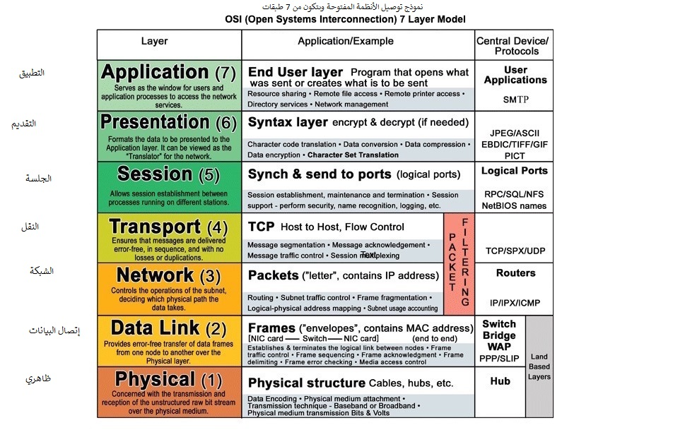
  <br/>
  <i><a href=http://www.escotal.com/osilayer.html>Дереккөз: OSI 7 деңгейлі модель</a></i>
</p>

### Гипермәтінді тасымалдау хаттамасы (HTTP)

HTTP — клиент пен сервер арасында деректерді кодтау және тасымалдау әдісі. Бұл сұраныс/жауап хаттамасы: клиенттер сұраныс жібереді, серверлер сұраныс туралы тиісті мазмұн мен аяқталу күйі ақпаратымен жауап береді. HTTP өздігінен жұмыс жасайды, сұраныстар мен жауаптардың жүктемені теңестіру, кэштеу, шифрлеу және қысуды орындайтын көптеген аралық маршрутизаторлар мен серверлер арқылы өтуіне мүмкіндік береді.

Негізгі HTTP сұранысы етістіктен (әдіс) және ресурстан (соқпа) тұрады. Төменде жалпы HTTP етістіктері берілген:

| Етістік | Сипаттама | Идемпотентті* | Қауіпсіз | Кэштелетін |
|---------|-----------|--------------|----------|-----------|
| GET | Ресурсты оқиды | Иә | Иә | Иә |
| POST | Ресурс жасайды немесе деректерді өңдейтін процесті іске қосады | Жоқ | Жоқ | Жауап жаңалық ақпаратын қамтыса иә |
| PUT | Ресурс жасайды немесе алмастырады | Иә | Жоқ | Жоқ |
| PATCH | Ресурсты ішінара жаңартады | Жоқ | Жоқ | Жауап жаңалық ақпаратын қамтыса иә |
| DELETE | Ресурсты жояды | Иә | Жоқ | Жоқ |

*Әртүрлі нәтижелерсіз көп рет шақырылуы мүмкін.

HTTP — **TCP** және **UDP** сияқты төменгі деңгейлі хаттамаларға сүйенетін қолданба деңгейі хаттамасы.

#### Дереккөз(дер) және қосымша оқу: HTTP

* [What is HTTP?](https://www.nginx.com/resources/glossary/http/)
* [Difference between HTTP and TCP](https://www.quora.com/What-is-the-difference-between-HTTP-protocol-and-TCP-protocol)
* [Difference between PUT and PATCH](https://laracasts.com/discuss/channels/general-discussion/whats-the-differences-between-put-and-patch?page=1)

### Деректерді беруді басқару хаттамасы (TCP)

<p align="center">
  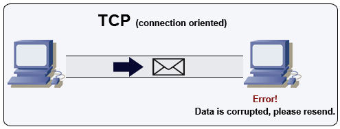
  <br/>
  <i><a href=http://www.wildbunny.co.uk/blog/2012/10/09/how-to-make-a-multi-player-game-part-1/>Дереккөз: Көп ойыншылы ойын жасау</a></i>
</p>

TCP — [IP желісіндегі](https://en.wikipedia.org/wiki/Internet_Protocol) байланысқа бағытталған хаттама. Байланыс [қол алысу](https://en.wikipedia.org/wiki/Handshaking) арқылы орнатылып аяқталады. Жіберілген барлық пакеттер мыналар арқылы бастапқы тәртіпте және зақымданбай тағайындалған жерге жетуіне кепілдік беріледі:

* Әр пакет үшін реттік нөмірлер мен [бақылау сомасы өрістері](https://en.wikipedia.org/wiki/Transmission_Control_Protocol#Checksum_computation)
* [Растау](https://en.wikipedia.org/wiki/Acknowledgement_(data_networks)) пакеттері мен автоматты қайта жіберу

Жіберуші дұрыс жауап алмаса, пакеттерді қайта жібереді. Бірнеше уақыт шегінен асу болса, байланыс үзіледі. TCP сонымен бірге [ағынды басқаруды](https://en.wikipedia.org/wiki/Flow_control_(data)) және [кептеліс басқаруды](https://en.wikipedia.org/wiki/Network_congestion#Congestion_control) іске асырады. Бұл кепілдіктер кешігуге алып келеді және жалпы UDP-ге қарағанда тиімдірек емес тасымалдауға алып келеді.

Жоғары өткізу қабілетін қамтамасыз ету үшін веб-серверлер көп TCP байланысын ашық ұстай алады, бұл жоғары жад пайдалануына алып келеді. Веб-сервер ағындары мен, айталық, [memcached](https://memcached.org/) сервері арасында көп ашық байланыс болуы қымбатқа түсуі мүмкін. [Байланыс ресурстарын басқару](https://en.wikipedia.org/wiki/Connection_pool) қолданылатын жерде UDP-ге ауысуға қосымша көмектесе алады.

TCP жоғары сенімділікті талап ететін, бірақ уақытқа онша маңызды емес қолданбалар үшін пайдалы. Кейбір мысалдар: веб-серверлер, дерекқор ақпараты, SMTP, FTP және SSH.

TCP-ні UDP-ден таңдаңыз, егер:

* Барлық деректердің бүтін жетуі қажет болса
* Желі өткізу қабілетін автоматты түрде ең жақсы пайдаланғыңыз келсе

### Пайдаланушы датаграмма хаттамасы (UDP)

<p align="center">
  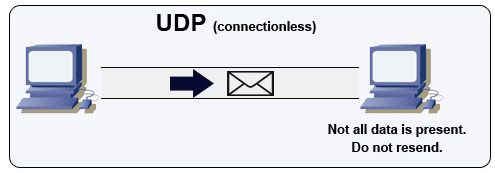
  <br/>
  <i><a href=http://www.wildbunny.co.uk/blog/2012/10/09/how-to-make-a-multi-player-game-part-1/>Дереккөз: Көп ойыншылы ойын жасау</a></i>
</p>

UDP — байланыссыз. Датаграммалар (пакеттерге ұқсас) тек датаграмма деңгейінде кепілдендіріледі. Датаграммалар тағайындалған жерге ретсіз жетуі немесе мүлде жетпеуі мүмкін. UDP кептеліс басқаруды қолдамайды. TCP қолдайтын кепілдіктерсіз UDP жалпы тиімдірек болады.

UDP таратылым жіберуі мүмкін, субжелідегі барлық құрылғыларға датаграммалар жіберу. Бұл [DHCP](https://en.wikipedia.org/wiki/Dynamic_Host_Configuration_Protocol) кезінде пайдалы, өйткені клиент әлі IP мекенжайын алмаған, сондықтан IP мекенжайысыз TCP ағынының жолын жабады.

UDP аз сенімді, бірақ VoIP, бейне чат, ағынды тарату және нақты уақыттағы көп ойыншылы ойындар сияқты нақты уақыт жағдайларында жақсы жұмыс істейді.

UDP-ні TCP-ден таңдаңыз, егер:

* Ең төменгі кідіріс қажет болса
* Кешіккен деректер деректерді жоғалтудан жаман болса
* Өз қате түзетуіңізді іске асырғыңыз келсе

#### Дереккөз(дер) және қосымша оқу: TCP және UDP

* [Networking for game programming](https://gafferongames.com/post/udp_vs_tcp/)
* [Key differences between TCP and UDP protocols](http://www.cyberciti.biz/faq/key-differences-between-tcp-and-udp-protocols/)
* [Difference between TCP and UDP](http://stackoverflow.com/questions/5970383/difference-between-tcp-and-udp)
* [Transmission control protocol](https://en.wikipedia.org/wiki/Transmission_Control_Protocol)
* [User datagram protocol](https://en.wikipedia.org/wiki/User_Datagram_Protocol)
* [Scaling memcache at Facebook](http://www.cs.bu.edu/~jappavoo/jappavoo.github.com/451/papers/memcache-fb.pdf)

### Қашықтан процедураны шақыру (RPC)

<p align="center">
  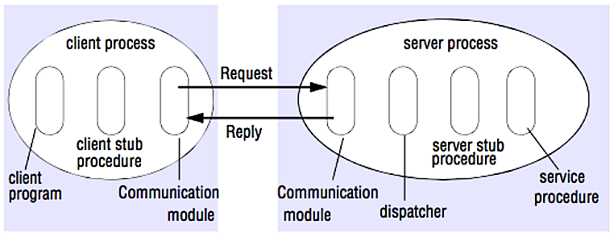
  <br/>
  <i><a href=http://www.puncsky.com/blog/2016-02-13-crack-the-system-design-interview>Дереккөз: Жүйені жобалау сұхбатын жар ету</a></i>
</p>

RPC-де клиент процедураны басқа мекенжай кеңістігінде, әдетте қашықтағы сервердегі орындалуын тудырады. Процедура жергілікті процедура шақыруы сияқты кодталады, клиент бағдарламасынан серверлермен байланысу жолдарының бөлшектерін абстракциялайды. Қашықтан шақырулар жалпы жергілікті шақырулардан баяу және аз сенімді, сондықтан RPC шақыруларын жергілікті шақырулардан ажырату пайдалы. Танымал RPC фреймворктары: [Protobuf](https://developers.google.com/protocol-buffers/), [Thrift](https://thrift.apache.org/) және [Avro](https://avro.apache.org/docs/current/).

RPC — сұраныс-жауап хаттамасы:

* **Клиент бағдарламасы** — клиент суррогат процедурасын шақырады. Параметрлер жергілікті процедура шақыруы сияқты стекке итеріледі.
* **Клиент суррогат процедурасы** — процедура идентификаторы мен аргументтерді сұраныс хабарламасына маршалдайды (буып).
* **Клиент байланыс модулі** — ОЖ хабарламаны клиенттен серверге жібереді.
* **Сервер байланыс модулі** — ОЖ кіріс пакеттерді сервер суррогат процедурасына береді.
* **Сервер суррогат процедурасы** — нәтижелерді демаршалдайды, процедура идентификаторына сәйкес сервер процедурасын шақырады және берілген аргументтерді береді.
* Сервер жауабы жоғарыдағы қадамдарды кері тәртіпте қайталайды.

RPC шақырулары үлгілері:

```
GET /someoperation?data=anId

POST /anotheroperation
{
  "data":"anId";
  "anotherdata": "another value"
}
```

RPC мінез-құлықтарды ашуға бағытталған. RPC жиі ішкі байланыстарда өнімділік себептерімен пайдаланылады, өйткені қолдану жағдайларыңызға жақсырақ сәйкес келу үшін жергілікті шақырулар дайындай аласыз.

Жергілікті кітапхананы (SDK) таңдаңыз, егер:

* Мақсатты платформаңызды білсеңіз.
* «Логикаға» қол жеткізуді басқарғыңыз келсе.
* Кітапханаңыздан тыс қателерді басқарудың қалай жүргізілетінін басқарғыңыз келсе.
* Өнімділік пен соңғы пайдаланушы тәжірибесі басты мақсатыңыз болса.

**REST**-ті ұстанатын HTTP API-лер жалпы API-лер үшін жиірек пайдаланылады.

#### Кемшілік(тер): RPC

* RPC клиенттері қызмет іске асырылуымен тығыз байланысады.
* Әр жаңа операция немесе қолдану жағдайы үшін жаңа API анықталуы керек.
* RPC-ды жөндеу қиын болуы мүмкін.
* Бар технологияларды қорапта пайдалана алмауыңыз мүмкін. Мысалы, [Squid](http://www.squid-cache.org/) сияқты кэштеу серверлерінде [RPC шақырулары дұрыс кэштелуін](https://web.archive.org/web/20170608193645/http://etherealbits.com/2012/12/debunking-the-myths-of-rpc-rest/) қамтамасыз ету үшін қосымша күш қажет болуы мүмкін.

### Өкілдік күй беру (REST)

REST — клиент сервер басқаратын ресурстар жинағына қызмет ететін клиент/сервер үлгісін орнататын архитектуралық стиль. Сервер ресурстар мен оларды өзгертуге немесе жаңа ресурс өкілдігін алуға болатын іс-әрекеттердің өкілдігін береді. Барлық байланыс күйсіз және кэштелетін болуы керек.

RESTful интерфейсінің төрт сапасы бар:

* **Ресурстарды анықтау (HTTP-дегі URI)** — кез келген операцияға қарамастан бірдей URI пайдалану.
* **Өкілдіктермен өзгерту (HTTP-дегі етістіктер)** — етістіктерді, тақырыпшаларды және денені пайдалану.
* **Өзін-өзі сипаттайтын қате хабарламасы (HTTP-дегі күй жауабы)** — күй кодтарын пайдалану, дөңгелекті қайта ойлап таппаңыз.
* **[HATEOAS](http://restcookbook.com/Basics/hateoas/) (HTTP үшін HTML интерфейсі)** — веб-қызметіңіз браузерде толық қолжетімді болуы керек.

REST шақырулары үлгілері:

```
GET /someresources/anId

PUT /someresources/anId
{"anotherdata": "another value"}
```

REST деректерді ашуға бағытталған. Клиент/сервер арасындағы байланысты азайтады және жиі жалпы HTTP API-лері үшін пайдаланылады. REST URI арқылы ресурстарды ашудың жалпырақ және біркелкі әдісін, [тақырыпшалар арқылы өкілдікті](https://github.com/for-GET/know-your-http-well/blob/master/headers.md) және GET, POST, PUT, DELETE және PATCH сияқты етістіктер арқылы іс-әрекеттерді пайдаланады. Күйсіз болу REST-ті горизонтал масштабтау мен бөлу үшін тамаша етеді.

#### Кемшілік(тер): REST

* REST деректерді ашуға бағытталғандықтан, ресурстар табиғи ұйымдастырылмаса немесе қарапайым иерархияда қолжетімді болмаса, жарамды болмауы мүмкін. Мысалы, белгілі бір оқиғалар жиынымен сәйкес келетін соңғы сағаттан барлық жаңартылған жазбаларды қайтару жолмен оңай өрнектелмейді. REST кезінде ол URI жолы, сұраныс параметрлері және мүмкін сұраныс денесінің комбинациясымен іске асырылуы ықтимал.
* REST әдетте бірнеше етістікке (GET, POST, PUT, DELETE және PATCH) сүйенеді, бұл кейде қолдану жағдайыңызға сәйкес келмейді. Мысалы, мерзімі өткен құжаттарды мұрағат қалтасына жылжыту осы етістіктерге жинақты сәйкес келмеуі мүмкін.
* Кірістірілген иерархиялары бар күрделі ресурстарды алу жалғыз көріністерді салу үшін клиент пен сервер арасындағы бірнеше айналма сапарларды талап етеді, мысалы, блог жазбасының мазмұнын және сол жазбадағы пікірлерді алу. Желі жағдайлары ауыспалы мобильді қолданбалар үшін осы бірнеше айналма сапарлар өте қолайсыз.
* Уақыт өте API жауабына қосымша өрістер қосылуы мүмкін, ескі клиенттер барлық жаңа деректер өрістерін, соның ішінде қажет еместерін де алады, нәтижесінде жүктеме өлшемі ісіп, үлкенірек кідіріске алып келеді.

### RPC және REST шақырулары салыстыруы

| Операция | RPC | REST |
|---------|-----|------|
| Тіркелу | **POST** /signup | **POST** /persons |
| Бас тарту | **POST** /resign<br/>{<br/>"personid": "1234"<br/>} | **DELETE** /persons/1234 |
| Адамды оқу | **GET** /readPerson?personid=1234 | **GET** /persons/1234 |
| Адамның элементтер тізімін оқу | **GET** /readUsersItemsList?personid=1234 | **GET** /persons/1234/items |
| Адам элементтеріне элемент қосу | **POST** /addItemToUsersItemsList<br/>{<br/>"personid": "1234";<br/>"itemid": "456"<br/>} | **POST** /persons/1234/items<br/>{<br/>"itemid": "456"<br/>} |
| Элементті жаңарту | **POST** /modifyItem<br/>{<br/>"itemid": "456";<br/>"key": "value"<br/>} | **PUT** /items/456<br/>{<br/>"key": "value"<br/>} |
| Элементті жою | **POST** /removeItem<br/>{<br/>"itemid": "456"<br/>} | **DELETE** /items/456 |

<p align="center">
  <i><a href=https://apihandyman.io/do-you-really-know-why-you-prefer-rest-over-rpc/>Дереккөз: RPC-дан REST-ті неге артық санайтыныңызды шынымен білесіз бе</a></i>
</p>

#### Дереккөз(дер) және қосымша оқу: REST және RPC

* [Do you really know why you prefer REST over RPC](https://apihandyman.io/do-you-really-know-why-you-prefer-rest-over-rpc/)
* [When are RPC-ish approaches more appropriate than REST?](http://programmers.stackexchange.com/a/181186)
* [REST vs JSON-RPC](http://stackoverflow.com/questions/15056878/rest-vs-json-rpc)
* [Debunking the myths of RPC and REST](https://web.archive.org/web/20170608193645/http://etherealbits.com/2012/12/debunking-the-myths-of-rpc-rest/)
* [What are the drawbacks of using REST](https://www.quora.com/What-are-the-drawbacks-of-using-RESTful-APIs)
* [Crack the system design interview](http://www.puncsky.com/blog/2016-02-13-crack-the-system-design-interview)
* [Thrift](https://code.facebook.com/posts/1468950976659943/)
* [Why REST for internal use and not RPC](http://arstechnica.com/civis/viewtopic.php?t=1190508)

## Қауіпсіздік

Бұл бөлім жаңартуларды қажет етуі мүмкін. [Үлес қосуды](#үлес-қосу) қарастырыңыз!

Қауіпсіздік кең тақырып. Қауіпсіздік бойынша елеулі тәжірибеңіз, қауіпсіздік негізіңіз болмаса немесе қауіпсіздік білімін талап ететін лауазымға өтінім бермесеңіз, негіздерден артығын білудің қажеті жоқ:

* Тасымалдау кезінде де, тыныштық күйінде де шифрлаңыз.
* [XSS](https://en.wikipedia.org/wiki/Cross-site_scripting) және [SQL инъекциясының](https://en.wikipedia.org/wiki/SQL_injection) алдын алу үшін барлық пайдаланушы кірістерін немесе пайдаланушыға ашық кіріс параметрлерін тазартыңыз.
* SQL инъекциясының алдын алу үшін параметрлендірілген сұраныстарды пайдаланыңыз.
* [Ең аз артықшылық](https://en.wikipedia.org/wiki/Principle_of_least_privilege) принципін пайдаланыңыз.

### Дереккөз(дер) және қосымша оқу

* [API security checklist](https://github.com/shieldfy/API-Security-Checklist)
* [Security guide for developers](https://github.com/FallibleInc/security-guide-for-developers)
* [OWASP top ten](https://www.owasp.org/index.php/OWASP_Top_Ten_Cheat_Sheet)

## Қосымша

Кейде ‘шамалы есептеулер’ жасауды сұрайды. Мысалы, дискіден 100 кескін нобайын жасауға қанша уақыт кететінін немесе деректер құрылымы қанша жады алатынын анықтауыңыз керек болуы мүмкін. **Екінің дәрежелері кестесі** және **Әр бағдарламашы білуі тиіс кідіріс сандары** ыңғайлы анықтамалар.

### Екінің дәрежелері кестесі

```
Дәреже      Нақты мән           Шамамен мән         Байт
---------------------------------------------------------------
7                             128
8                             256
10                           1024   1 мың               1 КБ
16                         65,536                      64 КБ
20                      1,048,576   1 миллион            1 МБ
30                  1,073,741,824   1 миллиард           1 ГБ
32                  4,294,967,296                        4 ГБ
40              1,099,511,627,776   1 триллион           1 ТБ
```

#### Дереккөз(дер) және қосымша оқу

* [Powers of two](https://en.wikipedia.org/wiki/Power_of_two)

### Әр бағдарламашы білуі тиіс кідіріс сандары

```
Кідіріс салыстыру сандары
--------------------------
L1 кэш сілтемесі                             0.5 нс
Тармақ қате болжауы                            5   нс
L2 кэш сілтемесі                               7   нс                      L1 кэштен 14 есе
Mutex құлып/ашу                               25   нс
Негізгі жад сілтемесі                        100   нс                      L2-ден 20 есе, L1-ден 200 есе
1КБ байтты Zippy-мен қысу               10,000   нс       10 мкс
1 Гбит/с желі арқылы 1 КБ байт жіберу  10,000   нс       10 мкс
SSD*-тан 4 КБ кездейсоқ оқу           150,000   нс      150 мкс          ~1ГБ/с SSD
Жадтан 1 МБ дәйекті оқу               250,000   нс      250 мкс
Бір деректер орталығында айналма сапар 500,000   нс      500 мкс
SSD*-тан 1 МБ дәйекті оқу           1,000,000   нс    1,000 мкс    1 мс  ~1ГБ/с SSD, жадтан 4 есе
HDD іздеу                           10,000,000   нс   10,000 мкс   10 мс  деректер орталығы сапарынан 20 есе
1 Гбит/с желіден 1 МБ дәйекті оқу  10,000,000   нс   10,000 мкс   10 мс  жадтан 40 есе, SSD-тан 10 есе
HDD-тан 1 МБ дәйекті оқу           30,000,000   нс   30,000 мкс   30 мс  жадтан 120 есе, SSD-тан 30 есе
CA->Нидерланды->CA пакет жіберу    150,000,000   нс  150,000 мкс  150 мс

Ескертпелер
-----------
1 нс = 10^-9 секунд
1 мкс = 10^-6 секунд = 1,000 нс
1 мс = 10^-3 секунд = 1,000 мкс = 1,000,000 нс
```

Жоғарыдағы сандарға негізделген ыңғайлы метриктер:

* HDD-тан 30 МБ/с жылдамдықпен дәйекті оқу
* 1 Гбит/с Ethernet арқылы 100 МБ/с жылдамдықпен дәйекті оқу
* SSD-тан 1 ГБ/с жылдамдықпен дәйекті оқу
* Негізгі жадтан 4 ГБ/с жылдамдықпен дәйекті оқу
* Секундына 6-7 дүниежүзілік айналма сапар
* Деректер орталығында секундына 2,000 айналма сапар

#### Кідіріс сандарын визуализация


#### Дереккөз(дер) және қосымша оқу

* [Latency numbers every programmer should know - 1](https://gist.github.com/jboner/2841832)
* [Latency numbers every programmer should know - 2](https://gist.github.com/hellerbarde/2843375)
* [Designs, lessons, and advice from building large distributed systems](http://www.cs.cornell.edu/projects/ladis2009/talks/dean-keynote-ladis2009.pdf)
* [Software Engineering Advice from Building Large-Scale Distributed Systems](https://static.googleusercontent.com/media/research.google.com/en//people/jeff/stanford-295-talk.pdf)

### Қосымша жүйені жобалау сұхбат сұрақтары

> Жалпы жүйені жобалау сұхбат сұрақтары, әрқайсысын қалай шешу туралы ресурстарға сілтемелермен.

| Сұрақ | Дереккөз(дер) |
|-------|--------------|
| Dropbox сияқты файлдарды синхрондау қызметін жобалаңыз | [youtube.com](https://www.youtube.com/watch?v=PE4gwstWhmc) |
| Google сияқты іздеу жүйесін жобалаңыз | [queue.acm.org](http://queue.acm.org/detail.cfm?id=988407)<br/>[stackexchange.com](http://programmers.stackexchange.com/questions/38324/interview-question-how-would-you-implement-google-search)<br/>[ardendertat.com](http://www.ardendertat.com/2012/01/11/implementing-search-engines/)<br/>[stanford.edu](http://infolab.stanford.edu/~backrub/google.html) |
| Google сияқты масштабталатын веб-шолғышты жобалаңыз | [quora.com](https://www.quora.com/How-can-I-build-a-web-crawler-from-scratch) |
| Google docs жобалаңыз | [code.google.com](https://code.google.com/p/google-mobwrite/)<br/>[neil.fraser.name](https://neil.fraser.name/writing/sync/) |
| Redis сияқты кілт-мән қоймасын жобалаңыз | [codecapsule.com](http://codecapsule.com/2012/11/07/ikvs-implementing-a-key-value-store-table-of-contents/)<br/>[allthingsdistributed.com](https://www.allthingsdistributed.com/files/amazon-dynamo-sosp2007.pdf) |
| Memcached сияқты кэш жүйесін жобалаңыз | [slideshare.net](http://www.slideshare.net/oemebamo/introduction-to-memcached) |
| Amazon сияқты ұсыныс жүйесін жобалаңыз | [hulu.com](https://web.archive.org/web/20170406065247/http://tech.hulu.com/blog/2011/09/19/recommendation-system.html)<br/>[ijcai13.org](http://ijcai13.org/files/tutorial_slides/td3.pdf) |
| Bitly сияқты tinyurl жүйесін жобалаңыз | [n00tc0d3r.blogspot.com](http://n00tc0d3r.blogspot.com/) |
| WhatsApp сияқты чат қолданбасын жобалаңыз | [highscalability.com](http://highscalability.com/blog/2014/2/26/the-whatsapp-architecture-facebook-bought-for-19-billion.html) |
| Instagram сияқты сурет бөлісу жүйесін жобалаңыз | [highscalability.com](http://highscalability.com/flickr-architecture)<br/>[highscalability.com](http://highscalability.com/blog/2011/12/6/instagram-architecture-14-million-users-terabytes-of-photos.html) |
| Facebook жаңалықтар ағыны функциясын жобалаңыз | [quora.com](http://www.quora.com/What-are-best-practices-for-building-something-like-a-News-Feed)<br/>[quora.com](http://www.quora.com/Activity-Streams/What-are-the-scaling-issues-to-keep-in-mind-while-developing-a-social-network-feed)<br/>[slideshare.net](http://www.slideshare.net/danmckinley/etsy-activity-feeds-architecture) |
| Facebook уақыт кестесі функциясын жобалаңыз | [facebook.com](https://www.facebook.com/note.php?note_id=10150468255628920)<br/>[highscalability.com](http://highscalability.com/blog/2012/1/23/facebook-timeline-brought-to-you-by-the-power-of-denormaliza.html) |
| Facebook чат функциясын жобалаңыз | [erlang-factory.com](http://www.erlang-factory.com/upload/presentations/31/EugeneLetuchy-ErlangatFacebook.pdf)<br/>[facebook.com](https://www.facebook.com/note.php?note_id=14218138919&id=9445547199&index=0) |
| Facebook сияқты граф іздеу функциясын жобалаңыз | [facebook.com](https://www.facebook.com/notes/facebook-engineering/under-the-hood-building-out-the-infrastructure-for-graph-search/10151347573598920)<br/>[facebook.com](https://www.facebook.com/notes/facebook-engineering/under-the-hood-indexing-and-ranking-in-graph-search/10151361720763920)<br/>[facebook.com](https://www.facebook.com/notes/facebook-engineering/under-the-hood-the-natural-language-interface-of-graph-search/10151432733048920) |
| CloudFlare сияқты контентті жеткізу желісін жобалаңыз | [figshare.com](https://figshare.com/articles/Globally_distributed_content_delivery/6605972) |
| Twitter сияқты трендті тақырыптар жүйесін жобалаңыз | [michael-noll.com](http://www.michael-noll.com/blog/2013/01/18/implementing-real-time-trending-topics-in-storm/)<br/>[snikolov .wordpress.com](http://snikolov.wordpress.com/2012/11/14/early-detection-of-twitter-trends/) |
| Кездейсоқ ID генерациялау жүйесін жобалаңыз | [blog.twitter.com](https://blog.twitter.com/2010/announcing-snowflake)<br/>[github.com](https://github.com/twitter/snowflake/) |
| Уақыт аралығында ең жоғары k сұранысты қайтарыңыз | [cs.ucsb.edu](https://www.cs.ucsb.edu/sites/default/files/documents/2005-23.pdf)<br/>[wpi.edu](http://davis.wpi.edu/xmdv/docs/EDBT11-diyang.pdf) |
| Бірнеше деректер орталықтарынан деректер беретін жүйені жобалаңыз | [highscalability.com](http://highscalability.com/blog/2009/8/24/how-google-serves-data-from-multiple-datacenters.html) |
| Онлайн көп ойыншылы карта ойынын жобалаңыз | [indieflashblog.com](https://web.archive.org/web/20180929181117/http://www.indieflashblog.com/how-to-create-an-asynchronous-multiplayer-game.html)<br/>[buildnewgames.com](http://buildnewgames.com/real-time-multiplayer/) |
| Қоқысты жинау жүйесін жобалаңыз | [stuffwithstuff.com](http://journal.stuffwithstuff.com/2013/12/08/babys-first-garbage-collector/)<br/>[washington.edu](http://courses.cs.washington.edu/courses/csep521/07wi/prj/rick.pdf) |
| API жылдамдық шектеушісін жобалаңыз | [https://stripe.com/blog/](https://stripe.com/blog/rate-limiters) |
| Қор биржасын (NASDAQ немесе Binance сияқты) жобалаңыз | [Jane Street](https://youtu.be/b1e4t2k2KJY)<br/>[Golang Implementation](https://around25.com/blog/building-a-trading-engine-for-a-crypto-exchange/)<br/>[Go Implementation](http://bhomnick.net/building-a-simple-limit-order-in-go/) |
| Жүйені жобалау сұрағын қосу | [Үлес қосу](#үлес-қосу) |

### Нақты әлем архитектуралары

> Нақты әлемдегі жүйелердің қалай жобаланатыны туралы мақалалар.

<p align="center">
  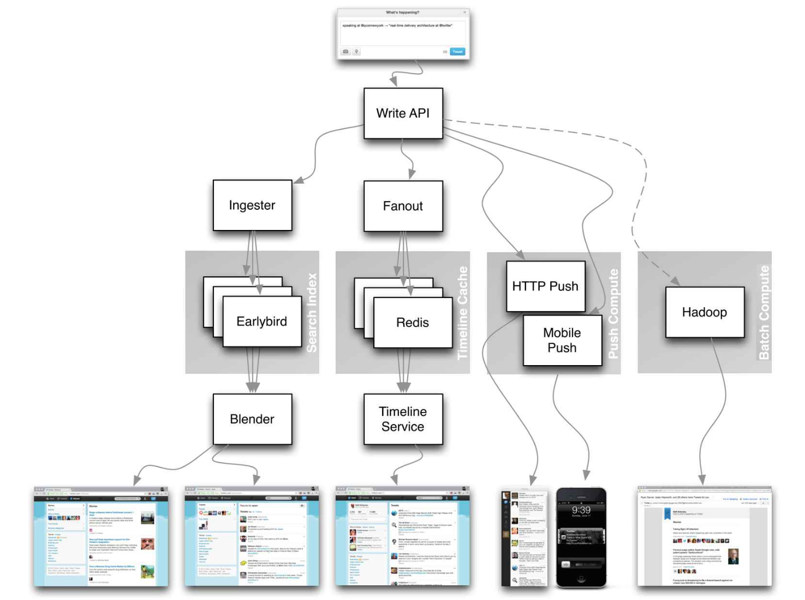
  <br/>
  <i><a href=https://www.infoq.com/presentations/Twitter-Timeline-Scalability>Дереккөз: Масштабтағы Twitter уақыт белгілері</a></i>
</p>

**Келесі мақалалардың ұсақ-түйек бөлшектеріне назар аудармаңыз, оның орнына:**

* Осы мақалалардағы ортақ принциптерді, жалпы технологияларды және үлгілерді анықтаңыз
* Әр компонент қандай мәселелерді шешетінін, қай жерде жұмыс істейтінін, қай жерде жұмыс істемейтінін зерттеңіз
* Үйренілген сабақтарды қараңыз

| Түрі | Жүйе | Дереккөз(дер) |
|------|------|--------------|
| Деректерді өңдеу | **MapReduce** — Google-дан таратылған деректерді өңдеу | [research.google.com](http://static.googleusercontent.com/media/research.google.com/zh-CN/us/archive/mapreduce-osdi04.pdf) |
| Деректерді өңдеу | **Spark** — Databricks-тен таратылған деректерді өңдеу | [slideshare.net](http://www.slideshare.net/AGrishchenko/apache-spark-architecture) |
| Деректерді өңдеу | **Storm** — Twitter-дан таратылған деректерді өңдеу | [slideshare.net](http://www.slideshare.net/previa/storm-16094009) |
| | | |
| Деректер қоймасы | **Bigtable** — Google-дан таратылған баған бағытталған дерекқор | [harvard.edu](http://www.read.seas.harvard.edu/~kohler/class/cs239-w08/chang06bigtable.pdf) |
| Деректер қоймасы | **HBase** — Bigtable-дің ашық бастапқы іске асырылуы | [slideshare.net](http://www.slideshare.net/alexbaranau/intro-to-hbase) |
| Деректер қоймасы | **Cassandra** — Facebook-тен таратылған баған бағытталған дерекқор | [slideshare.net](http://www.slideshare.net/planetcassandra/cassandra-introduction-features-30103666) |
| Деректер қоймасы | **DynamoDB** — Amazon-нан құжат бағытталған дерекқор | [harvard.edu](http://www.read.seas.harvard.edu/~kohler/class/cs239-w08/decandia07dynamo.pdf) |
| Деректер қоймасы | **MongoDB** — Құжат бағытталған дерекқор | [slideshare.net](http://www.slideshare.net/mdirolf/introduction-to-mongodb) |
| Деректер қоймасы | **Spanner** — Google-дан жаһандық таратылған дерекқор | [research.google.com](http://research.google.com/archive/spanner-osdi2012.pdf) |
| Деректер қоймасы | **Memcached** — Таратылған жадты кэштеу жүйесі | [slideshare.net](http://www.slideshare.net/oemebamo/introduction-to-memcached) |
| Деректер қоймасы | **Redis** — Тұрақтылық пен мән түрлері бар таратылған жадты кэштеу жүйесі | [slideshare.net](http://www.slideshare.net/dvirsky/introduction-to-redis) |
| | | |
| Файлдық жүйе | **Google File System (GFS)** — Таратылған файлдық жүйе | [research.google.com](http://static.googleusercontent.com/media/research.google.com/zh-CN/us/archive/gfs-sosp2003.pdf) |
| Файлдық жүйе | **Hadoop File System (HDFS)** — GFS-тің ашық бастапқы іске асырылуы | [apache.org](http://hadoop.apache.org/docs/stable/hadoop-project-dist/hadoop-hdfs/HdfsDesign.html) |
| | | |
| Басқа | **Chubby** — Google-дан тығыз байланыспаған таратылған жүйелерге арналған құлып қызметі | [research.google.com](http://static.googleusercontent.com/external_content/untrusted_dlcp/research.google.com/en/us/archive/chubby-osdi06.pdf) |
| Басқа | **Dapper** — Таратылған жүйелерді іздеу инфрақұрылымы | [research.google.com](http://static.googleusercontent.com/media/research.google.com/en//pubs/archive/36356.pdf) |
| Басқа | **Kafka** — LinkedIn-нен Pub/sub хабарлама кезегі | [slideshare.net](http://www.slideshare.net/mumrah/kafka-talk-tri-hug) |
| Басқа | **Zookeeper** — Синхрондауды қамтамасыз ететін орталықтандырылған инфрақұрылым мен қызметтер | [slideshare.net](http://www.slideshare.net/sauravhaloi/introduction-to-apache-zookeeper) |
| | Архитектура қосу | [Үлес қосу](#үлес-қосу) |

### Компания архитектуралары

| Компания | Дереккөз(дер) |
|---------|--------------|
| Amazon | [Amazon architecture](http://highscalability.com/amazon-architecture) |
| Cinchcast | [Producing 1,500 hours of audio every day](http://highscalability.com/blog/2012/7/16/cinchcast-architecture-producing-1500-hours-of-audio-every-d.html) |
| DataSift | [Realtime datamining At 120,000 tweets per second](http://highscalability.com/blog/2011/11/29/datasift-architecture-realtime-datamining-at-120000-tweets-p.html) |
| Dropbox | [How we’ve scaled Dropbox](https://www.youtube.com/watch?v=PE4gwstWhmc) |
| ESPN | [Operating At 100,000 duh nuh nuhs per second](http://highscalability.com/blog/2013/11/4/espns-architecture-at-scale-operating-at-100000-duh-nuh-nuhs.html) |
| Google | [Google architecture](http://highscalability.com/google-architecture) |
| Instagram | [14 million users, terabytes of photos](http://highscalability.com/blog/2011/12/6/instagram-architecture-14-million-users-terabytes-of-photos.html)<br/>[What powers Instagram](http://instagram-engineering.tumblr.com/post/13649370142/what-powers-instagram-hundreds-of-instances) |
| Justin.tv | [Justin.Tv’s live video broadcasting architecture](http://highscalability.com/blog/2010/3/16/justintvs-live-video-broadcasting-architecture.html) |
| Facebook | [Scaling memcached at Facebook](https://cs.uwaterloo.ca/~brecht/courses/854-Emerging-2014/readings/key-value/fb-memcached-nsdi-2013.pdf)<br/>[TAO: Facebook’s distributed data store for the social graph](https://cs.uwaterloo.ca/~brecht/courses/854-Emerging-2014/readings/data-store/tao-facebook-distributed-datastore-atc-2013.pdf)<br/>[Facebook’s photo storage](https://www.usenix.org/legacy/event/osdi10/tech/full_papers/Beaver.pdf)<br/>[How Facebook Live Streams To 800,000 Simultaneous Viewers](http://highscalability.com/blog/2016/6/27/how-facebook-live-streams-to-800000-simultaneous-viewers.html) |
| Flickr | [Flickr architecture](http://highscalability.com/flickr-architecture) |
| Mailbox | [From 0 to one million users in 6 weeks](http://highscalability.com/blog/2013/6/18/scaling-mailbox-from-0-to-one-million-users-in-6-weeks-and-1.html) |
| Netflix | [A 360 Degree View Of The Entire Netflix Stack](http://highscalability.com/blog/2015/11/9/a-360-degree-view-of-the-entire-netflix-stack.html)<br/>[Netflix: What Happens When You Press Play?](http://highscalability.com/blog/2017/12/11/netflix-what-happens-when-you-press-play.html) |
| Pinterest | [From 0 To 10s of billions of page views a month](http://highscalability.com/blog/2013/4/15/scaling-pinterest-from-0-to-10s-of-billions-of-page-views-a.html)<br/>[18 million visitors, 10x growth, 12 employees](http://highscalability.com/blog/2012/5/21/pinterest-architecture-update-18-million-visitors-10x-growth.html) |
| Playfish | [50 million monthly users and growing](http://highscalability.com/blog/2010/9/21/playfishs-social-gaming-architecture-50-million-monthly-user.html) |
| PlentyOfFish | [PlentyOfFish architecture](http://highscalability.com/plentyoffish-architecture) |
| Salesforce | [How they handle 1.3 billion transactions a day](http://highscalability.com/blog/2013/9/23/salesforce-architecture-how-they-handle-13-billion-transacti.html) |
| Stack Overflow | [Stack Overflow architecture](http://highscalability.com/blog/2009/8/5/stack-overflow-architecture.html) |
| TripAdvisor | [40M visitors, 200M dynamic page views, 30TB data](http://highscalability.com/blog/2011/6/27/tripadvisor-architecture-40m-visitors-200m-dynamic-page-view.html) |
| Tumblr | [15 billion page views a month](http://highscalability.com/blog/2012/2/13/tumblr-architecture-15-billion-page-views-a-month-and-harder.html) |
| Twitter | [Making Twitter 10000 percent faster](http://highscalability.com/scaling-twitter-making-twitter-10000-percent-faster)<br/>[Storing 250 million tweets a day using MySQL](http://highscalability.com/blog/2011/12/19/how-twitter-stores-250-million-tweets-a-day-using-mysql.html)<br/>[150M active users, 300K QPS, a 22 MB/S firehose](http://highscalability.com/blog/2013/7/8/the-architecture-twitter-uses-to-deal-with-150m-active-users.html)<br/>[Timelines at scale](https://www.infoq.com/presentations/Twitter-Timeline-Scalability)<br/>[Big and small data at Twitter](https://www.youtube.com/watch?v=5cKTP36HVgI)<br/>[Operations at Twitter: scaling beyond 100 million users](https://www.youtube.com/watch?v=z8LU0Cj6BOU)<br/>[How Twitter Handles 3,000 Images Per Second](http://highscalability.com/blog/2016/4/20/how-twitter-handles-3000-images-per-second.html) |
| Uber | [How Uber scales their real-time market platform](http://highscalability.com/blog/2015/9/14/how-uber-scales-their-real-time-market-platform.html)<br/>[Lessons Learned From Scaling Uber To 2000 Engineers, 1000 Services, And 8000 Git Repositories](http://highscalability.com/blog/2016/10/12/lessons-learned-from-scaling-uber-to-2000-engineers-1000-ser.html) |
| WhatsApp | [The WhatsApp architecture Facebook bought for $19 billion](http://highscalability.com/blog/2014/2/26/the-whatsapp-architecture-facebook-bought-for-19-billion.html) |
| YouTube | [YouTube scalability](https://www.youtube.com/watch?v=w5WVu624fY8)<br/>[YouTube architecture](http://highscalability.com/youtube-architecture) |

### Компанияның инженерлік блогтары

> Сұхбат беретін компаниялардың архитектуралары.
>
> Кездесетін сұрақтар бір доменнен болуы мүмкін.

* [Airbnb Engineering](http://nerds.airbnb.com/)
* [Atlassian Developers](https://developer.atlassian.com/blog/)
* [AWS Blog](https://aws.amazon.com/blogs/aws/)
* [Bitly Engineering Blog](http://word.bitly.com/)
* [Box Blogs](https://blog.box.com/blog/category/engineering)
* [Cloudera Developer Blog](http://blog.cloudera.com/)
* [Dropbox Tech Blog](https://tech.dropbox.com/)
* [Engineering at Quora](https://www.quora.com/q/quoraengineering)
* [Ebay Tech Blog](http://www.ebaytechblog.com/)
* [Evernote Tech Blog](https://blog.evernote.com/tech/)
* [Etsy Code as Craft](http://codeascraft.com/)
* [Facebook Engineering](https://www.facebook.com/Engineering)
* [Flickr Code](http://code.flickr.net/)
* [Foursquare Engineering Blog](http://engineering.foursquare.com/)
* [GitHub Engineering Blog](https://github.blog/category/engineering)
* [Google Research Blog](http://googleresearch.blogspot.com/)
* [Groupon Engineering Blog](https://engineering.groupon.com/)
* [Heroku Engineering Blog](https://engineering.heroku.com/)
* [Hubspot Engineering Blog](http://product.hubspot.com/blog/topic/engineering)
* [High Scalability](http://highscalability.com/)
* [Instagram Engineering](http://instagram-engineering.tumblr.com/)
* [Intel Software Blog](https://software.intel.com/en-us/blogs/)
* [Jane Street Tech Blog](https://blogs.janestreet.com/category/ocaml/)
* [LinkedIn Engineering](http://engineering.linkedin.com/blog)
* [Microsoft Engineering](https://engineering.microsoft.com/)
* [Microsoft Python Engineering](https://blogs.msdn.microsoft.com/pythonengineering/)
* [Netflix Tech Blog](http://techblog.netflix.com/)
* [Paypal Developer Blog](https://developer.paypal.com/community/blog/)
* [Pinterest Engineering Blog](https://medium.com/@Pinterest_Engineering)
* [Reddit Blog](http://www.redditblog.com/)
* [Salesforce Engineering Blog](https://developer.salesforce.com/blogs/engineering/)
* [Slack Engineering Blog](https://slack.engineering/)
* [Spotify Labs](https://labs.spotify.com/)
* [Stripe Engineering Blog](https://stripe.com/blog/engineering)
* [Twilio Engineering Blog](http://www.twilio.com/engineering)
* [Twitter Engineering](https://blog.twitter.com/engineering/)
* [Uber Engineering Blog](http://eng.uber.com/)
* [Yahoo Engineering Blog](http://yahooeng.tumblr.com/)
* [Yelp Engineering Blog](http://engineeringblog.yelp.com/)
* [Zynga Engineering Blog](https://www.zynga.com/blogs/engineering)

#### Дереккөз(дер) және қосымша оқу

Блог қосқыңыз келе ме? Жұмысты қайталамау үшін компания блогыңызды келесі репозиторийге қосуды қарастырыңыз:

* [kilimchoi/engineering-blogs](https://github.com/kilimchoi/engineering-blogs)

## Дамуда

Бөлім қосқыңыз немесе аяқталмаған бөлімді аяқтауға көмектескіңіз келе ме? [Үлес қосыңыз](#үлес-қосу)!

* MapReduce арқылы үлестірілген есептеу
* Дәйекті хэштеу (Consistent hashing)
* Шашырату-жинау (Scatter gather)
* [Үлес қосыңыз](#үлес-қосу)

## Алғыс

Бүкіл репозиторий бойынша алғыстар мен дереккөздер берілген.

Ерекше алғыс:

* [Hired in tech](http://www.hiredintech.com/system-design/the-system-design-process/)
* [Cracking the coding interview](https://www.amazon.com/dp/0984782850/)
* [High scalability](http://highscalability.com/)
* [checkcheckzz/system-design-interview](https://github.com/checkcheckzz/system-design-interview)
* [shashank88/system_design](https://github.com/shashank88/system_design)
* [mmcgrana/services-engineering](https://github.com/mmcgrana/services-engineering)
* [System design cheat sheet](https://gist.github.com/vasanthk/485d1c25737e8e72759f)
* [A distributed systems reading list](http://dancres.github.io/Pages/)
* [Cracking the system design interview](http://www.puncsky.com/blog/2016-02-13-crack-the-system-design-interview)

## Байланыс ақпараты

Кез келген мәселені, сұрақты немесе пікірді талқылау үшін маған хабарласыңыз.

Байланыс ақпаратымды [GitHub бетімнен](https://github.com/donnemartin) таба аласыз.

## Лицензия

*Мен осы репозиторийдегі код пен ресурстарды сізге ашық бастапқы лицензия бойынша ұсынамын. Бұл менің жеке репозиторийім болғандықтан, сіз алатын лицензия менің жұмыс берушімнен (Facebook) емес, менен алынады.*

    Copyright 2017 Donne Martin

    Creative Commons Attribution 4.0 International License (CC BY 4.0)

    http://creativecommons.org/licenses/by/4.0/
