*[English](README.md) ∙ [日本語](README-ja.md) ∙ [Русский](README-ru.md) ∙ [简体中文](README-zh-Hans.md) ∙ [繁體中文](README-zh-TW.md) | [العَرَبِيَّة‎](https://github.com/donnemartin/system-design-primer/issues/170) ∙ [বাংলা](https://github.com/donnemartin/system-design-primer/issues/220) ∙ [Português do Brasil](https://github.com/donnemartin/system-design-primer/issues/40) ∙ [Deutsch](https://github.com/donnemartin/system-design-primer/issues/186) ∙ [ελληνικά](https://github.com/donnemartin/system-design-primer/issues/130) ∙ [עברית](https://github.com/donnemartin/system-design-primer/issues/272) ∙ [Italiano](https://github.com/donnemartin/system-design-primer/issues/104) ∙ [한국어](https://github.com/donnemartin/system-design-primer/issues/102) ∙ [فارسی](https://github.com/donnemartin/system-design-primer/issues/110) ∙ [Polski](https://github.com/donnemartin/system-design-primer/issues/68) ∙ [Español](https://github.com/donnemartin/system-design-primer/issues/136) ∙ [ภาษาไทย](https://github.com/donnemartin/system-design-primer/issues/187) ∙ [Türkçe](https://github.com/donnemartin/system-design-primer/issues/39) ∙ [tiếng Việt](https://github.com/donnemartin/system-design-primer/issues/127) ∙ [Français](https://github.com/donnemartin/system-design-primer/issues/250) | [Add Translation](https://github.com/donnemartin/system-design-primer/issues/28)*

**Помогайте [переводить](TRANSLATIONS.md) это руководство!**

# Пособие по проектированию систем

> Перевод: [@DmitryOlkhovoi](https://github.com/DmitryOlkhovoi), [@voitau](https://github.com/voitau). По вопросам и правкам перевода пишите [@DmitryOlkhovoi](https://github.com/DmitryOlkhovoi).
>
> Первоначальный конспект «Букварь по дизайну систем» (Google Doc, для истории): https://docs.google.com/document/d/1w3qb6SS1Hycyce5Fg5mVMdzkGYXTRskSf57IoD98ZQw/edit

<p align="center">
  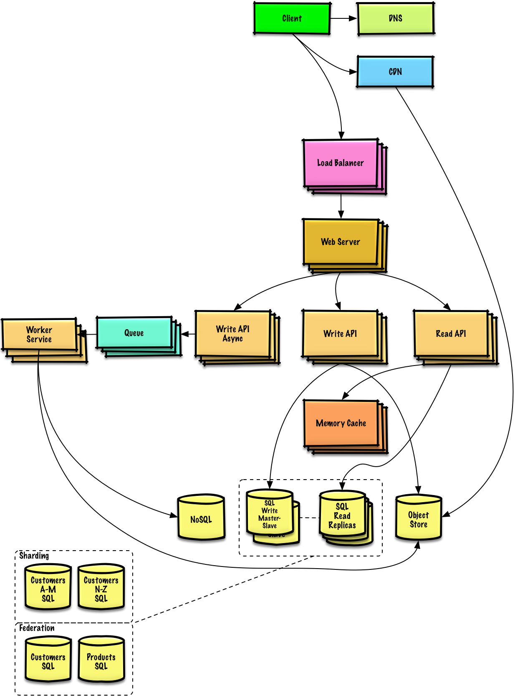
  <br/>
</p>

## Для чего это нужно

> Чтобы узнать, как проектировать крупномасштабные системы.
>
> Чтобы подготовиться к собеседованию по проектированию систем.

### Научитесь проектировать крупномасштабные системы

Умение проектировать масштабируемые системы поможет улучшить ваши инженерные навыки.

Проектирование систем - это обширная тема. В сети есть **огромное количество ресурсов** по принципам проектирования систем.

Этот репозиторий представляет собой **организованную коллекцию** ресурсов, которые помогут вам научиться создавать системы на большом масштабе.

### Учитесь у сообщества по разработке ПО с открытым исходным кодом

Это постоянно обновляемый проект с открытым исходным кодом.

[Содействие](#содействуйте) очень приветствуется!

### Подготовка к собеседованию по проектированию систем

Наряду с интервью по написанию кода, проектирование систем является **обязательным компонентом процесса технического интервью** во многих технологических компаниях.

**Практикуйте общие вопросы по проектированию систем** и **сравнивайте** свои результаты с **примерами решений**: обсуждения, код и диаграммы.

Дополнительные темы для подготовки к собеседованию:

* [Руководство](#руководство)
* [Как отвечать на вопросы на интервью по проектированию систем](#как-отвечать-на-вопросы-на-интервью-по-проектированию-систем)
* [Вопросы на интервью по проектированию систем с решениями](#вопросы-на-интервью-по-проектированию-систем-с-решениями)
* [Вопросы на интервью по объектно-ориентированному программированию с решениями](#вопросы-на-интервью-по-объектно-ориентированному-программированию-с-решениями)
* [Дополнительные вопросы на интервью по проектированию систем](#дополнительные-вопросы-на-интервью-по-проектированию-систем)

## Карточки Anki

<p align="center">
  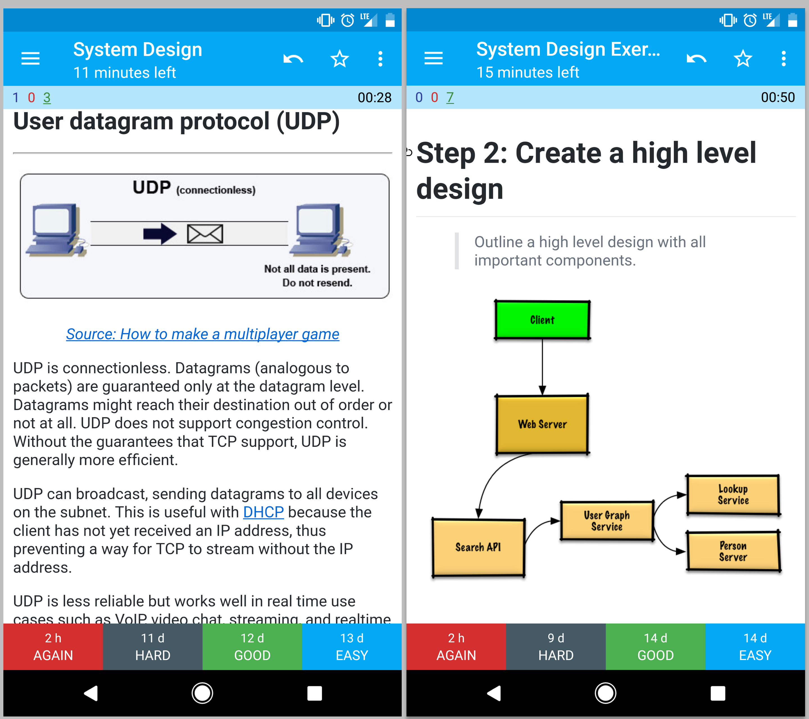
  <br/>
</p>

Предоставленные [карточки Anki](https://apps.ankiweb.net/) могут быть использованы для повторения и запоминания ключевых концепций проектирования систем.

* [System design deck](https://github.com/donnemartin/system-design-primer/tree/master/resources/flash_cards/System%20Design.apkg)
* [System design exercises deck](https://github.com/donnemartin/system-design-primer/tree/master/resources/flash_cards/System%20Design%20Exercises.apkg)
* [Object oriented design exercises deck](https://github.com/donnemartin/system-design-primer/tree/master/resources/flash_cards/OO%20Design.apkg)

### Ресурсы по программированию: интерактивные задачи

Ищете ресурсы для подготовки к [**Coding Interview**](https://github.com/donnemartin/interactive-coding-challenges)?

<p align="center">
  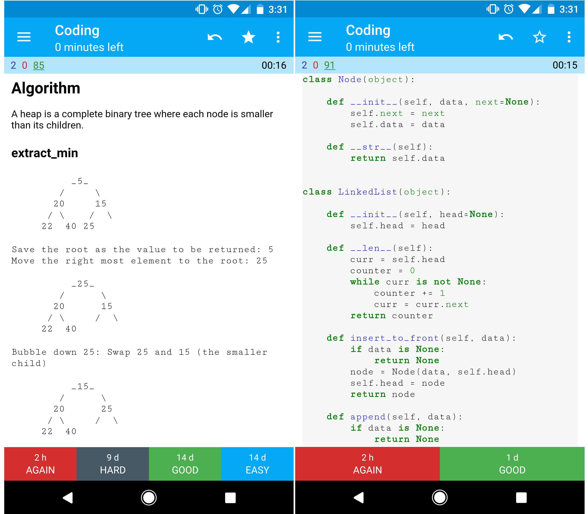
  <br/>
</p>

Посмотрите другой репозиторий [**Interactive Coding Challenges**](https://github.com/donnemartin/interactive-coding-challenges), который тоже содержит набор карт Anki:

* [Coding deck](https://github.com/donnemartin/interactive-coding-challenges/tree/master/anki_cards/Coding.apkg)

## Содействуйте

> Учитесь у сообщества.

Не стесняйтесь отправлять запросы на:

* Исправление ошибок
* Улучшение разделов
* Добавление новых разделов
* [Перевод](https://github.com/donnemartin/system-design-primer/issues/28)

Контент, который нуждается в некоторой доработке, помещается в раздел [В разработке](#в-разработке).

Ознакомьтесь с [Принципами содействия](CONTRIBUTING.md).

## Содержание

> Обобщение различных тем по проектированию систем, включая преимущества и недостатки.  **Любое решение требует компромисса**.
>
> Каждый раздел содержит ссылки на более подробное описание.

<p align="center">
  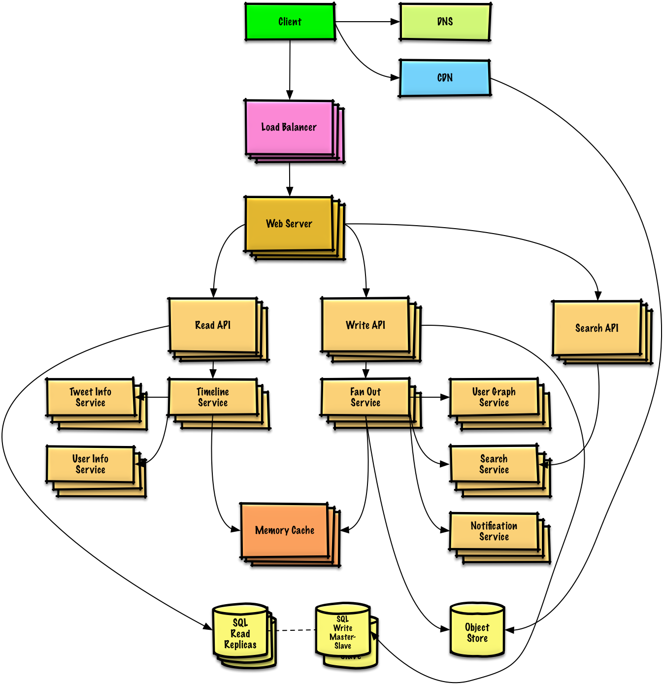
  <br/>
</p>

- [Темы по проектированию систем: начало](#темы-по-проектированию-систем-начало)
  - [Шаг 1: Посмотрите видео-лекцию по масштабированию](#шаг-1-посмотрите-видео-лекцию-по-масштабированию)
  - [Шаг 2: Прочитайте статьи по масштабированию](#шаг-2-прочитайте-статьи-по-масштабированию)
  - [Следующие шаги](#следующие-шаги)
- [Производительность и масштабируемость](#производительность-и-масштабируемость)
- [Задержка и пропускная способность](#задержка-и-пропускная-способность)
- [Доступность и согласованность данных](#доступность-и-согласованность-данных)
  - [Теорема CAP](#теорема-cap)
    - [CP - Согласованность данных и Устойчивость к разделению](#cp---согласованность-данных-и-устойчивость-к-разделению)
    - [AP - Доступность и Устойчивость к разделению](#ap---доступность-и-устойчивость-к-разделению)
- [Шаблоны реализации согласованности](#шаблоны-реализации-согласованности)
  - [Слабая согласованность](#слабая-согласованность)
  - [Согласованность в конечном счете](#согласованность-в-конечном-счете)
  - [Сильная согласованность](#сильная-согласованность)
- [Шаблоны доступности](#шаблоны-доступности)
  - [Отказоустойчивость](#отказоустойчивость)
    - [Активный-пассивный](#активный-пассивный)
    - [Активный-активный](#активный-активный)
  - [Репликация](#репликация)
    - [Master-Slave и Master-Master](#master-slave-и-master-master)
  - [Доступность в цифрах](#доступность-в-цифрах)
    - [Доступность 99.9% - 3 девятки](#доступность-999---3-девятки)
    - [Доступность 99.99% - четыре девятки](#доступность-9999---четыре-девятки)
    - [Параллельная и последовательная доступность](#параллельная-и-последовательная-доступность)
        - [Последовательная доступность](#последовательная-доступность)
        - [Параллельная доступность](#параллельная-доступность)
- [Система доменных имен](#система-доменных-имен)
- [Сеть доставки содержимого (CDN)](#сеть-доставки-содержимого-cdn)
  - [Push CDN](#push-cdn)
  - [Pull CDN](#pull-cdn)
- [Балансировщик нагрузки](#балансировщик-нагрузки)
  - [Layer 4 балансировка](#layer-4-балансировка)
  - [Layer 7 балансировка](#layer-7-балансировка)
  - [Горизонтальное масштабирование](#горизонтальное-масштабирование)
- [Обратный прокси-сервер (Reverse proxy)](#обратный-прокси-сервер-reverse-proxy)
  - [Сравнение балансировщика нагрузки и обратного прокси-сервера](#сравнение-балансировщика-нагрузки-и-обратного-прокси-сервера)
- [Уровень приложений](#уровень-приложений)
  - [Микросервисы](#микросервисы)
  - [Обнаружение сервисов (Service Discovery)](#обнаружение-сервисов-service-discovery)
- [Базы данных](#базы-данных)
  - [Реляционные системы управления базами данных](#реляционные-системы-управления-базами-данных)
    - [Репликация Master-Slave](#репликация-master-slave)
    - [Репликация Master-Master](#репликация-master-master)
    - [Федерализация](#федерализация)
    - [Шардирование](#шардирование)
    - [Денормализация](#денормализация)
    - [Оптимизация SQL запросов](#оптимизация-sql-запросов)
      - [Пересмотрите схему](#пересмотрите-схему)
      - [Используйте хорошие индексы](#используйте-хорошие-индексы)
      - [Избегайте больших объединений](#избегайте-больших-объединений)
      - [Разбиение таблиц](#разбиение-таблиц)
      - [Настройте кэширование запросов](#настройте-кэширование-запросов)
  - [NoSQL](#nosql)
    - [Хранилище типа ключ-значение](#хранилище-типа-ключ-значение)
    - [Хранилище документов](#хранилище-документов)
    - [Колоночное хранилище](#колоночное-хранилище)
    - [Графовая база данных](#графовая-база-данных)
  - [SQL или NoSQL](#sql-или-nosql)
- [Кэширование](#кэширование)
  - [Кэширование на клиенте](#кэширование-на-клиенте)
  - [Кэширование в CDN](#кэширование-в-cdn)
  - [Кэширование на веб-сервере](#кэширование-на-веб-сервере)
  - [Кэширование в базах данных](#кэширование-в-базах-данных)
  - [Кэширование в приложениях](#кэширование-в-приложениях)
  - [Кэширование на уровне запросов в базу данных](#кэширование-на-уровне-запросов-в-базу-данных)
  - [Кэширование на уровне объектов](#кэширование-на-уровне-объектов)
  - [Когда обновлять кэш](#когда-обновлять-кэш)
    - [Кэширование Cache-aside (кэш отдельно)](#кэширование-cache-aside-кэш-отдельно)
    - [Кэширование Write-through (сквозное)](#кэширование-write-through-сквозное)
    - [Кэширование Write-behind / write-back (отложенная запись)](#кэширование-write-behind--write-back-отложенная-запись)
    - [Кэширование Refresh-ahead (предварительное обновление)](#кэширование-refresh-ahead-предварительное-обновление)
- [Асинхронность](#асинхронность)
  - [Очереди сообщений](#очереди-сообщений)
  - [Очереди задач](#очереди-задач)
  - [Обратное давление](#обратное-давление)
- [Взаимодействие](#взаимодействие)
  - [HTTP (Hypertext transfer protocol)](#http-hypertext-transfer-protocol)
  - [Transmission control protocol (TCP)](#transmission-control-protocol-tcp)
  - [User datagram protocol (UDP)](#user-datagram-protocol-udp)
  - [Удалённый вызов процедур (Remote procedure call, RPC)](#удалённый-вызов-процедур-remote-procedure-call-rpc)
  - [REST (Representational state transfer)](#rest-representational-state-transfer)
  - [Сравнение вызовов RPC и REST](#сравнение-вызовов-rpc-и-rest)
- [Безопасность](#безопасность)
- [Приложение](#приложение)
  - [Таблица степеней двойки](#таблица-степеней-двойки)
  - [Время выполнения задач, которые должен знать каждый программист](#время-выполнения-задач-которые-должен-знать-каждый-программист)
    - [Визуализация времени выполнения задач](#визуализация-времени-выполнения-задач)
  - [Дополнительные вопросы на интервью по проектированию систем](#дополнительные-вопросы-на-интервью-по-проектированию-систем)
  - [Архитектуры действующих систем](#архитектуры-действующих-систем)
  - [Архитектуры компаний](#архитектуры-компаний)
  - [Блоги инженерных компаний](#блоги-инженерных-компаний)
- [В разработке](#в-разработке)
- [Благодарность](#благодарность)
- [Контактная информация](#контактная-информация)
- [License](#license)

## Руководство

> Предлагаемые темы для повторения в зависимости от того, сколько у вас есть времени для подготовки к интервью (мало, средне, много)

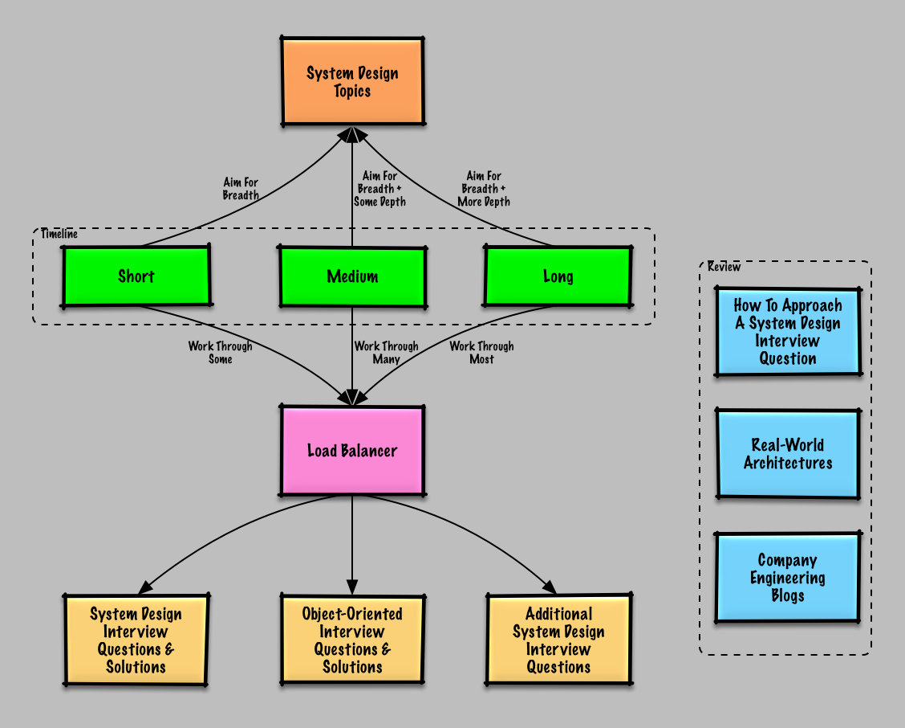

**Вопрос: Надо ли мне знать все из этого документа для интервью?**

**Ответ: Нет, не обязательно**.

То, что вас будут спрашивать на интервью, зависит от:

* Вашего опыта - сколько времени и чем вы занимались
* Должности, на которую вы проходите собеседование
* Компании, в которую вы проходите собеседование
* Как повезёт

Ожидается, что более опытные кандидаты в общем случае знают больше о проектировании систем, а архитекторы и руководители команд знают больше, чем индивидуальные разработчики. Топовые IT компании скорее всего будут проводить один или более этапов собеседования по проектированию систем.

Начинайте широко и углубляйтесь в некоторые области. Это поможет узнать больше о различных темах по проектированию систем. Корректируйте ваш план в зависимости от того, сколько у вас есть времени, какой у вас опыт, на какую должность вы проходите собеседование и в какие компании.

* **Короткий срок** - настраивайтесь на **широту** покрытия тем. Тренируйтесь отвечать на **некоторые** вопросы.
* **Средний срок** - настраивайтесь на **широту** и **немного глубины** покрытия тем. Тренируйтесь отвечать на **многие** вопросы.
* **Длительный срок** - настраивайтесь на **широту** и **больше глубины** покрытия тем. Тренируйтесь отвечать на **большинство** вопросов.

| | Малый срок | Средний срок | Длительный срок |
|---|---|---|---|
| Смотрите [Содержание](#содержание), чтобы получить общее понимание, как работают системы | :+1: | :+1: | :+1: |
| Почитайте несколько статей из блогов компаний, в которые вы проходите собеседование - [Блоги инженерных компаний](#блоги-инженерных-компаний)  | :+1: | :+1: | :+1: |
| Изучите несколько [Архитектур действующих систем](#архитектуры-действующих-систем) | :+1: | :+1: | :+1: |
| [Как отвечать на вопросы на интервью по проектированию систем](#как-отвечать-на-вопросы-на-интервью-по-проектированию-систем) | :+1: | :+1: | :+1: |
| [Вопросы на интервью по проектированию систем с решениями](#вопросы-на-интервью-по-проектированию-систем-с-решениями) | Немного | Много | Большинство |
| [Вопросы на интервью по объектно-ориентированному программированию с решениями](#вопросы-на-интервью-по-объектно-ориентированному-программированию-с-решениями) | Немного | Много | Большинство |
| [Дополнительные вопросы на интервью по проектированию систем](#дополнительные-вопросы-на-интервью-по-проектированию-систем) | Немного | Много | Большинство |

## Как отвечать на вопросы на интервью по проектированию систем

Это интервью является **открытой беседой**. Ожидается, что вы возьмете инициативу по его ведению на себя.

Изучите раздел [Вопросов на интервью по проектированию систем с решениями](#вопросы-на-интервью-по-проектированию-систем-с-решениями) и используйте шаги, описанные ниже.

### Шаг 1: определите сценарии использования, ограничения и допущения

Соберите требования и оцените рамки задачи. Задавайте вопросы, чтобы уточнить варианты использования и ограничения. Обсудите допущения.

* Кто будет использовать решение?
* Как его будут использовать?
* Сколько пользователей?
* Что система должна делать?
* Что система получает на вход, и что должно быть на выходе?
* Какое количество данных система должна обрабатывать?
* Сколько ожидается запросов в секунду?
* Какое соотношение количества операций чтения и записи?

### Шаг 2: Создайте высокоуровневый проект

Сделайте набросок проекта с наиболее важными компонентами:

* Выделите главные компоненты и связи между ними
* Обоснуйте ваши идеи

### Шаг 3: Спроектируйте основные компоненты

Детализируйте каждый компонент. Например, если вас попросили разработать [сервис сокращения URL](solutions/system_design/pastebin/README.md), обсудите следующие моменты:

* Генерация и хранение хэша оригинального URL
    * [MD5](solutions/system_design/pastebin/README.md) и [Base62](solutions/system_design/pastebin/README.md)
    * Коллизии хэш-функции
    * SQL или NoSQL
    * Схема базы данных
* Перевод хэшированного URL в оригинальный URL
    * Поиск в базе данных
* API и объектно-ориентированное проектирование

### Шаг 4: Увеличьте масштаб проекта

Определите узкие места и разберитесь с ними, учитывая данные ограничения. Например, для решения проблем с масштабируемостью, может ли вам понадобиться что-то из:

* Балансировщик нагрузки
* Горизонтальное масштабирование
* Кэширование
* Шардинг (sharding) базы данных

Обсудите потенциальные варианты и компромиссы. Разберитесь с узкими местами, используя [принципы проектирования масштабируемых систем](#содержание).

### Вычисления "на салфетке"

Вас могут попросить сделать оценку решения по некоторым параметрам. Разделы [Приложения](#приложение) могут с этим помочь:

* [Use back of the envelope calculations](http://highscalability.com/blog/2011/1/26/google-pro-tip-use-back-of-the-envelope-calculations-to-choo.html)
* [Таблица степеней двойки](#таблица-степеней-двойки)
* [Время выполнения задач, которые должен знать каждый программист](#время-выполнения-задач-которые-должен-знать-каждый-программист)

### Источники и другие ссылки

Посмотрите следующие ссылки, чтобы лучше понимать, что можно ожидать (внешние ссылки без перевода):

* [How to ace a systems design interview](https://web.archive.org/web/20210505130322/https://www.palantir.com/2011/10/how-to-rock-a-systems-design-interview/)
* [The system design interview](http://www.hiredintech.com/system-design)
* [Intro to Architecture and Systems Design Interviews](https://www.youtube.com/watch?v=ZgdS0EUmn70)
* [System design template](https://leetcode.com/discuss/career/229177/My-System-Design-Template)

## Вопросы на интервью по проектированию систем с решениями

> Распространенные задачи с обсуждением, кодом и диаграммами.
>
> Решения находятся в папке `solutions/`.

| Задача на проектирование | |
|---|---|
| Pastebin.com (или Bit.ly) | [Решение](solutions/system_design/pastebin/README.md) |
| Лента и поиск в Twitter (или Facebook) | [Решение](solutions/system_design/twitter/README.md) |
| Веб-сканер | [Решение](solutions/system_design/web_crawler/README.md) |
| Система управления личными финансами Mint.com | [Решение](solutions/system_design/mint/README.md) |
| Структура данных для социальной сети | [Решение](solutions/system_design/social_graph/README.md) |
| Хранилище типа ключ-значение для поисковика | [Решение](solutions/system_design/query_cache/README.md) |
| Рейтинг продаж по категориям в Amazon | [Решение](solutions/system_design/sales_rank/README.md) |
| Система, которая масштабируется до миллиона пользователей на AWS | [Решение](solutions/system_design/scaling_aws/README.md) |
| Добавьте задачу | [Добавить](#содействуйте) |

### Спроектируйте Pastebin.com (или Bit.ly)

[Требования и решение](solutions/system_design/pastebin/README.md)

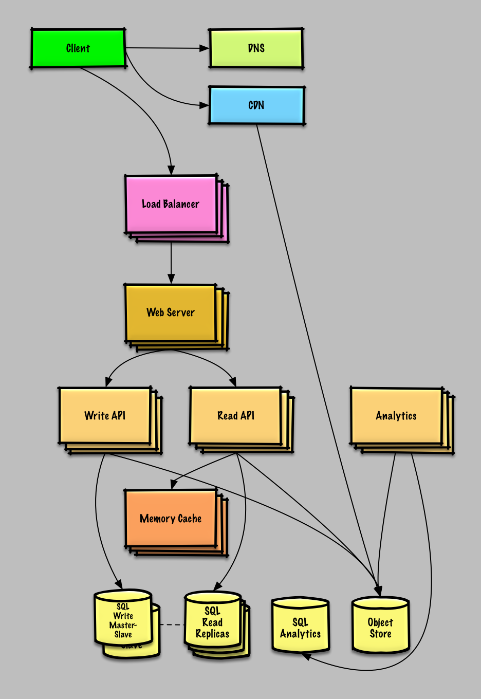

### Спроектируйте ленту Twitter или Facebook и поиск

[Требования и решение](solutions/system_design/twitter/README.md)


### Спроектируйте веб-сканер

[Требования и решение](solutions/system_design/web_crawler/README.md)

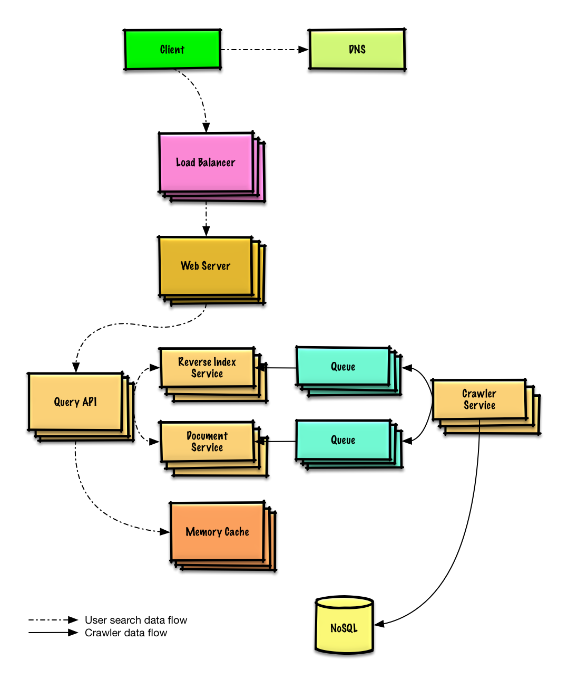

### Спроектируйте Mint.com

[Требования и решение](solutions/system_design/mint/README.md)

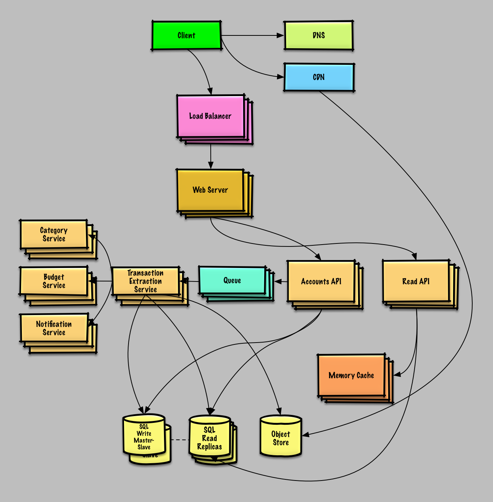

### Спроектируйте структуру данных для социальной сети

[Требования и решение](solutions/system_design/social_graph/README.md)

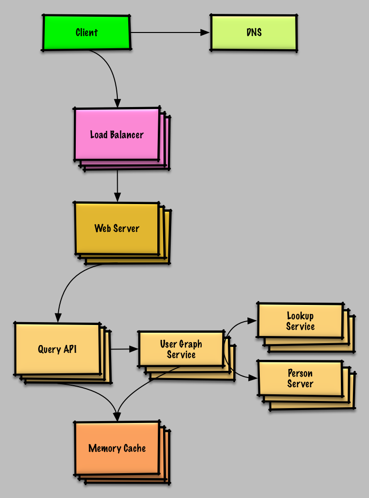

### Спроектируйте хранилище типа "ключ-значение" для поисковика

[Требования и решение](solutions/system_design/query_cache/README.md)

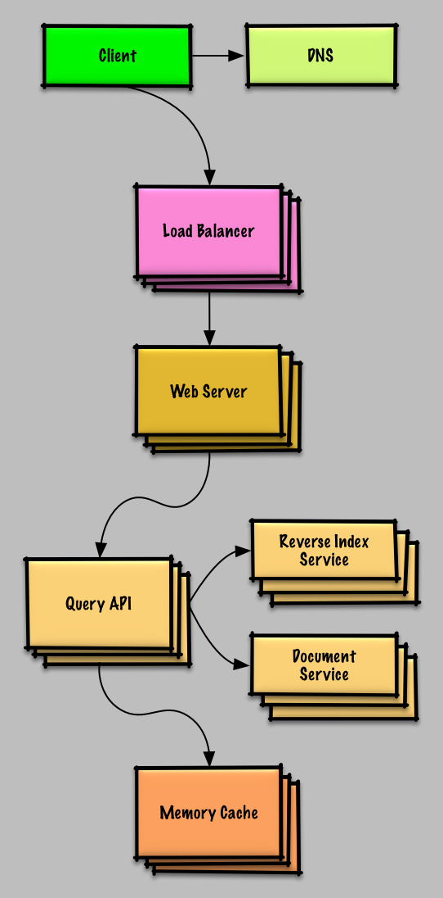

### Спроектируйте ранжирование товаров Amazon по категориям

[Требования и решение](solutions/system_design/sales_rank/README.md)

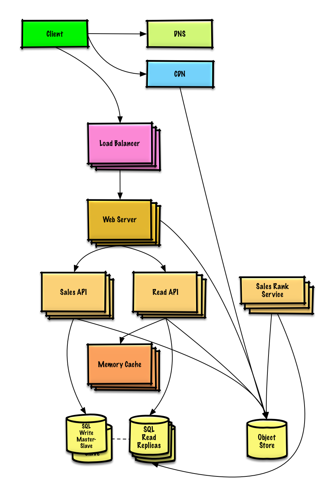

### Спроектируйте систему, которая масштабируется на миллионы пользователей с помощью AWS

[Требования и решение](solutions/system_design/scaling_aws/README.md)


## Вопросы на интервью по объектно-ориентированному программированию с решениями

> Распространенные задачи с обсуждением, кодом и диаграммами.
>
> Решения находятся в папке `solutions/`.

>**Внимание, этот раздел находится в стадии разработки**

| Задачи на проектирование | |
|---|---|
| Хэш таблица | [Решение](solutions/object_oriented_design/hash_table/hash_map.ipynb)  |
| Кэширование с вытеснением давно неиспользуемых (Least recently used - LRU) | [Решение](solutions/object_oriented_design/lru_cache/lru_cache.ipynb)  |
| Центр обработки звонков | [Решение](solutions/object_oriented_design/call_center/call_center.ipynb)  |
| Набор карт | [Решение](solutions/object_oriented_design/deck_of_cards/deck_of_cards.ipynb)  |
| Парковка | [Решение](solutions/object_oriented_design/parking_lot/parking_lot.ipynb)  |
| Чат сервер | [Решение](solutions/object_oriented_design/online_chat/online_chat.ipynb)  |
| Циклический массив | [Добавить](#содействуйте)  |
| Добавьте задачу | [Добавить](#содействуйте) |

## Темы по проектированию систем: начало

Только начинаете изучать проектирование систем?

Для начала вам понадобится понимание базовых принципов, как они используются, их преимущества и недостатки.

### Шаг 1: Посмотрите видео-лекцию по масштабированию

[Лекция по масштабированию в Гарварде](https://www.youtube.com/watch?v=-W9F__D3oY4)

* Темы:
  * Вертикальное масштабирование
  * Горизонтальное масштабирование
  * Кэширование
  * Балансировка нагрузки
  * Репликация баз данных
  * Партицирование баз данных

### Шаг 2: Прочитайте статьи по масштабированию

[Scalability](https://web.archive.org/web/20221030091841/http://www.lecloud.net/tagged/scalability/chrono)

* Темы:
    * [Clones](https://web.archive.org/web/20220530193911/https://www.lecloud.net/post/7295452622/scalability-for-dummies-part-1-clones)
    * [Databases](https://web.archive.org/web/20220602114024/https://www.lecloud.net/post/7994751381/scalability-for-dummies-part-2-database)
    * [Caches](https://web.archive.org/web/20230126233752/https://www.lecloud.net/post/9246290032/scalability-for-dummies-part-3-cache)
    * [Asynchronism](https://web.archive.org/web/20220926171507/https://www.lecloud.net/post/9699762917/scalability-for-dummies-part-4-asynchronism)

### Следующие шаги

Далее рассмотрим компромиссы в общем виде:

* **Производительность** и **масштабирование**
* **Задержка** и **пропускная способность**
* **Доступность** и **согласованность данных**

Помните, что **везде необходимы компромиссы**.

Далее рассмотрим более детально DNS, CDN, балансировщики нагрузки и другие темы.

## Производительность и масштабируемость

Сервис считается **масштабируемым**, если его **производительность** растет пропорционально добавленным ресурсам. Обычно под увеличением производительности подразумевают увеличение количества обрабатываемых единиц работы. Однако это может быть и обработка более крупных единиц работы, как, например, при росте объема данных.<sup><a href=http://www.allthingsdistributed.com/2006/03/a_word_on_scalability.html>1</a></sup>

Иначе говоря:

* если у вас проблемы с **производительностью**, ваша система медленная для одного пользователя;
* если у вас проблемы с **масштабируемостью**, ваша система быстрая для одного пользователя, но становится медленной под большой нагрузкой.

### Источники и дополнительные ссылки

* [A word on scalability](http://www.allthingsdistributed.com/2006/03/a_word_on_scalability.html)
* [Scalability, availability, stability, patterns](http://www.slideshare.net/jboner/scalability-availability-stability-patterns/)

## Задержка и пропускная способность

**Задержка** - это время, необходимое для выполнения действия или достижения некоторого результата.

**Пропускная способность** - это количество таких действий или результатов в единицу времени.

Обычно следует стремиться к **максимальной пропускной способности**, при этом сохраняя **задержку приемлемой**.

### Источники и дополнительные ссылки

* [Understanding latency vs throughput](https://community.cadence.com/cadence_blogs_8/b/fv/posts/understanding-latency-vs-throughput)

## Доступность и согласованность данных

### Теорема CAP

<p align="center">
  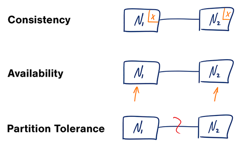
  <br/>
  <i><a href="https://robertgreiner.com/cap-theorem-revisited">Источник: CAP theorem revisited</a></i>
  <br/>
  <i><a href=https://ru.wikipedia.org/wiki/%D0%A2%D0%B5%D0%BE%D1%80%D0%B5%D0%BC%D0%B0_CAP>Дополнительный источник: Wikipedia</a></i>
</p>

В распределённых системах можно обеспечить только два из трех свойств, указанных ниже:

* **Согласованность данных (Consistency)** - каждый запрос на чтение возвращает самые актуальные данные либо ошибку.
* **Доступность (Availability)** - любой запрос возвращает результат, но без гарантии, что он содержит самую актуальную версию данных.
* **Устойчивость к разделению (Partition Tolerance)** - система продолжает работать, несмотря на произвольное разделение узлов системы из-за проблем с сетью.

*Сетевые соединения ненадежны, поэтому поддерживать **устойчивость к разделению** необходимо. Выбор придется делать между **согласованностью данных** и **доступностью**.*

#### CP - Согласованность данных и Устойчивость к разделению

При таком подходе ожидание ответа от узла может привести к ошибке - истечению времени ожидания (timeout error). CP решение хорошо подходит для систем, где необходима атомарность операций чтения и записи.

#### AP - Доступность и Устойчивость к разделению

При таком решении запросы возвращают готовую версию данных, доступную на каком-либо узле распределённой системы на данный момент, хотя она может быть не самой актуальной. Операция записи может занять некоторое время, если придется ожидать восстановления потерянного соединения с одним из узлов.

AP решение подходит для систем, где система должна продолжать работать несмотря на внешние ошибки и допустима [Согласованность в конечном счете](#согласованность-в-конечном-счете).

### Источники и дополнительные ссылки

* [CAP theorem revisited](https://robertgreiner.com/cap-theorem-revisited/)
* [A plain english introduction to CAP theorem](http://ksat.me/a-plain-english-introduction-to-cap-theorem)
* [CAP FAQ](https://github.com/henryr/cap-faq)
* [The CAP theorem](https://www.youtube.com/watch?v=k-Yaq8AHlFA)

## Шаблоны реализации согласованности

В распределённой системе может существовать несколько копий одних и тех же данных. Для достижения согласованности данных, получаемых клиентским приложением, существует несколько подходов синхронизации этих копий. Вспомните определение согласованности из [Теоремы CAP](#теорема-cap) - каждая операция чтения возвращает либо самую последнюю записанную версию, либо ошибку.

### Слабая согласованность

После операции записи данных операция чтения необязательно вернёт эти данные. Используется подход «по мере возможности» (best effort).

Этот подход используется в таких системах, как memcached. Слабая согласованность применяется в таких системах как VoIP, видео чаты и многопользовательские игры реального времени. Например, если вы на звонке и на несколько секунд пропала связь, после восстановления связи вы не услышите, что говорили, пока связь отсутствовала.

### Согласованность в конечном счете

После операции записи данных операция чтения в конечном счете увидит эти данные (обычно в течение нескольких миллисекунд). Данные в таком случае реплицируются асинхронно.

Такой подход используется в таких системах, как DNS и электронная почта. Согласованность в конечном счете хорошо подходит для систем с высокой доступностью.

### Сильная согласованность

После операции записи данных операция чтения увидит эти данные. Данные реплицируются синхронно.

Такой подход используется в файловых системах и реляционных БД. Сильная согласованность хорошо подходит для систем, где требуются транзакции.

### Источники и дополнительные ссылки

* [Transactions across data centers](http://snarfed.org/transactions_across_datacenters_io.html)

## Шаблоны доступности

Для обеспечения высокой доступности существует два паттерна: **отказоустойчивость** и **репликация**.

### Отказоустойчивость

#### Активный-пассивный

В таком режиме активный и пассивный сервер, находящийся в режиме ожидания, обмениваются специальными сообщениями - heartbeats. Если такое сообщение не приходит, то пассивный сервер получает IP адрес активного сервера и восстанавливает работу сервера.

Время простоя определяется состоянием, в котором находится пассивный сервер:

* горячее (hot) ожидание - сервер уже работает
* холодное (cold) ожидание - сервер должен быть запущен.

Только активный сервер может обрабатывать клиентские запросы.

#### Активный-активный

В таком режиме оба сервера обрабатывают клиентские запросы, распределяя нагрузку между собой.

Если серверы доступны извне, то публичные IP адреса обоих серверов должны быть зарегистрированы в DNS. Если серверы находятся во внутренней сети, то клиентское приложение должно знать про оба сервера.

Режим "активный-активный" также известен как "Master-Master".

### Недостатки отказоустойчивости

* Отказоустойчивость делает систему более сложной и требует большего количества аппаратного обеспечения.
* Существует вероятность потери данных, если данные не успели реплицироваться во время переключения активного и пассивного серверов.

### Репликация

#### Master-Slave и Master-Master

Эта тема обсуждается далее в разделе [Базы данных](#базы-данных):

* [Репликация Master-Slave](#репликация-master-slave)
* [Репликация Master-Master](#репликация-master-master)

### Доступность в цифрах

Доступность обычно измеряется как соотношение времени, когда система доступна ко всему промежутку времени измерения. Обычно это количество девяток. Говорят, что сервис с доступностью 99.99% имеет доступность в четыре девятки.

#### Доступность 99.9% - 3 девятки

| Длительность           | Допустимое время простоя |
|------------------------|--------------------------|
| Время простоя в год    | 8ч 45мин 57сек           |
| Время простоя в месяц  | 43мин 49.7сек            |
| Время простоя в неделю | 10мин 4.8сек             |
| Время простоя в день   | 1мин 26.4сек             |

#### Доступность 99.99% - четыре девятки

| Длительность           | Допустимое время простоя |
|------------------------|--------------------------|
| Время простоя в год    | 52мин 35.7сек            |
| Время простоя в месяц  | 4мин 23сек               |
| Время простоя в неделю | 1мин 5сек                |
| Время простоя в день   | 8.6сек                   |

#### Параллельная и последовательная доступность

Если сервис состоит из нескольких компонентов, которые могут отказать в обслуживании, доступность сервиса зависит от того, как связаны эти компоненты - последовательно или параллельно.

###### Последовательная доступность

Общая доступность уменьшается, если два компонента (например, Foo и Bar) с доступностью менее 100% связаны последовательно:

```
Доступность (Общая) = Доступность (Foo) * Доступность (Bar)
```

###### Параллельная доступность

Общая доступность увеличивается, если два компонента с доступностью менее 100% связаны параллельно:

```
Доступность (Общая) = 1 - (1 - Доступность (Foo)) * (1 - Доступность (Bar))
```

Если `Foo` и `Bar` имеют доступность 99.9%, их общая доступность при параллельной связи будет 99.9999%.

## Система доменных имен

<p align="center">
  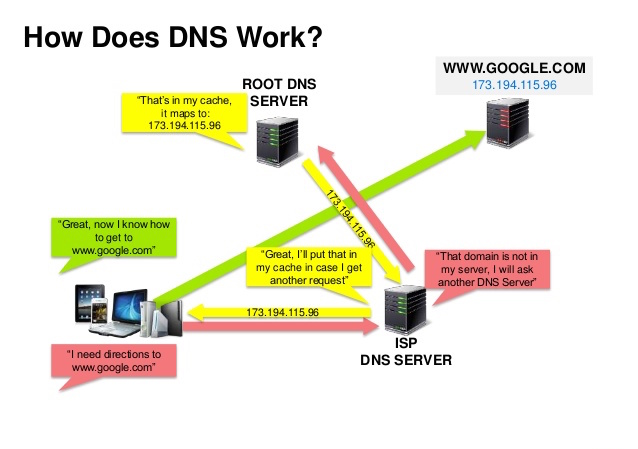
  <br/>
  <i><a href=http://www.slideshare.net/srikrupa5/dns-security-presentation-issa>Источник: DNS security presentation</a></i>
</p>

Система доменных имен (DNS) преобразует доменное имя (например, www.example.com) в IP адрес.

DNS иерархична и имеет несколько корневых серверов. Информация о том, какой DNS сервер надо использовать, предоставляется вашим маршрутизатором или интернет-провайдером. Нижестоящие DNS сервера кэшируют таблицы соответствия хостов и IP адресов, которые могут устаревать из-за задержки обновления. Результаты преобразования могут быть закэшированы браузером или операционной системой на определенное [Время жизни (Time to live - TTL)](https://ru.wikipedia.org/wiki/Time_to_live)

Типы записей:

* **Запись NS (name server)** - указывает DNS сервер для вашего домена/поддомена.
* **Запись MX (mail exchange)** - указывает сервера электронной почты для получения сообщений.
* **Запись A (address)** - связывает имя с IP адресом.
* **CNAME (canonical)** - связывает имя с другим именем, записью CNAME (example.com в www.example.com) или записью А.

Такие сервисы, как [CloudFlare](https://www.cloudflare.com/dns/) и [Route 53](https://aws.amazon.com/ru/route53/) предоставляют полностью управляемые DNS сервисы. Некоторые DNS сервисы могут направлять трафик, используя различные методы:

* взвешенный циклический ([Weighted round robin](https://www.jscape.com/blog/load-balancing-algorithms)):
  * предотвращает попадание трафика на серверы, находящиеся на обслуживании
  * балансирует трафик для кластера, размер которого может меняться
  * может использоваться для A/B тестирования
* [на основе задержки отклика серверов](https://docs.aws.amazon.com/Route53/latest/DeveloperGuide/routing-policy-latency.html)
* [на основе гео-распределения серверов](https://docs.aws.amazon.com/Route53/latest/DeveloperGuide/routing-policy-geo.html)

### Недостатки DNS

* Запрос на DNS сервер занимает некоторое время, которое может быть сокращено с помощью кэширования, описанного выше.
* Управление DNS серверами может быть трудоёмким, поэтому обычно они управляются [правительствами государств, интернет-провайдерами и большими компаниями](http://superuser.com/questions/472695/who-controls-the-dns-servers/472729)
* DNS серверы могут подвергаться [DDoS-атакам](http://dyn.com/blog/dyn-analysis-summary-of-friday-october-21-attack/), в результате пользователи не могут получить доступ к сервисам, например Twitter, не зная его IP адреса(-ов).

### Источники и дополнительные ссылки

* [DNS architecture](https://technet.microsoft.com/en-us/library/dd197427(v=ws.10).aspx)
* [Wikipedia (ru)](https://ru.wikipedia.org/wiki/DNS)
* [DNS articles](https://support.dnsimple.com/categories/dns/)

## Сеть доставки содержимого (CDN)

<p align="center">
  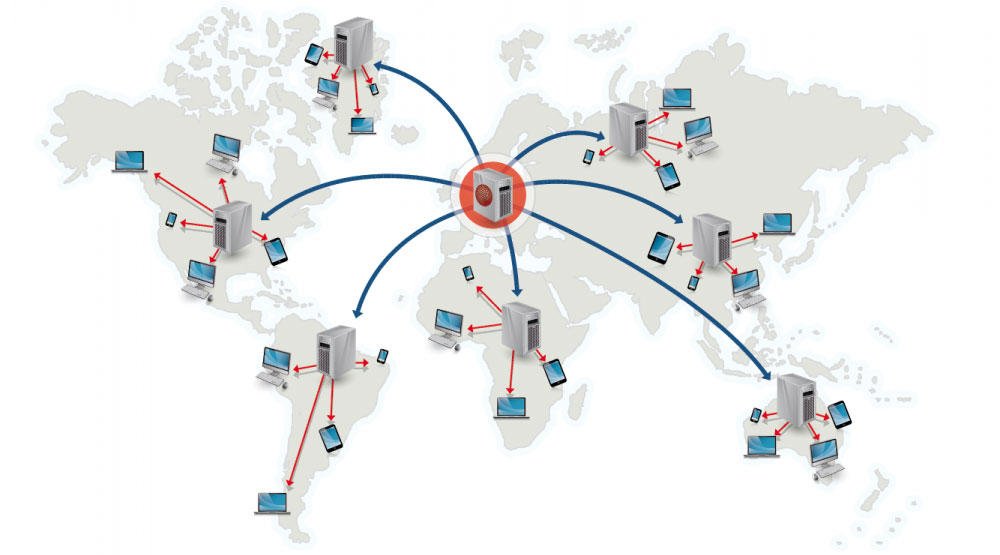
  <br/>
  <i><a href=https://www.creative-artworks.eu/why-use-a-content-delivery-network-cdn/>Источник: Why use a CDN</a></i>
</p>

Сеть доставки содержимого (Content Delivery Network, CDN) - это глобальная распределённая сеть прокси-серверов, которая доставляет содержимое с серверов, наиболее близко находящихся к пользователю. Обычно в CDN размещаются статические файлы, такие как HTML/CSS/JS, фотографии и видео. Некоторые сервисы, например Amazon CloudFront, поддерживают доставку динамического содержимого. Ответ на DNS запрос к сайту сообщает клиенту, к какому CDN серверу обращаться.

Раздача содержимого из CDN может значительно улучшить производительность по двум причинам:

* Пользователи будут получать содержимое из дата-центров, которые находятся ближе к ним
* Вашим серверам не придется обрабатывать запросы, которые может обработать CDN

### Push CDN

Содержимое Push CDN обновляется тогда, когда оно обновляется на сервере. Разработчик сайта загружает содержимое на CDN и обновляет соответствующие URL адреса, чтобы они указывали на CDN. Далее можно сконфигурировать время жизни содержимого в CDN и когда оно должно быть обновлено. Загружается только новое или обновленное содержимое, что минимизирует трафик, но увеличивает объем хранящихся данных в CDN.

С таким типом CDN хорошо работают сайты с небольшим трафиком, либо сайты с содержимым, которое редко обновляется. Содержимое размещается в CDN один раз, вместо того, чтобы регулярно обновляться.

### Pull CDN

Pull CDN загружает новое содержимое при первом обращении пользователя. Разработчик сайта оставляет содержимое на своем сервере, но обновляет адреса, чтобы они указывали на CDN. В результате первые запросы обрабатываются медленнее, пока содержимое не будет закэшировано в CDN.

[Время жизни (Time to live - TTL)](https://ru.wikipedia.org/wiki/Time_to_live) определяет, как долго содержимое будет закэшировано. Pull CDN минимизирует объем хранящихся данных в CDN, но может привести к дополнительному трафику, если время жизни в CDN истекло, а файл на сервере изменен не был.

Pull CDN подходит для загруженных сайтов. Трафик в таком случае распределяется более равномерно и в результате в CDN хранится только то содержимое, к которому обращались недавно.

### Недостатки CDN

* Стоимость CDN может быть высока и зависит от объема трафика, но стоит иметь в виду и дополнительные расходы, которые будут, если CDN не использовать.
* Содержимое в CDN может оказаться устаревшим, если оно будет обновлено до того, как истечет время жизни (TTL).
* Исходные URL ссылки должны быть изменены и указывать на CDN.

### Источники и дополнительные ссылки

* [Globally distributed content delivery](https://figshare.com/articles/Globally_distributed_content_delivery/6605972)
* [The differences between push and pull CDNs](https://www.geeksforgeeks.org/system-design/pull-cdn-vs-push-cdn/)
* [Wikipedia (ru)](https://ru.wikipedia.org/wiki/Content_Delivery_Network)

## Балансировщик нагрузки

<p align="center">
  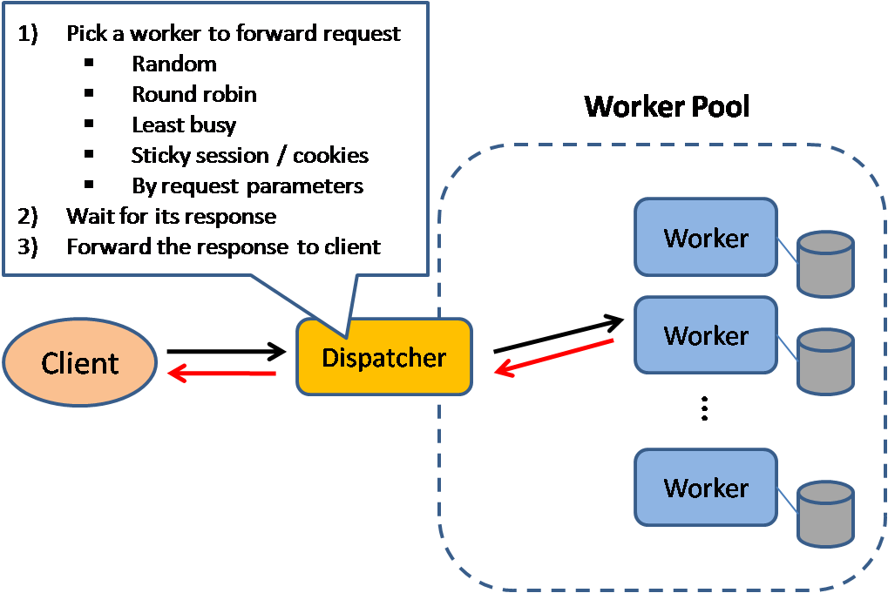
  <br/>
  <i><a href=http://horicky.blogspot.com/2010/10/scalable-system-design-patterns.html>Источник: Scalable system design patterns</a></i>
</p>

Балансировщик нагрузки распределяет входящие клиентские запросы между серверами приложений или баз данных, возвращая ответ от конкретного сервера клиенту, от которого пришел запрос. Балансировщики нагрузки используются для:

* предотвращения запроса на неработающий сервер
* предотвращения чрезмерной нагрузки на ресурсы
* избежания единой точки отказа

Балансировщики нагрузки могут быть аппаратными (дорогой вариант) или программными (например, HAProxy).

Дополнительные плюсы:

* **SSL-терминация** - расшифровка входящих запросов и шифровка ответов; в таком случае бэкенд-сервера не тратят свои ресурсы на эти потенциально трудоемкие операции
  * нет необходимости устанавливать [X.509 сертификаты](https://ru.wikipedia.org/wiki/X.509)
* **Сохранение сессии** - выдает куки и перенаправляет клиентский запрос на тот же сервер в случае, если сами веб-приложения не хранят сессии.

Для защиты от сбоев можно использовать вместе несколько балансировщиков в режимах [Активный-Пассивный](#активный-пассивный) или [Активный-Активный](#активный-активный).

Балансировщики могут направлять трафик, опираясь на различные метрики, включая:

* случайно
* наименее загруженный сервер
* сессия/куки
* взвешенный циклический ([Weighted round robin](https://www.g33kinfo.com/info/round-robin-vs-weighted-round-robin-lb))
* [Layer 4](#layer-4-балансировка)
* [Layer 7](#layer-7-балансировка)

### Layer 4 балансировка

Для распределения запросов балансировщики 4-го уровня используют [Транспортный уровень](#взаимодействие) модели OSI. Обычно используются IP адрес и порт источника и получателя из заголовков пакетов, но не из их содержимого. Балансировщики этого уровня перенаправляют сетевые пакеты к серверам и обратно, используя [Network Address Translation (NAT)](https://web.archive.org/web/20240117134735/https://www.nginx.com/resources/glossary/layer-4-load-balancing/).

### Layer 7 балансировка

Для распределения запросов балансировщики 7-го уровня используют [Прикладной уровень](#взаимодействие) модели OSI. Для этого могут быть задействованы заголовок, сообщение и куки. Балансировщики на этом уровне прерывают сетевой трафик, сканируют сообщение, принимают решение, куда отправить запрос, и открывают соединение с выбранным сервером. Например, они могут отправить запрос видео на видеосервер, а запрос, связанный с оплатой, - на серверы с усиленной безопасностью.

Балансировка на 4-м уровне быстрее и требует меньше ресурсов, чем на 7-м уровне, но имеет меньшую гибкость. Хотя на современном аппаратном обеспечении эта разница может быть незаметна.

### Горизонтальное масштабирование

Балансировщики нагрузки могут быть использованы для горизонтального масштабирования, улучшая производительность и доступность. "Масштабирование вширь", используя стандартные сервера, дешевле и приводит к более высокой доступности, чем "масштабирование вверх" одного сервера с более дорогим аппаратным обеспечением (**Вертикальное масштабирование**). Также проще найти специалиста, который умеет работать со стандартным аппаратным обеспечением, чем со специализированными Enterprise-системами.

#### Недостатки горизонтального масштабирования

* Горизонтальное масштабирование увеличивает сложность системы и предполагает клонирование серверов:
  * Сервера не должны хранить состояние, например сессию или изображение пользователя
  * Сессии должны храниться в централизованном хранилище, например в [Базе данных](#базы-данных) (SQL, NoSQL) или в [Кэше](#кэширование) (Redis, Memcached)
* С увеличением количества серверов принимающие сервера на следующем уровне должны обрабатывать больше одновременных запросов

### Недостатки балансировщика

* Балансировщик нагрузки может стать узким местом в производительности системы, если он неправильно настроен или его аппаратное обеспечение слишком слабое.
* Балансировщик нагрузки позволяет избежать единой точки отказа, но увеличивает совокупную сложность всей системы.
* Единственный балансировщик становится единой точкой отказа, использование нескольких балансировщиков еще больше усложняет систему.

### Источники и дополнительные ссылки

* [NGINX architecture](https://www.nginx.com/blog/inside-nginx-how-we-designed-for-performance-scale/)
* [HAProxy architecture guide](http://www.haproxy.org/download/1.2/doc/architecture.txt)
* [Scalability](https://web.archive.org/web/20220530193911/https://www.lecloud.net/post/7295452622/scalability-for-dummies-part-1-clones)
* [Wikipedia](https://en.wikipedia.org/wiki/Load_balancing_(computing))
* [Layer 4 load balancing](https://www.nginx.com/resources/glossary/layer-4-load-balancing/)
* [Layer 7 load balancing](https://www.nginx.com/resources/glossary/layer-7-load-balancing/)
* [ELB listener config](http://docs.aws.amazon.com/elasticloadbalancing/latest/classic/elb-listener-config.html)

## Обратный прокси-сервер (Reverse proxy)

<p align="center">
  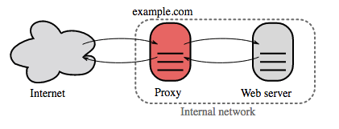
  <br/>
  <i><a href=https://upload.wikimedia.org/wikipedia/commons/6/67/Reverse_proxy_h2g2bob.svg>Источник: Wikipedia</a></i>
  <br/>
</p>

Обратный прокси-сервер - это веб-сервер, который централизует внутренние сервисы и предоставляет для них унифицированный интерфейс для доступа из публичной сети. Клиентские запросы перенаправляются на сервер, который их будет обрабатывать, и затем обратный прокси возвращает ответ клиенту.

Дополнительные преимущества:

* **Повышенная безопасность** - скрывает информацию о бэкенд-серверах, блокирует IP адреса, ограничивает допустимое количество соединений на клиента
* **Повышенная масштабируемость и гибкость** - клиентское приложение знает только IP адрес прокси-сервера, таким образом можно менять количество серверов или изменять их конфигурацию
* **SSL терминация** - расшифровка входящих запросов и шифровка ответов; в таком случае бэкенд-серверы не тратят свои ресурсы на эти потенциально трудоемкие операции
  * нет необходимости устанавливать [X.509 сертификаты](https://ru.wikipedia.org/wiki/X.509)
* **Сжатие** - сжатие ответов сервера клиенту
* **Кэширование** - возвращает ответы для закэшированных запросов
* **Статическое содержимое** - предоставляет статическое содержимое напрямую:
  * HTML/CSS/JS
  * Фотографии
  * Видео
  * и т.д.

### Сравнение балансировщика нагрузки и обратного прокси-сервера

* Использование балансировщика нагрузки полезно при наличии нескольких серверов. Часто балансировщики направляют трафик на сервера, выполняющие одинаковую функцию.
* Обратный прокси-сервер может быть полезен даже при использовании одного веб-сервера или сервера приложений, предоставляет преимущества, описанные в предыдущей секции
* Такие решения, как NGINX и HAProxy могут поддерживать как обратный прокси-сервер 7-го уровня, так и балансировку нагрузки

### Недостатки обратного прокси-сервера

* Использование обратного прокси-сервера увеличивает сложность системы в целом
* Использование одного прокси-сервера создает единую точку отказа. Настройка нескольких обратных прокси-серверов ([Аварийное переключение](https://ru.wikipedia.org/wiki/%D0%90%D0%B2%D0%B0%D1%80%D0%B8%D0%B9%D0%BD%D0%BE%D0%B5_%D0%BF%D0%B5%D1%80%D0%B5%D0%BA%D0%BB%D1%8E%D1%87%D0%B5%D0%BD%D0%B8%D0%B5)) еще больше усложняет систему.

### Источники и дополнительные ссылки

* [Reverse proxy vs load balancer](https://www.nginx.com/resources/glossary/reverse-proxy-vs-load-balancer/)
* [NGINX architecture](https://www.nginx.com/blog/inside-nginx-how-we-designed-for-performance-scale/)
* [HAProxy architecture guide](http://www.haproxy.org/download/1.2/doc/architecture.txt)
* [Wikipedia (ru)](https://ru.wikipedia.org/wiki/%D0%9E%D0%B1%D1%80%D0%B0%D1%82%D0%BD%D1%8B%D0%B9_%D0%BF%D1%80%D0%BE%D0%BA%D1%81%D0%B8)

## Уровень приложений

<p align="center">
  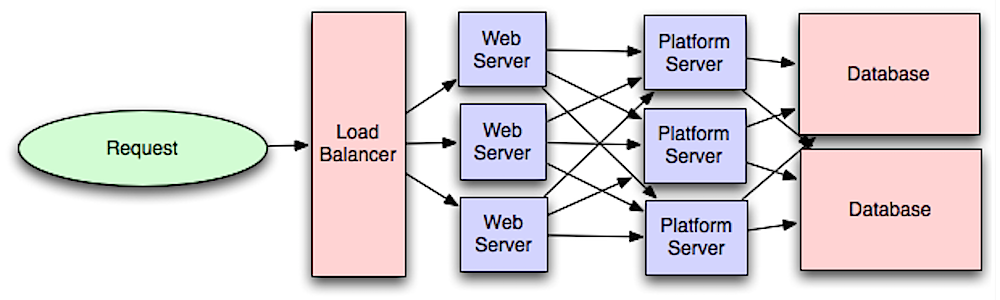
  <br/>
  <i><a href=http://lethain.com/introduction-to-architecting-systems-for-scale/#platform_layer>Источник: Intro to architecting systems for scale</a></i>
</p>

Разделение веб-уровня и уровня приложения (также известного как уровень платформы) позволяет масштабировать и настраивать оба уровня независимо. Для добавления нового API может понадобиться добавление нового сервера на уровне приложения, но необязательно на веб-уровне. **Принцип единственной ответственности** подразумевает создание небольших и автономных сервисов, которые работают вместе. Небольшие команды с небольшими сервисами могут быстрее расти.

Worker-сервера на уровне приложений позволяют поддерживать [Асинхронность](#асинхронность).

### Микросервисы

[Микросервисная архитектура](https://ru.wikipedia.org/wiki/%D0%9C%D0%B8%D0%BA%D1%80%D0%BE%D1%81%D0%B5%D1%80%D0%B2%D0%B8%D1%81%D0%BD%D0%B0%D1%8F_%D0%B0%D1%80%D1%85%D0%B8%D1%82%D0%B5%D0%BA%D1%82%D1%83%D1%80%D0%B0) может быть описана как набор независимо развёртываемых, небольших, модульных сервисов. Каждый сервис работает как независимый процесс и взаимодействует на основе предустановленного легковесного протокола для обслуживания бизнес задачи. <sup><a href=https://smartbear.com/learn/api-design/what-are-microservices>1</a></sup>

Примеры микросервисов в Pinterest: профиль пользователя, подписчик, лента, поиск, загрузка фото и т.д.

### Обнаружение сервисов (Service Discovery)

Ведя учет зарегистрированных имен, адресов и портов, такие системы, как [Consul](https://www.consul.io/docs/index.html), [Etcd](https://coreos.com/etcd/docs/latest), и [Zookeeper](http://www.slideshare.net/sauravhaloi/introduction-to-apache-zookeeper) помогают сервисам находить друг друга. Проверки состояния [Health checks](https://www.consul.io/intro/getting-started/checks.html) позволяют убедиться в работоспособности сервера с помощью [HTTP](#http-hypertext-transfer-protocol) запроса. Consul и Etcd имеют [Хранилище типа ключ-значение](#хранилище-типа-ключ-значение), которое может быть полезно для хранения конфигурации и других общих данных.

### Недостатки уровня приложений

* Добавление уровня приложений со слабо связанными сервисами требует другого подхода для архитектуры и процессов (в отличие от монолитной системы).
* Микросервисная архитектура усложняет развертывание и эксплуатацию сервисов.

### Источники и дополнительные ссылки

* [Intro to architecting systems for scale](http://lethain.com/introduction-to-architecting-systems-for-scale)
* [Crack the system design interview](http://www.puncsky.com/blog/2016-02-13-crack-the-system-design-interview)
* [Сервис-ориентированная архитектура](https://ru.wikipedia.org/wiki/%D0%A1%D0%B5%D1%80%D0%B2%D0%B8%D1%81-%D0%BE%D1%80%D0%B8%D0%B5%D0%BD%D1%82%D0%B8%D1%80%D0%BE%D0%B2%D0%B0%D0%BD%D0%BD%D0%B0%D1%8F_%D0%B0%D1%80%D1%85%D0%B8%D1%82%D0%B5%D0%BA%D1%82%D1%83%D1%80%D0%B0)
* [Introduction to Zookeeper](http://www.slideshare.net/sauravhaloi/introduction-to-apache-zookeeper)
* [Here's what you need to know about building microservices](https://cloudncode.wordpress.com/2016/07/22/msa-getting-started/)

## Базы данных

<p align="center">
  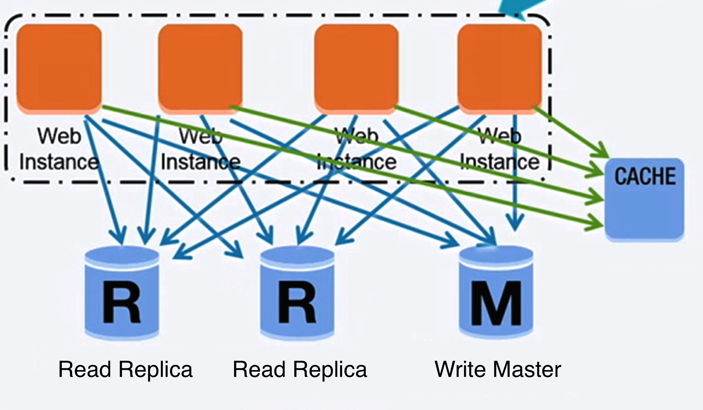
  <br/>
  <i><a href=https://www.youtube.com/watch?v=kKjm4ehYiMs>Источник: Scaling up to your first 10 million users</a></i>
</p>

### Реляционные системы управления базами данных

Реляционная база данных (Relational database management system, RDBMS, SQL) - это набор данных, организованных в виде таблиц.

**ACID** - описывает набор свойств [транзакций для реляционных баз данных](https://ru.wikipedia.org/wiki/%D0%A2%D1%80%D0%B0%D0%BD%D0%B7%D0%B0%D0%BA%D1%86%D0%B8%D1%8F_(%D0%B8%D0%BD%D1%84%D0%BE%D1%80%D0%BC%D0%B0%D1%82%D0%B8%D0%BA%D0%B0)).

* **Атомарность (Atomicity)** - каждая транзакция выполняется либо целиком, либо не выполняется совсем (откатывается)
* **Согласованность (Consistency)** - любая транзакция переводит базу данных из одного правильного состояния в другое правильное состояние, сохраняя согласованность данных
* **Изолированность (Isolation)** - параллельное выполнение транзакций должно иметь такие же результаты, как и их последовательное выполнение
* **Стойкость (Durability)** - после завершения транзакции данные должны остаться сохранёнными

Существует ряд подходов для масштабирования реляционных баз данных:

* репликация "Master-Slave"
* репликация "Master-Master"
* федерализация
* шардирование
* денормализация
* оптимизация SQL запросов

#### Репликация Master-Slave

Ведущий сервер работает на чтение и запись, реплицируя записи на один или более ведомых серверов. Ведомый сервер работает только на чтение. Ведомые сервера могут реплицировать на дополнительные ведомые сервера (как в древовидной структуре). Если ведущий сервер перестает работать, система продолжает работать в режиме только на чтение до тех пор, пока один из ведомых серверов не станет ведущим, или пока новый ведущий сервер не будет создан.

<p align="center">
  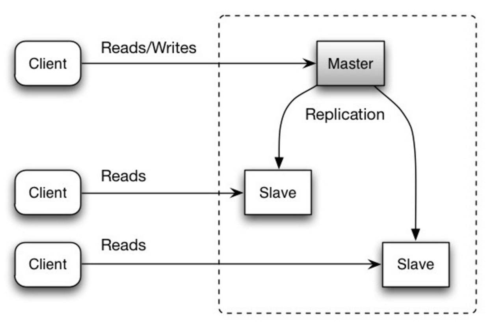
  <br/>
  <i><a href=http://www.slideshare.net/jboner/scalability-availability-stability-patterns/>Источник: Scalability, availability, stability, patterns</a></i>
</p>

##### Недостатки репликации master-slave

* Для переключения ведомого сервера в ведущий необходима дополнительная логика
* См. [Недостатки репликации](#недостатки-репликации) для особенностей, характерных для подходов "Master-Slave" и "Master-Master".

#### Репликация Master-Master

Оба ведущих сервера работают на чтение и запись и координируют операции записи между собой. Если один из ведущих серверов перестаёт работать, система может продолжать работать на чтение и запись.

<p align="center">
  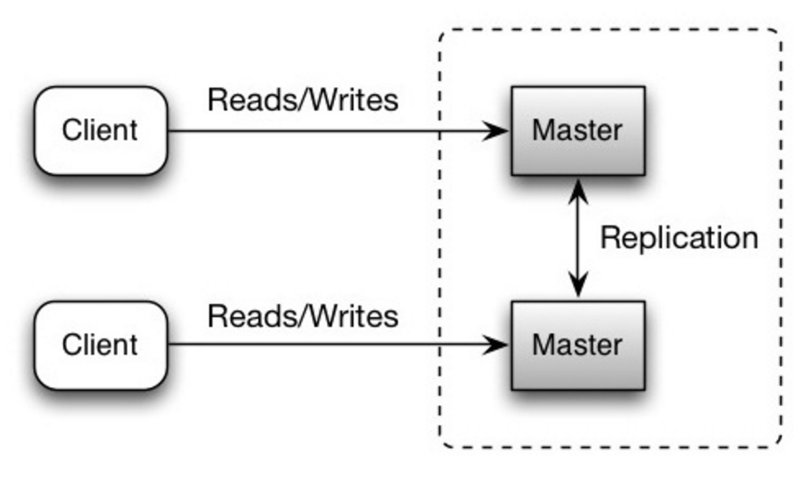
  <br/>
  <i><a href=http://www.slideshare.net/jboner/scalability-availability-stability-patterns/>Источник: Scalability, availability, stability, patterns</a></i>
</p>

##### Недостатки репликации Master-Master

* Необходим балансировщик нагрузки или понадобится изменить логику приложения, чтобы определять, куда будет идти запись.
* Большинство систем "Master-Master" либо слабо согласованы (нарушая ACID), либо имеют большую задержку из-за необходимости синхронизации.
* При возрастании количества серверов для записи данных (ведущих) возрастает задержка и возникает необходимость разрешения конфликтов.
* См. [Недостатки репликации](#недостатки-репликации) для пунктов, характерных для подходов "Master-Slave" и "Master-Master".

##### Недостатки репликации

* Существует риск потери данных, если ведущий сервер перестает работать до того, как новые данные будут реплицированы на другие сервера.
* Операции записи реплицируются на ведомые сервера. Если совершается много операций записи, ведомые сервера могут быть перегружены реплицированием этих операций, влияя на производительность операций чтения.
* С ростом количества ведомых серверов увеличивается объем репликации, что приводит к задержке репликации.
* В некоторых системах запись на ведущем сервере может делаться в несколько потоков, выполняемых параллельно. Запись на ведомых серверах происходит последовательно в один поток.
* Репликация требует большего количества аппаратного обеспечения и увеличивает общую сложность системы.

##### Источники и дополнительные ссылки

* [Scalability, availability, stability, patterns](http://www.slideshare.net/jboner/scalability-availability-stability-patterns/)
* [Multi-master replication](https://en.wikipedia.org/wiki/Multi-master_replication)

#### Федерализация

<p align="center">
  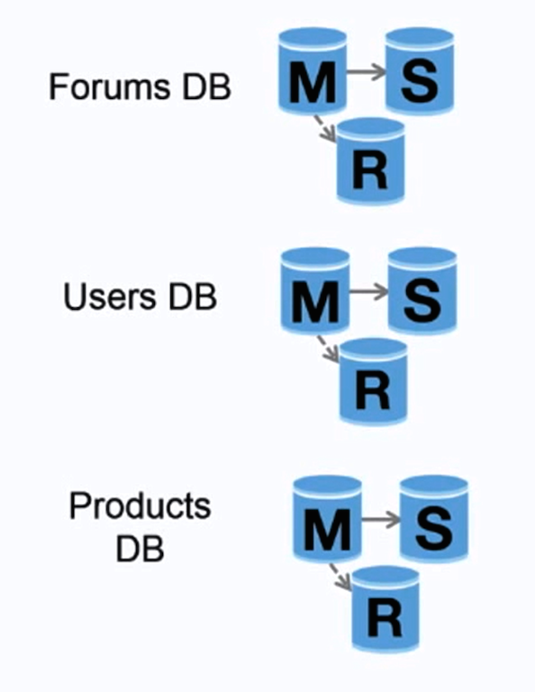
  <br/>
  <i><a href=https://www.youtube.com/watch?v=kKjm4ehYiMs>Источник: Scaling up to your first 10 million users</a></i>
</p>

Федерализация (или функциональное разделение) разбивает базы данных по функциям. Например, вместо одной монолитной базы данных можно создать три отдельных базы данных:
**форум**, **пользователи** и **товары**, что приведет к меньшему количеству операций чтения и записи в каждую базу данных и, как следствие, к сокращению задержки репликации. Меньшие базы данных позволяют хранить больше данных в памяти, что приводит к более оптимальному использованию кэширования. Из-за отсутствия единого ведущего сервера операции записи можно делать параллельно, увеличивая пропускную способность.

##### Недостатки федерализации

* Федерализация неэффективна, если схема базы данных требует больших функций или таблиц.
* Необходимо изменить логику приложения, чтобы определить, с какими базами данных работать.
* Операция соединения данных (JOIN) становится сложнее с [server link](http://stackoverflow.com/questions/5145637/querying-data-by-joining-two-tables-in-two-database-on-different-servers).
* Федерализация требует большего количества аппаратного обеспечения и увеличивает общую сложность системы.

##### Источники и дополнительные ссылки

* [Scaling up to your first 10 million users](https://www.youtube.com/watch?v=kKjm4ehYiMs)

#### Шардирование

<p align="center">
  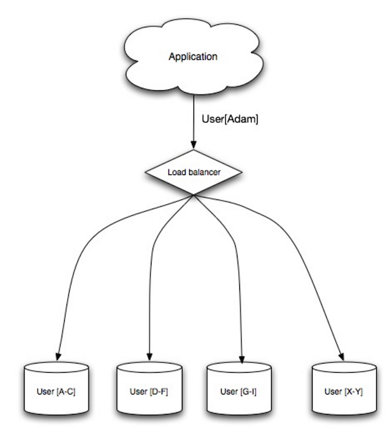
  <br/>
  <i><a href=http://www.slideshare.net/jboner/scalability-availability-stability-patterns/>Источник: Scalability, availability, stability, patterns</a></i>
</p>

Шардирование распределяет данные между разными базами данных так, что каждая база данных управляет только частью данных. Например, с увеличением количества пользователей в базу данных пользователей добавляются новые серверы (шарды).

Аналогично [Федерализации](#федерализация), шардирование уменьшает количество операций записи и чтения на каждый сервер, уменьшая репликацию и улучшая кэширование. Размер индексов также уменьшается, что приводит к улучшению производительности и более быстрым запросам. Если один из шардов выходит из строя, другие шарды продолжают работать. Во избежание потери данных можно ввести дополнительную репликацию данных. Так же как и с федерализацией, нет централизованного сервера на запись, что позволяет делать запись параллельно, увеличивая пропускную способность.

Распространённый подход шардирования таблицы пользователей основан на разделении по имени или местоположению.

##### Недостатки шардирования

* Логика приложения должна быть адаптирована к работе с шардами, что может привести к более сложным SQL запросам.
* Данные могут неравномерно распределяться среди шардов. Например, использование данных активных пользователей, находящихся на одном шарде, увеличивает нагрузку на него.
  * Балансировка усложняет систему. Функция шардирования, основанная на [consistent hashing](http://www.paperplanes.de/2011/12/9/the-magic-of-consistent-hashing.html), может уменьшить общий объем передаваемых данных.
* Соединение данных (JOIN) из нескольких шардов сложнее.
* Шардирование требует большего количества аппаратного обеспечения и увеличивает общую сложность системы.

##### Источники и дополнительные ссылки

* [The coming of the shard](http://highscalability.com/blog/2009/8/6/an-unorthodox-approach-to-database-design-the-coming-of-the.html)
* [Shard database architecture](https://en.wikipedia.org/wiki/Shard_(database_architecture))
* [Consistent hashing](http://www.paperplanes.de/2011/12/9/the-magic-of-consistent-hashing.html)

#### Денормализация

Денормализация - это попытка улучшить скорость чтения за счет производительности записи. Избыточные копии данных записываются в несколько таблиц для избежания сложных операций соединения данных. Некоторые СУБД, например [PostgreSQL](https://ru.wikipedia.org/wiki/PostgreSQL) и Oracle, поддерживают [материализованное представление](https://ru.wikipedia.org/wiki/%D0%9C%D0%B0%D1%82%D0%B5%D1%80%D0%B8%D0%B0%D0%BB%D0%B8%D0%B7%D0%BE%D0%B2%D0%B0%D0%BD%D0%BD%D0%BE%D0%B5_%D0%BF%D1%80%D0%B5%D0%B4%D1%81%D1%82%D0%B0%D0%B2%D0%BB%D0%B5%D0%BD%D0%B8%D0%B5), которое выполняет задачу хранения избыточных данных и поддержки их согласованности.

При использовании [Федерализации](#федерализация) и [Шардирования](#шардирование) данные становятся распределенными. В результате выполнение операций соединения данных, которые могут находиться в разных дата-центрах, усложняется. Денормализация может позволить избавиться от необходимости в сложных JOIN запросах.

В большинстве систем количество операций чтения значительно больше операций записи (100:1, или даже 1000:1). Операция чтения в результате сложного соединения данных может быть очень ресурсоемкой и требовать значительного времени, потраченного на операции с жестким диском.

##### Недостатки денормализации

* Данные дублируются.
* Ограничения могут помочь поддерживать избыточные копии данных в актуальном состоянии, но увеличивают сложность архитектуры базы данных
* Денормализованная база данных под большой нагрузкой может работать медленнее, чем её нормализованный аналог.

###### Источники и дополнительные ссылки

* [Денормализация](https://ru.wikipedia.org/wiki/%D0%94%D0%B5%D0%BD%D0%BE%D1%80%D0%BC%D0%B0%D0%BB%D0%B8%D0%B7%D0%B0%D1%86%D0%B8%D1%8F)

#### Оптимизация SQL запросов

Оптимизация SQL запросов - это обширная тема, описанная во многих [книгах](https://www.amazon.com/s/ref=nb_sb_noss_2?url=search-alias%3Daps&field-keywords=sql+tuning).

Очень важно проводить **бенчмарки** и **профилирование** для имитации и обнаружения узких мест.

* **Бенчмарк** - эталонный тест производительности, имитация высокой нагрузки с помощью таких средств, как [ab](http://httpd.apache.org/docs/2.2/programs/ab.html).
* **Профилирование** - отслеживание проблем производительности с помощью таких средств, как [slow query log](http://dev.mysql.com/doc/refman/5.7/en/slow-query-log.html)

Проведение бенчмарков и профилирования может указать на следующие шаги оптимизации.

##### Пересмотрите схему

* MySQL записывает данные на диск смежными блоками для быстрого доступа.
* Используйте `CHAR` вместо `VARCHAR` для полей с фиксированной длиной.
  * `CHAR` обеспечивает быстрый произвольный доступ, в случае с `VARCHAR` необходимо найти конец строки для перехода на следующую.
* Используйте `TEXT` для больших фрагментов текста (например, блог-посты). `TEXT` позволяет делать булевый поиск. Использование поля типа `TEXT` приводит к хранению указателя на диске, который используется для поиска этого блока.
* Используйте `INT` для больших чисел до 2^32.
* Используйте `DECIMAL` для денежных единиц для избежания ошибок, связанных с представлением в формате с плавающей точкой.
* Избегайте хранения больших `BLOBS`, вместо этого храните указатель на объект.
* Установите ограничения `NOT NULL`, где возможно, для улучшения производительности ([improve search performance](http://stackoverflow.com/questions/1017239/how-do-null-values-affect-performance-in-a-database-search)).

##### Используйте хорошие индексы

* Запрос столбцов (включая операторы `SELECT`, `GROUP BY`, `ORDER BY`, `JOIN`) может быть быстрее с индексами.
* Индексы обычно представляют собой самобалансирующиеся [B-деревья](https://ru.wikipedia.org/wiki/B-%D0%B4%D0%B5%D1%80%D0%B5%D0%B2%D0%BE), которые хранят данные отсортированными, позволяют делать поиск, последовательный доступ, вставку и удаление с логарифмической сложностью.
* Добавление индекса может потребовать хранения данных в памяти, требуя больше места.
* Операции записи могут быть медленнее, так как индекс тоже необходимо обновлять.
* При загрузке большого объема данных отключение индексов может ускорить эту операцию, индексы в таком случае обновляются после загрузки данных.

##### Избегайте больших объединений

* [Денормализуйте](#денормализация), если необходимо повысить производительность.

##### Разбиение таблиц

* Разбейте таблицу, поместив часто используемые данные в отдельную таблицу, для того, чтобы хранить ее в памяти.

##### Настройте кэширование запросов

* В некоторых случаях кэширование запросов ([query cache](https://dev.mysql.com/doc/refman/5.7/en/query-cache.html)) может привести к проблемам с производительностью ([performance issues](https://www.percona.com/blog/2016/10/12/mysql-5-7-performance-tuning-immediately-after-installation/)).

##### Источники и дополнительные ссылки

* [Tips for optimizing MySQL queries](http://aiddroid.com/10-tips-optimizing-mysql-queries-dont-suck/)
* [Is there a good reason i see VARCHAR(255) used so often?](http://stackoverflow.com/questions/1217466/is-there-a-good-reason-i-see-varchar255-used-so-often-as-opposed-to-another-l)
* [How do null values affect performance?](http://stackoverflow.com/questions/1017239/how-do-null-values-affect-performance-in-a-database-search)
* [Slow query log](http://dev.mysql.com/doc/refman/5.7/en/slow-query-log.html)

### NoSQL

NoSQL - это набор данных, представленных в виде **базы ключ-значение**, **документоориентированной базы данных**, **колоночной базы данных** или **графовой базы данных**. Данные денормализованы, и операции соединения данных обычно происходят на уровне кода. Большинство NoSQL хранилищ не поддерживают ACID свойства транзакций и характеризуются [согласованностью в конечном счете](https://ru.wikipedia.org/wiki/%D0%A1%D0%BE%D0%B3%D0%BB%D0%B0%D1%81%D0%BE%D0%B2%D0%B0%D0%BD%D0%BD%D0%BE%D1%81%D1%82%D1%8C_%D0%B2_%D0%BA%D0%BE%D0%BD%D0%B5%D1%87%D0%BD%D0%BE%D0%BC_%D1%81%D1%87%D1%91%D1%82%D0%B5).

Для описания свойств NoSQL баз данных используют **BASE** свойства. Согласно [Теореме CAP](#теорема-cap), BASE придерживается доступности данных, а не их согласованности.

* **В целом доступные** - система гарантирует доступность.
* **Неустойчивое состояние (soft state)** - состояние системы может со временем измениться, даже без дополнительных операций.
* **Согласованность в конечном счете (eventual consistency)** - данные в системе станут согласованными в течение некоторого времени, если в течение этого времени не будут приходить новые данные.

Вместе с выбором между [SQL или NoSQL](#sql-или-nosql) надо сделать выбор типа NoSQL базы данных, которая подходит для вашего сценария использования. В следующей секции представлены **базы ключ-значение**, **документоориентированные базы данных**, **колоночные базы данных** и **графовые базы данных**.

#### Хранилище типа ключ-значение

> Абстракция: хэш-таблица

Хранилище типа ключ-значение обычно позволяет выполнять операции чтения и записи со сложностью O(1) и использует оперативную память или SSD. Эти хранилища могут поддерживать [лексикографический порядок](https://ru.wikipedia.org/wiki/%D0%9B%D0%B5%D0%BA%D1%81%D0%B8%D0%BA%D0%BE%D0%B3%D1%80%D0%B0%D1%84%D0%B8%D1%87%D0%B5%D1%81%D0%BA%D0%B8%D0%B9_%D0%BF%D0%BE%D1%80%D1%8F%D0%B4%D0%BE%D0%BA), позволяя эффективно выполнять запросы на диапазон ключей. Базы этого типа позволяют хранить метаданные вместе с данными.

Такие хранилища имеют высокую производительность и обычно используются для простых моделей данных или для быстро изменяющихся данных, таких как кэши, находящиеся в оперативной памяти. Обычно они предоставляют ограниченный набор действий. Поэтому сложность смещается на уровень приложения в том случае, если необходимы дополнительные действия.

Хранилища типа ключ-значение являются основой для более сложных систем, таких как хранилище документов и, в некоторых случаях, графовые базы данных.

##### Источники и дополнительные ссылки

* [База данных "ключ-значение"](https://ru.wikipedia.org/wiki/%D0%91%D0%B0%D0%B7%D0%B0_%D0%B4%D0%B0%D0%BD%D0%BD%D1%8B%D1%85_%C2%AB%D0%BA%D0%BB%D1%8E%D1%87-%D0%B7%D0%BD%D0%B0%D1%87%D0%B5%D0%BD%D0%B8%D0%B5%C2%BB)
* [Disadvantages of key-value stores](http://stackoverflow.com/questions/4056093/what-are-the-disadvantages-of-using-a-key-value-table-over-nullable-columns-or)
* [Redis architecture](http://qnimate.com/overview-of-redis-architecture/)
* [Memcached architecture](https://adayinthelifeof.nl/2011/02/06/memcache-internals/)

#### Хранилище документов

> Абстракция: база данных "ключ-значение" с документами в качестве значения

Хранилище документов работает с документами (XML, JSON, бинарные и др.), где документ хранит всю информацию об объекте. Такие хранилища предоставляют API или язык для запросов по внутренней структуре самих документов. *Обратите внимание, что такая же функциональность может быть доступна и для метаданных, тем самым размывая разницу между этими двумя типами данных.*

В зависимости от реализации документы могут быть организованы по коллекциям, меткам, метаданным или директориям. Документы могут быть организованы и сгруппированы вместе, и одновременно иметь поля, которых нет в других документах.

Такие базы данных, как [MongoDB](https://www.mongodb.com/mongodb-architecture) и [CouchDB](https://blog.couchdb.org/2016/08/01/couchdb-2-0-architecture/) предоставляют SQL-подобный язык для выполнения сложных запросов. [DynamoDB](http://www.read.seas.harvard.edu/~kohler/class/cs239-w08/decandia07dynamo.pdf) работает с данными в виде "ключ-значение" и с документами.

Хранилища документов предоставляют высокую гибкость и часто используются для работы с данными, структура которых может меняться.

##### Источники и дополнительные ссылки

* [Документоориентированная СУБД](https://ru.wikipedia.org/wiki/%D0%94%D0%BE%D0%BA%D1%83%D0%BC%D0%B5%D0%BD%D1%82%D0%BE%D0%BE%D1%80%D0%B8%D0%B5%D0%BD%D1%82%D0%B8%D1%80%D0%BE%D0%B2%D0%B0%D0%BD%D0%BD%D0%B0%D1%8F_%D0%A1%D0%A3%D0%91%D0%94)
* [MongoDB architecture](https://www.mongodb.com/mongodb-architecture)
* [CouchDB architecture](https://blog.couchdb.org/2016/08/01/couchdb-2-0-architecture/)
* [Elasticsearch architecture](https://www.elastic.co/blog/found-elasticsearch-from-the-bottom-up)

#### Колоночное хранилище

<p align="center">
  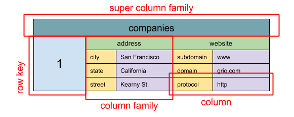
  <br/>
  <i><a href=http://blog.grio.com/2015/11/sql-nosql-a-brief-history.html>Источник: SQL & NoSQL, a brief history</a></i>
</p>

> Абстракция: вложенная ассоциативная таблица `ColumnFamily<RowKey, Columns<ColKey, Value, Timestamp>>`

Основной единицей данных в колоночных хранилищах является колонка - пара имя/значение. Колонки могут быть сгруппированы в семейства колонок (по аналогии с SQL таблицей). Следующим уровнем будет супер-семейство колонок. Значение каждой колонки можно получить по ключу строки. Все колонки с одинаковым ключом строки формируют строку. Каждое значение содержит временную метку для версионности и разрешения конфликтов.

Google представила [Bigtable](http://www.read.seas.harvard.edu/~kohler/class/cs239-w08/chang06bigtable.pdf) как первую колоночную базу данных, которая повлияла на создание [HBase](https://www.edureka.co/blog/hbase-architecture/), часто используемой в экосистеме Hadoop, и [Cassandra](http://docs.datastax.com/en/cassandra/3.0/cassandra/architecture/archIntro.html) от Facebook. BigTable, HBase, Cassandra и другие базы данных этого типа хранят ключи в лексикографическом порядке, позволяя делать эффективные запросы по диапазону ключей.

Колоночные хранилища имеют высокую доступность и масштабируемость. Часто они используются для очень больших объемов данных.

##### Источники и дополнительные ссылки

* [SQL & NoSQL, a brief history](http://blog.grio.com/2015/11/sql-nosql-a-brief-history.html)
* [Bigtable architecture](http://www.read.seas.harvard.edu/~kohler/class/cs239-w08/chang06bigtable.pdf)
* [HBase architecture](https://www.edureka.co/blog/hbase-architecture/)
* [Cassandra architecture](http://docs.datastax.com/en/cassandra/3.0/cassandra/architecture/archIntro.html)

#### Графовая база данных

<p align="center">
  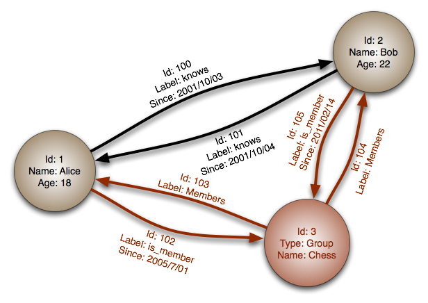
  <br/>
  <i><a href=https://en.wikipedia.org/wiki/File:GraphDatabase_PropertyGraph.png>Источник: Graph database</a></i>
</p>

> Абстракция: граф

В графовой базе данных каждый узел - это запись, а каждое ребро - связь между двумя узлами. Графовые базы данных оптимизированы для представления сложных связей с множеством внешних ключей или связей "многие ко многим".

Графовые базы данных имеют высокую производительность для моделей данных со сложными связями, как в социальных сетях. Они относительно новые и пока не используются широко. Может быть сложно найти средства и ресурсы для их разработки. Получить доступ ко многим графам можно только с помощью [REST API](#rest-representational-state-transfer).

##### Источники и дополнительные ссылки

* [Графовая база данных](https://ru.wikipedia.org/wiki/%D0%93%D1%80%D0%B0%D1%84%D0%BE%D0%B2%D0%B0%D1%8F_%D0%B1%D0%B0%D0%B7%D0%B0_%D0%B4%D0%B0%D0%BD%D0%BD%D1%8B%D1%85)
* [Neo4j](https://neo4j.com/)
* [FlockDB](https://blog.twitter.com/2010/introducing-flockdb)

#### Источники и дополнительные ссылки по NoSQL

* [Explanation of base terminology](http://stackoverflow.com/questions/3342497/explanation-of-base-terminology)
* [NoSQL databases a survey and decision guidance](https://medium.com/baqend-blog/nosql-databases-a-survey-and-decision-guidance-ea7823a822d#.wskogqenq)
* [Scalability](https://web.archive.org/web/20220602114024/https://www.lecloud.net/post/7994751381/scalability-for-dummies-part-2-database)
* [Introduction to NoSQL](https://www.youtube.com/watch?v=qI_g07C_Q5I)
* [NoSQL patterns](http://horicky.blogspot.com/2009/11/nosql-patterns.html)

### SQL или NoSQL

<p align="center">
  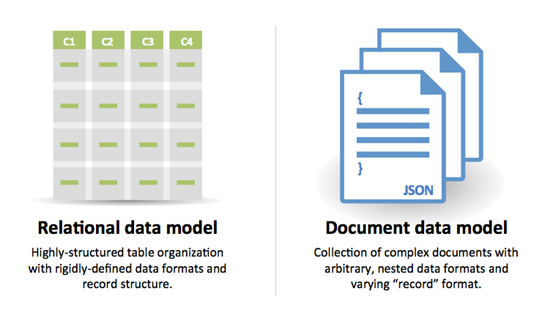
  <br/>
  <i><a href=https://www.infoq.com/articles/Transition-RDBMS-NoSQL/>Источник: Transitioning from RDBMS to NoSQL</a></i>
</p>

Причины использовать **SQL**:

* Структурированные данные
* Строгая схема
* Реляционные данные
* Необходимость сложных соединений (JOIN)
* Транзакции
* Понятные шаблоны масштабирования
* Широко используются: разработчики, сообщество, код, средства и т.д.
* Поиск по индексу очень быстрый

Причины использовать **NoSQL**:

* Частично-структурированные данные
* Динамическая или гибкая схема данных
* Нереляционные данные
* Нет необходимости в сложных соединениях (JOIN)
* Хранение большого количества данных (TB или PB)
* Очень большая нагрузка, связанная с работой с данными
* Большая пропускная способность для IOPS (количество операций ввода-вывода в секунду)

Примеры данных, хорошо подходящих для NoSQL:

* Быстрое сохранение данных потоков кликов (clickstream) и данных журналирования (logs)
* Список лидеров или общий счет
* Временные данные, например, корзина
* Таблицы с частым доступом (горячие таблицы)
* Метаданные или данные для поиска

##### Источники и дополнительные ссылки по SQL или NoSQL

* [Scaling up to your first 10 million users](https://www.youtube.com/watch?v=kKjm4ehYiMs)
* [SQL vs NoSQL differences](https://www.sitepoint.com/sql-vs-nosql-differences/)

## Кэширование

<p align="center">
  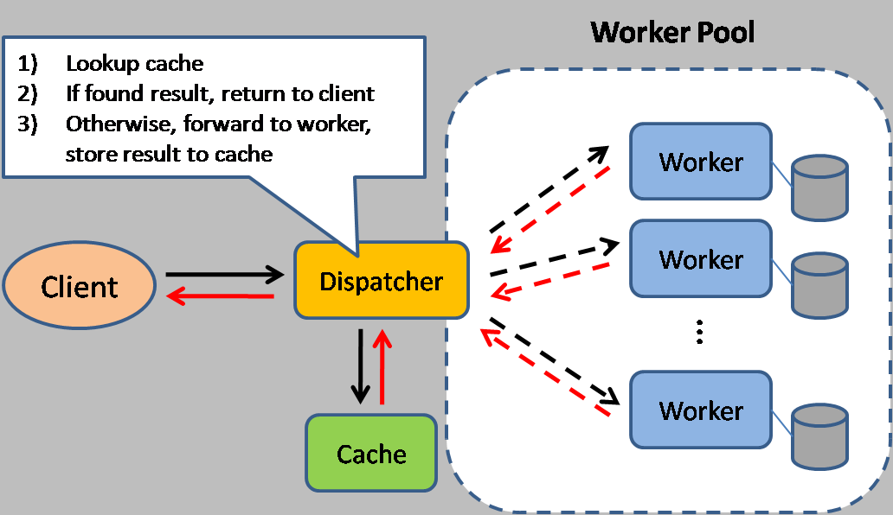
  <br/>
  <i><a href=http://horicky.blogspot.com/2010/10/scalable-system-design-patterns.html>Источник: Scalable system design patterns</a></i>
</p>

Кэширование улучшает время загрузки страницы и может уменьшить нагрузку на серверы и базы данных. При таком подходе диспетчер вначале проверяет, делался ли запрос ранее, чтобы найти ответ, который уже на него возвращался, сократив при этом время выполнения текущего запроса.

Базы данных работают оптимальным образом при равномерном распределении операций чтения и записи между их партициями (partitions). Популярные элементы могут нарушить равномерность распределения, создавая узкие места. Добавление системы кэширования перед базой данных может позволить сгладить неравномерность поступающего трафика.

### Кэширование на клиенте

Системы кэширования могут находиться на клиентской стороне (ОС или браузер), [на сервере](#обратный-прокси-сервер-reverse-proxy), или в выделенном уровне для кэширования.

### Кэширование в CDN

[Сети доставки содержимого (CDN)](#сеть-доставки-содержимого-cdn) считаются одним из видов кэширования.

### Кэширование на веб-сервере

[Обратные прокси-сервера](#обратный-прокси-сервер-reverse-proxy) и такие системы кэширования, как [Varnish](https://www.varnish-cache.org/) могут выдавать как статический, так и динамический контент. Веб-серверы тоже могут кэшировать запросы, возвращая ответы без обращения к серверам приложений.

### Кэширование в базах данных

Базы данных в конфигурации по умолчанию обычно уже включают кэширование, которое оптимизировано для стандартных сценариев использования. Настройка этих параметров для конкретных сценариев использования данных может еще больше улучшить их производительность.

### Кэширование в приложениях

Системы кэширования в памяти (например, Memcached и Redis) являются хранилищами типа "ключ-значение", которые находятся между вашим приложением и хранилищем данных. Они обычно быстрее, так как данные хранятся в оперативной памяти, а не на жестком диске, как это обычно бывает в случае с базами данных. Количество оперативной памяти имеет больше ограничений, чем жесткий диск, поэтому [алгоритмы очистки кэша](https://ru.wikipedia.org/wiki/%D0%90%D0%BB%D0%B3%D0%BE%D1%80%D0%B8%D1%82%D0%BC%D1%8B_%D0%BA%D1%8D%D1%88%D0%B8%D1%80%D0%BE%D0%B2%D0%B0%D0%BD%D0%B8%D1%8F), как например [вытеснение давно неиспользуемых (Least recently used, LRU)](https://ru.wikipedia.org/wiki/%D0%90%D0%BB%D0%B3%D0%BE%D1%80%D0%B8%D1%82%D0%BC%D1%8B_%D0%BA%D1%8D%D1%88%D0%B8%D1%80%D0%BE%D0%B2%D0%B0%D0%BD%D0%B8%D1%8F#Least_recently_used_(%D0%92%D1%8B%D1%82%D0%B5%D1%81%D0%BD%D0%B5%D0%BD%D0%B8%D0%B5_%D0%B4%D0%B0%D0%B2%D0%BD%D0%BE_%D0%BD%D0%B5%D0%B8%D1%81%D0%BF%D0%BE%D0%BB%D1%8C%D0%B7%D1%83%D0%B5%D0%BC%D1%8B%D1%85)) помогают удалять из кэша "холодные" записи и оставлять в памяти "горячие".

Redis включает дополнительную функциональность:

* возможность сохранения данных (из памяти на диск)
* встроенные структуры данных, например сортированные множества или списки

Существует несколько уровней кэширования, которые можно обобщить в две категории: "запросы к БД" и "объекты":

* записи БД
* запросы
* сформированные сериализуемые объекты
* сформированный HTML

Как правило, стоит избегать кэширования файлов, так как такой подход усложняет клонирование и автоматическое масштабирование.

### Кэширование на уровне запросов в базу данных

При таком подходе результат сохраняется с ключом, которым является вычисленное хэш-значение для запроса в базу данных. Такой подход имеет ряд недостатков:

* Тяжело удалить закэшированный результат сложных запросов
* Если меняется значение одной ячейки данных, необходимо удалить все запросы, которые могут содержать эти данные

### Кэширование на уровне объектов

При таком подходе данные рассматриваются как объекты, аналогично объектам в коде приложения. Приложение собирает данные из базы в объект класса или структуру(ы) данных:

* Объект удаляется из кэша, если структура данных, которую он представляет, изменилась
* Возможна асинхронная обработка: новые объекты могут собираться из текущей версии закэшированных объектов

Что можно кэшировать как объекты:

* Пользовательские сессии
* Полностью сформированные веб-страницы
* Потоки активности
* Графовые данные пользователя

### Когда обновлять кэш

Для каждого сценария использования необходимо определять, какая стратегия очистки кэша подходит наилучшим образом, так как количество данных, которые можно хранить в системе кэширования, ограничено.

#### Кэширование Cache-aside (кэш отдельно)

<p align="center">
  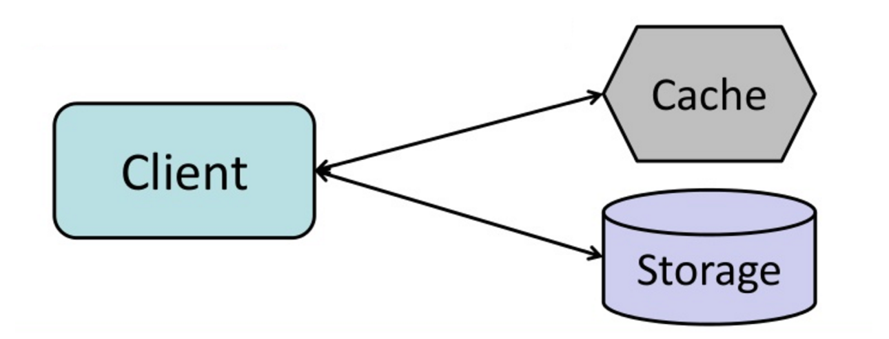
  <br/>
  <i><a href=http://www.slideshare.net/tmatyashovsky/from-cache-to-in-memory-data-grid-introduction-to-hazelcast>Источник: From cache to in-memory data grid</a></i>
</p>

Приложение читает данные из хранилища и записывает в него. Система кэширования не взаимодействует с хранилищем. Приложение выполняет следующие действия:

* Ищет элемент в кэше и не находит его
* Загружает данные из БД
* Добавляет элемент в кэш
* Возвращает результат клиенту

```python
def get_user(self, user_id):
    user = cache.get("user.{0}", user_id)
    if user is None:
        user = db.query("SELECT * FROM users WHERE user_id = {0}", user_id)
        if user is not None:
            key = "user.{0}".format(user_id)
            cache.set(key, json.dumps(user))
    return user
```

Обычно так используется [Memcached](https://memcached.org/).

Последующие запросы на чтение данных, находящихся в кэше, выполняются быстро. Такой подход также известен как ленивая загрузка. Только запрашиваемые данные попадают в систему кэширования, и не происходит её заполнения данными, которые не запрашиваются.

##### Недостатки Cache-aside

* Если запрашиваемые данные отсутствуют в кэше, выполняется три дополнительных действия, которые могут привести к заметной задержке
* Данные могут устареть, если они обновляются в БД. Для смягчения последствий этой проблемы используют время жизни (TTL), которое вызывает обновление элемента в кэше, либо делают сквозную запись
* Когда выходит из строя сервер кэширования, он заменяется новым сервером с пустым кэшем, что увеличивает задержку.

#### Кэширование Write-through (сквозное)

<p align="center">
  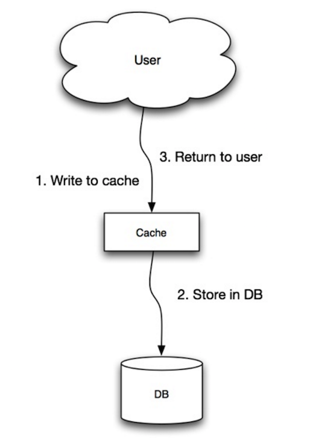
  <br/>
  <i><a href=http://www.slideshare.net/jboner/scalability-availability-stability-patterns/>Источник: Scalability, availability, stability, patterns</a></i>
</p>

Приложение использует систему кэширования как основное хранилище данных, считывая и записывая данные в неё. Система кэширования в свою очередь записывает и считывает данные из БД:

* Приложение добавляет и обновляет элемент в системе кэширования
* Система кэширования синхронно записывает данные в БД
* Возвращается результат

Код приложения:

```python
set_user(12345, {"foo":"bar"})
```

Код системы кэширования:

```python
def set_user(user_id, values):
    user = db.query("UPDATE Users WHERE id = {0}", user_id, values)
    cache.set(user_id, user)
```

В целом, подход со сквозной записью является медленным из-за операции записи, но последующие операции чтения выполняются быстро. Пользователи обычно легче мирятся с задержкой при обновлении данных, чем при их чтении. Данные в системе кэширования не устаревают.

##### Недостатки кэширования Write-through

* Когда добавляется новый сервер из-за отказа другого, либо в результате масштабирования, его кэш не содержит никаких элементов, пока данные не обновятся в БД. Использование "отдельного" кэша может помочь смягчить последствия этой проблемы
* Большая часть записываемых данных может вообще не использоваться. Использование времени жизни данных (TTL) может смягчить последствия этой проблемы.

#### Кэширование Write-behind / write-back (отложенная запись)

<p align="center">
  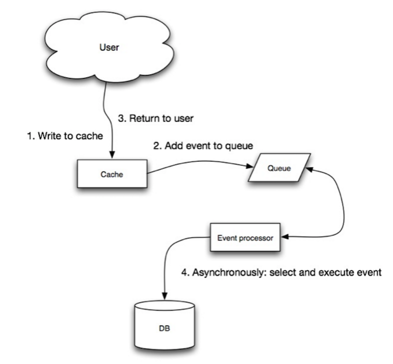
  <br/>
  <i><a href=http://www.slideshare.net/jboner/scalability-availability-stability-patterns/>Источник: Scalability, availability, stability, patterns</a></i>
</p>

При таком подходе приложение делает следующее:

* Добавляет/обновляет элемент в системе кэширования
* Асинхронно делает запись в БД, улучшая скорость записи

##### Недостатки кэширования Write-behind

* Возможна потеря данных, если система кэширования выйдет из строя до сохранения данных в БД.
* Такую систему сложнее реализовать, чем "отдельный" или "сквозной" кэш.

#### Кэширование Refresh-ahead (предварительное обновление)

<p align="center">
  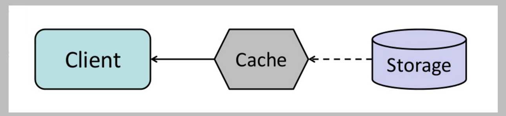
  <br/>
  <i><a href=http://www.slideshare.net/tmatyashovsky/from-cache-to-in-memory-data-grid-introduction-to-hazelcast>Источник: From cache to in-memory data grid</a></i>
</p>

При таком подходе можно настроить автоматическое обновление закэшированных данных, к которым недавно обращались, не ожидая истечения их срока действия.

Кэширование методом "предварительного обновления" может уменьшить задержку по сравнению с кэшем, который делает сквозное чтение, если можно точно определить, какие элементы могут быть запрошены в будущем.

##### Недостатки Refresh-ahead

* Неточное определение элементов, которые могут понадобиться в будущем, может привести к ухудшению производительности.

### Недостатки кэширования

* Необходимость поддерживать согласованность данных в кэше и источнике данных, таком как БД, с помощью [инвалидации кэша](https://ru.wikipedia.org/wiki/%D0%90%D0%BB%D0%B3%D0%BE%D1%80%D0%B8%D1%82%D0%BC%D1%8B_%D0%BA%D1%8D%D1%88%D0%B8%D1%80%D0%BE%D0%B2%D0%B0%D0%BD%D0%B8%D1%8F).
* Инвалидация кэша является сложной задачей и включает дополнительную задачу по определению времени, когда кэш нужно обновлять.
* Необходимы изменения в приложении, например, добавление Redis или Memcached.

### Источники и дополнительные ссылки

* [From cache to in-memory data grid](http://www.slideshare.net/tmatyashovsky/from-cache-to-in-memory-data-grid-introduction-to-hazelcast)
* [Scalable system design patterns](http://horicky.blogspot.com/2010/10/scalable-system-design-patterns.html)
* [Introduction to architecting systems for scale](http://lethain.com/introduction-to-architecting-systems-for-scale/)
* [Scalability, availability, stability, patterns](http://www.slideshare.net/jboner/scalability-availability-stability-patterns/)
* [Scalability](https://web.archive.org/web/20230126233752/https://www.lecloud.net/post/9246290032/scalability-for-dummies-part-3-cache)
* [AWS ElastiCache strategies](http://docs.aws.amazon.com/AmazonElastiCache/latest/UserGuide/Strategies.html)
* [Кэш - Wikipedia](https://ru.wikipedia.org/wiki/%D0%9A%D1%8D%D1%88)

## Асинхронность

<p align="center">
  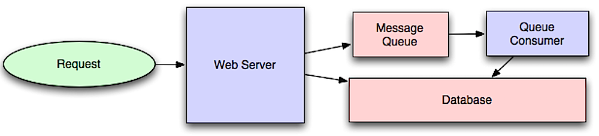
  <br/>
  <i><a href=http://lethain.com/introduction-to-architecting-systems-for-scale/#platform_layer>Источник: Intro to architecting systems for scale</a></i>
</p>

Асинхронные процессы позволяют сократить время запросов для трудоёмких операций по сравнению со случаями, когда эти операции выполняются синхронно. Они также могут помочь с выполнением времязатратных операций, таких как периодическое агрегирование данных.

### Очереди сообщений

Очереди сообщений позволяют принимать, хранить и доставлять сообщения. Если операция слишком медленная для синхронного выполнения, можно использовать очередь сообщений со следующим рабочим процессом:

* Приложение отправляет задачу в очередь, затем оповещает пользователя о состоянии задачи
* Рабочий процесс (воркер) берет задачу из очереди, выполняет её и посылает сообщение о том, что задача выполнена

При таком подходе пользователь не заблокирован и задача выполняется в фоне. В это время клиентское приложение может частично обработать данные и создать видимость выполнения. Например, сразу после публикации вашего сообщения в соц. сети, оно может появиться в вашей ленте, но фактическая доставка этого сообщения фолловерам может занять некоторое время.

**[Redis](https://redis.io/)** - может использоваться как простой брокер сообщений (message broker), но сообщения могут быть утеряны.

**[RabbitMQ](https://www.rabbitmq.com/)** - широко распространен, но потребует адаптации к "AMQP" протоколу и поддержки серверов для его развертывания.

**[Amazon SQS](https://aws.amazon.com/ru/sqs/)** - полностью управляемый сервис, но может иметь большую задержку и возможность доставки сообщений дважды.

### Очереди задач

Очереди задач принимают задачи и связанные с ними данные, выполняют их и затем выдают их результаты. Они могут поддерживать планирование и использоваться для выполнения задач, которые требуют высоких вычислительных мощностей, в фоне.

Планирование есть в **[Celery](https://docs.celeryproject.org/en/stable/)**, который в основном поддерживается на Python.

### Обратное давление

Если очередь достигает больших размеров, ее размер может стать больше памяти, что приведет к запросу элементов, которых нет в кэше, увеличению количества операций чтения с жесткого диска и ухудшению производительности. [Обратное давление](http://mechanical-sympathy.blogspot.com/2012/05/apply-back-pressure-when-overloaded.html) может помочь, ограничивая размер очереди, поддерживая высокую пропускную способность и хорошее время отклика для задач, которые уже находятся в очереди. Как только очередь заполнится, клиентские приложения получают код состояния HTTP 503 ("Сервис недоступен"). Клиенты могут повторить запрос позже, в том числе и с [экспоненциальной выдержкой](https://ru.wikipedia.org/wiki/%D0%AD%D0%BA%D1%81%D0%BF%D0%BE%D0%BD%D0%B5%D0%BD%D1%86%D0%B8%D0%B0%D0%BB%D1%8C%D0%BD%D0%B0%D1%8F_%D0%B2%D1%8B%D0%B4%D0%B5%D1%80%D0%B6%D0%BA%D0%B0).

### Недостатки асинхронности

* Для простых вычислений и процессов реального времени лучше подойдут синхронные операции, так как введение очередей может добавить задержку и усложнить систему.

### Источники и дополнительные ссылки

* [It's all a numbers game](https://www.youtube.com/watch?v=1KRYH75wgy4)
* [Applying back pressure when overloaded](http://mechanical-sympathy.blogspot.com/2012/05/apply-back-pressure-when-overloaded.html)
* [Закон Литтла](https://ru.wikipedia.org/wiki/%D0%97%D0%B0%D0%BA%D0%BE%D0%BD_%D0%9B%D0%B8%D1%82%D1%82%D0%BB%D0%B0)
* [What is the difference between a message queue and a task queue?](https://www.quora.com/What-is-the-difference-between-a-message-queue-and-a-task-queue-Why-would-a-task-queue-require-a-message-broker-like-RabbitMQ-Redis-Celery-or-IronMQ-to-function)

## Взаимодействие

<p align="center">
  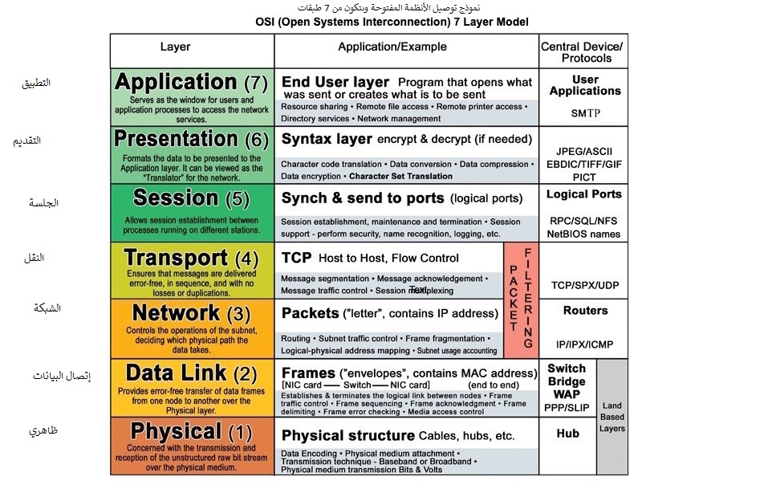
  <br/>
  <i><a href=http://www.escotal.com/osilayer.html>Источник: OSI 7 layer model</a></i>
</p>

### HTTP (Hypertext transfer protocol)

HTTP - это метод для кодировки и передачи данных между клиентом и сервером. Этот протокол основан на модели запрос/ответ: клиенты делают запросы, серверы отвечают на них с соответствующим контентом и информацией о состоянии завершения запроса. HTTP самодостаточен, позволяя запросам и ответам свободно передаваться через множество маршрутизаторов и серверов-посредников, которые выполняют балансировку, кэширование, шифрование и сжатие.

Стандартный HTTP запрос состоит из глагола (метода) и ресурса (конечной точки (endpoint)). Ниже приведены распространенные HTTP методы:

| Метод  | Описание                                                         | Идемпотентность* | Безопасность | Кэшируемость                                              |
|--------|------------------------------------------------------------------|------------------|--------------|-----------------------------------------------------------|
| GET    | Считывает ресурс                                                 | Да               | Да           | Да                                                        |
| POST   | Создает ресурс или запускает какой-то процесс обработки данных   | Нет              | Нет          | Да, если ответ содержит информацию об актуальности данных |
| PUT    | Создает или замещает ресурс                                      | Да               | Нет          | Нет                                                       |
| PATCH  | Частично обновляет ресурс                                        | Нет              | Нет          | Да, если ответ содержит информацию об актуальности данных |
| DELETE | Удаляет ресурс                                                   | Да               | Нет          | Нет                                                       |

*Может быть вызван несколько раз, при этом результат будет всегда одинаковым.

HTTP - это протокол уровня приложений, который построен на более низкоуровневых протоколах, таких как **TCP** и **UDP**.

#### Источники и дополнительные ссылки по HTTP

* [What is HTTP?](https://www.nginx.com/resources/glossary/http/)
* [Difference between HTTP and TCP](https://www.quora.com/What-is-the-difference-between-HTTP-protocol-and-TCP-protocol)
* [Difference between PUT and PATCH](https://laracasts.com/discuss/channels/general-discussion/whats-the-differences-between-put-and-patch?page=1)

### Transmission control protocol (TCP)

<p align="center">
  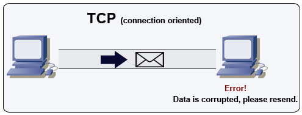
  <br/>
  <i><a href=http://www.wildbunny.co.uk/blog/2012/10/09/how-to-make-a-multi-player-game-part-1/>Источник: How to make a multiplayer game</a></i>
</p>

TCP - это протокол с установкой соединения, работающий поверх [межсетевого протокола IP](https://ru.wikipedia.org/wiki/IP). Соединение устанавливается и завершается с помощью [рукопожатия](https://en.wikipedia.org/wiki/Handshaking). Гарантия доставки пакетов получателю в оригинальном порядке и без искажений основана на:

* номерах последовательности и [поле контрольной суммы](https://ru.wikipedia.org/wiki/Transmission_Control_Protocol#%D0%9A%D0%BE%D0%BD%D1%82%D1%80%D0%BE%D0%BB%D1%8C%D0%BD%D0%B0%D1%8F_%D1%81%D1%83%D0%BC%D0%BC%D0%B0_(Checksum))
* [подтверждении](https://ru.wikipedia.org/wiki/Transmission_Control_Protocol#%D0%9D%D0%BE%D0%BC%D0%B5%D1%80_%D0%BF%D0%BE%D0%B4%D1%82%D0%B2%D0%B5%D1%80%D0%B6%D0%B4%D0%B5%D0%BD%D0%B8%D1%8F) пакетов и автоматической повторной передаче.

Если отправитель не получает правильного ответа, пакеты будут отправлены повторно. Если время ожидания истекает несколько раз, соединение разрывается. TCP также реализует [контроль потока](https://ru.wikipedia.org/wiki/%D0%9A%D0%BE%D0%BD%D1%82%D1%80%D0%BE%D0%BB%D1%8C_%D0%BF%D0%BE%D1%82%D0%BE%D0%BA%D0%B0) и [отслеживание перегрузок](https://en.wikipedia.org/wiki/Network_congestion#Congestion_control). Такие гарантии вызывают задержки и обычно приводят к менее эффективной передаче по сравнению с UDP.

Для поддержки высокой пропускной способности веб-сервера могут содержать большое количество открытых TCP соединений, что приводит к использованию большого количества оперативной памяти. Ресурсозатратным может быть поддержание большого количества открытых соединений между потоками веб-сервера и, например, сервером [Memcached](https://memcached.org/). В этом случае может помочь использование [пула соединений](https://en.wikipedia.org/wiki/Connection_pool) и UDP там, где он может быть применим.

TCP подходит для приложений, которым нужна высокая надежность, но которые менее требовательны ко времени, например веб-серверы, базы данных, SMTP, FTP, SSH.

Используйте TCP (а не UDP) в случаях, когда необходимо:

* сохранить данные неповрежденными
* наилучшим образом использовать пропускную способность сети автоматически

### User datagram protocol (UDP)

<p align="center">
  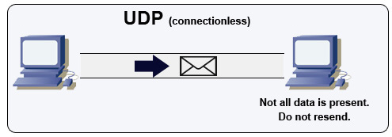
  <br/>
  <i><a href=http://www.wildbunny.co.uk/blog/2012/10/09/how-to-make-a-multi-player-game-part-1/>Источник: How to make a multiplayer game</a></i>
</p>

UDP не требует соединения. Датаграммы (по аналогии с пакетами данных) гарантированы только на уровне датаграммы. Датаграммы могут быть доставлены в порядке, отличном от того, в котором они были отправлены, либо не доставлены совсем. UDP не поддерживает контроля перегрузок. Без гарантий, которые дает TCP, UDP обычно более эффективен.

UDP поддерживает широковещательную передачу данных, отправляя датаграммы всем устройствам подсети. Это полезно использовать вместе с [DHCP](https://ru.wikipedia.org/wiki/DHCP), так как с клиентом, который еще не получил IP адрес, нельзя установить TCP соединение.

UDP менее надежный, но работает хорошо для приложений реального времени, например, VoIP, видеочатов, потоковой передачи данных и мультиплеерных игр реального времени.

Используйте UDP (а не TCP) в случаях, когда:

* вам необходима минимальная задержка передачи данных
* данные, которые пришли поздно, хуже, чем потеря данных
* вы хотите сами реализовать исправление ошибок

#### Источники и дополнительные ссылки по TCP и UDP

* [Networking for game programming](https://gafferongames.com/post/udp_vs_tcp/)
* [Key differences between TCP and UDP protocols](http://www.cyberciti.biz/faq/key-differences-between-tcp-and-udp-protocols/)
* [Difference between TCP and UDP](http://stackoverflow.com/questions/5970383/difference-between-tcp-and-udp)
* [Transmission control protocol](https://ru.wikipedia.org/wiki/Transmission_Control_Protocol)
* [User datagram protocol](https://ru.wikipedia.org/wiki/UDP)
* [Scaling memcache at Facebook](http://www.cs.bu.edu/~jappavoo/jappavoo.github.com/451/papers/memcache-fb.pdf)

### Удалённый вызов процедур (Remote procedure call, RPC)

<p align="center">
  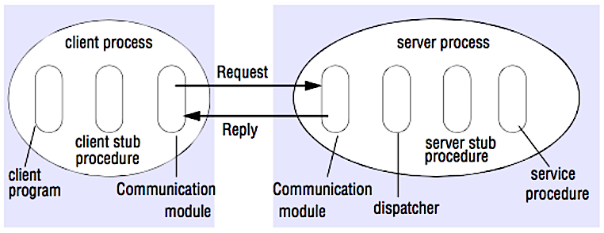
  <br/>
  <i><a href=http://www.puncsky.com/blog/2016-02-13-crack-the-system-design-interview>Источник: Crack the system design interview</a></i>
</p>

При использовании RPC клиент вызывает выполнение процедуры в другом адресном пространстве, обычно на удаленном сервере. Эта процедура вызывается так же, как локальная, абстрагируя детали взаимодействия сервера и клиентского приложения. Удаленные вызовы обычно медленнее и менее надежны, чем локальные вызовы. Поэтому полезно отличать удаленные вызовы от локальных. Популярными RPC фреймворками являются [Protobuf](https://developers.google.com/protocol-buffers/), [Thrift](https://thrift.apache.org/) и [Avro](https://avro.apache.org/docs/current/).

RPC - это протокол на основе запроса и ответа:

* **Клиентское приложение** - вызывает клиентскую процедуру-заглушку. Параметры передаются в стек, так же, как и при вызове локальной процедуры.
* **Клиентская процедура-заглушка** - собирает идентификатор процедуры и её аргументы в сообщение для запроса.
* **Клиентский модуль взаимодействия** - ОС отправляет сообщение с клиента на сервер.
* **Серверный модуль взаимодействия** - ОС передает входящие пакеты серверной процедуре-заглушке.
* **Серверная процедура-заглушка** - разбирает входящее сообщение, вызывает процедуру по полученному идентификатору и передаёт ей полученные аргументы.
* Таким же образом, только в обратном порядке, идет ответ от сервера клиенту.

Примеры вызовов RPC:

```
GET /someoperation?data=anId

POST /anotheroperation
{
  "data":"anId";
  "anotherdata": "another value"
}
```

RPC сфокусированы на поведении системы. RPC обычно используются для достижения высокой производительности при внутренней передаче данных, так как можно использовать нативные вызовы, подходящие для ваших сценариев использования.

Используйте нативные библиотеки (SDK), когда:

* вы знаете целевую платформу
* вы хотите контролировать доступ к вашей логике
* вы хотите контролировать работу с ошибками в вашей библиотеке
* производительность и опыт конечного пользователя являются для вас главным приоритетом.

REST API на основе HTTP часто используются для публичных API.

#### Недостатки RPC

* клиентские приложения RPC становятся сильно связанными с сервисной реализацией.
* необходимо делать новый API для каждой новой операции или сценария использования.
* отладка (debug) вызовов RPC может быть непростой.
* вы, возможно, не сможете использовать существующие технологии как есть "из коробки". Например, могут понадобиться дополнительные действия для того, чтобы убедиться, что [RPC запросы закэшированы](https://web.archive.org/web/20170608193645/http://etherealbits.com/2012/12/debunking-the-myths-of-rpc-rest/) на серверах систем кэширования, например [Squid](http://www.squid-cache.org/).

### REST (Representational state transfer)

REST - это архитектурный стиль взаимодействия клиента и сервера, где клиент работает с ресурсами, управляемыми сервером. Сервер предоставляет представление ресурсов и действия для управления ими или получения нового представления. Любое взаимодействие не должно иметь состояния и должно быть кэшируемым.

Существует четыре характеристики REST-интерфейса:

* **Определение ресурса (URI в HTTP)** - независимо от операции используется один и тот же URI.
* **Изменение представления** - используйте методы, заголовки и тело.
* **Самодостаточное сообщение об ошибке (код состояния в HTTP)** - используйте коды состояния и не изобретайте велосипед.
* **[HATEOAS](http://restcookbook.com/Basics/hateoas/) (HTML интерфейс для HTTP)** - ваш веб-сервис должен быть доступен через браузер.

Пример REST запроса:

```
GET /someresources/anId

PUT /someresources/anId
{"anotherdata": "another value"}
```

REST ориентирован на предоставление данных. Он снижает связность между клиентом и сервером и часто используется для публичных API. REST использует обобщенный и унифицированный метод предоставления ресурсов через URI, [представление через заголовки](https://github.com/for-GET/know-your-http-well/blob/master/headers.md), и действия с помощью методов, таких как GET, POST, PUT, DELETE и PATCH. Не имея состояния, REST хорошо подходит для горизонтального масштабирования и партицирования.

#### Недостатки REST

* Учитывая, что REST ориентирован на предоставление данных, этот подход может не подойти, если ресурсы недостаточно организованы или к ним нельзя обратиться через простую иерархию. Например, возвращение всех обновленных за последний час записей, соответствующих определенному набору событий, не так просто представить в виде пути. Скорее всего, в таком случае реализация будет включать сочетание пути URI, параметров запроса и, возможно, тело запроса.
* REST обычно полагается на несколько методов (GET, POST, PUT, DELETE и PATCH), что не всегда может подходить для вашего сценария использования. Например, нет определенного метода для представления перемещения документов с истекшим сроком в архивную папку.
* Получение сложных ресурсов с вложенными иерархиями требует нескольких повторных запросов между клиентом и сервером, например, получение контента записи в блоге и комментариев к этой записи. Для мобильных приложений, которые функционируют в условиях переменного качества сети, эти повторные запросы являются крайне нежелательными.
* С течением времени больше полей может добавляться в ответ API, и более старые клиенты будут получать все новые поля, включая даже те, которые не нужны. В результате увеличивается размер пересылаемых данных, что приводит к увеличению задержки передачи данных.

### Сравнение вызовов RPC и REST

| Действие                                       | RPC                                                                                       | REST                                                         |
|------------------------------------------------|-------------------------------------------------------------------------------------------|--------------------------------------------------------------|
| Регистрация                                    | **POST** /signup                                                                          | **POST** /persons                                            |
| Удаление пользователя                          | **POST** /resign<br/>{<br/>"personid": "1234"<br/>}                                       | **DELETE** /persons/1234                                     |
| Получение пользователя (person)                | **GET** /readPerson?personid=1234                                                         | **GET** /persons/1234                                        |
| Получение списка элементов (item) пользователя | **GET** /readUsersItemsList?personid=1234                                                 | **GET** /persons/1234/items                                  |
| Добавление элемента в список пользователя      | **POST** /addItemToUsersItemsList<br/>{<br/>"personid": "1234";<br/>"itemid": "456"<br/>} | **POST** /persons/1234/items<br/>{<br/>"itemid": "456"<br/>} |
| Обновление элемента                            | **POST** /modifyItem<br/>{<br/>"itemid": "456";<br/>"key": "value"<br/>}                  | **PUT** /items/456<br/>{<br/>"key": "value"<br/>}            |
| Удаление элемента                              | **POST** /removeItem<br/>{<br/>"itemid": "456"<br/>}                                      | **DELETE** /items/456                                        |

<p align="center">
  <i><a href=https://apihandyman.io/do-you-really-know-why-you-prefer-rest-over-rpc/>Источник: Do you really know why you prefer REST over RPC</a></i>
</p>

#### Источники и дополнительные ссылки по REST и RPC

* [Do you really know why you prefer REST over RPC](https://apihandyman.io/do-you-really-know-why-you-prefer-rest-over-rpc/)
* [When are RPC-ish approaches more appropriate than REST?](http://programmers.stackexchange.com/a/181186)
* [REST vs JSON-RPC](http://stackoverflow.com/questions/15056878/rest-vs-json-rpc)
* [Debunking the myths of RPC and REST](https://web.archive.org/web/20170608193645/http://etherealbits.com/2012/12/debunking-the-myths-of-rpc-rest/)
* [What are the drawbacks of using REST](https://www.quora.com/What-are-the-drawbacks-of-using-RESTful-APIs)
* [Crack the system design interview](http://www.puncsky.com/blog/2016-02-13-crack-the-system-design-interview)
* [Thrift](https://code.facebook.com/posts/1468950976659943/)
* [Why REST for internal use and not RPC](http://arstechnica.com/civis/viewtopic.php?t=1190508)

## Безопасность

Эта секция нуждается в дополнении. [Содействуйте](#содействуйте)!

Обеспечение безопасности - это обширная тема. Если у вас нет значительного опыта в безопасности, либо вы не подаётесь на вакансию, которая требует знаний по безопасности, возможно, вам будет достаточно основ:

* Шифруйте данные во время передачи и при хранении
* Очищайте входные данные пользователя и любые параметры, которые доступны пользователю для избежания [межсайтового скриптинга](https://ru.wikipedia.org/wiki/%D0%9C%D0%B5%D0%B6%D1%81%D0%B0%D0%B9%D1%82%D0%BE%D0%B2%D1%8B%D0%B9_%D1%81%D0%BA%D1%80%D0%B8%D0%BF%D1%82%D0%B8%D0%BD%D0%B3) и [внедрения SQL-кода](https://ru.wikipedia.org/wiki/%D0%92%D0%BD%D0%B5%D0%B4%D1%80%D0%B5%D0%BD%D0%B8%D0%B5_SQL-%D0%BA%D0%BE%D0%B4%D0%B0).
* Используйте параметризованные запросы для предотвращения внедрения SQL-кода
* Используйте [принцип минимальных привилегий](https://ru.wikipedia.org/wiki/%D0%9F%D1%80%D0%B8%D0%BD%D1%86%D0%B8%D0%BF_%D0%BC%D0%B8%D0%BD%D0%B8%D0%BC%D0%B0%D0%BB%D1%8C%D0%BD%D1%8B%D1%85_%D0%BF%D1%80%D0%B8%D0%B2%D0%B8%D0%BB%D0%B5%D0%B3%D0%B8%D0%B9)

### Источники и дополнительные ссылки

* [API security checklist](https://github.com/shieldfy/API-Security-Checklist)
* [Security guide for developers](https://github.com/FallibleInc/security-guide-for-developers)
* [OWASP top ten](https://www.owasp.org/index.php/OWASP_Top_Ten_Cheat_Sheet)

## Приложение

Вас иногда могут попросить сделать оценку по времени "на салфетке". Например, определить, сколько времени понадобится для генерации 100 миниатюр изображений с жесткого диска, или сколько памяти потребует структура данных. **Таблица степеней двойки** и **Время выполнения задач, которые должен знать любой программист** могут в этом помочь.

### Таблица степеней двойки

```
Степень           Точное значение   Приблизительное значение    Байты
---------------------------------------------------------------------
7                             128
8                             256
10                           1024   1 тысяча                    1 KB
16                         65,536                               64 KB
20                      1,048,576   1 миллион                   1 MB
30                  1,073,741,824   1 миллиард                  1 GB
32                  4,294,967,296                               4 GB
40              1,099,511,627,776   1 триллион                  1 TB
```

#### Источники и дополнительные ссылки

* [Powers of two](https://en.wikipedia.org/wiki/Power_of_two)

### Время выполнения задач, которые должен знать каждый программист

```
Время выполнения
--------------------------
Обращение к кэшу первого уровня (L1)                                  0.5 ns
Ошибка предсказания ветвления                                         5   ns
Обращение к кэшу второго уровня (L2)                                  7   ns                      14x L1 кэша
Блокировка/снятие блокировки (mutex)                                 25   ns
Обращение к основной памяти                                         100   ns                      20x L2 кэша, 200x L1 кэша
Сжатие 1 KB с помощью Zippy                                      10,000   ns       10 us
Отправить 1 KB по сети 1 Gbps                                    10,000   ns       10 us
Считать 4 KB случайно с SSD*                                    150,000   ns      150 us          ~1GB/sec SSD
Считать 1 MB последовательно из памяти                          250,000   ns      250 us
Полный обход внутри дата-центра                                 500,000   ns      500 us
Считать 1 MB последовательно с SSD*                           1,000,000   ns    1,000 us    1 ms  ~1GB/sec SSD, 4X памяти
Поиск на HDD                                                 10,000,000   ns   10,000 us   10 ms  20x полного обхода дата-центра
Считать 1 MB последовательно по сети 1 Gbps                  10,000,000   ns   10,000 us   10 ms  40x памяти, 10X SSD
Считать 1 MB последовательно с HDD                           30,000,000   ns   30,000 us   30 ms 120x памяти, 30X SSD
Послать пакет данных Калифорния->Нидерланды->Калифорния     150,000,000   ns  150,000 us  150 ms

Заметки
-----
1 ns = 10^-9 seconds
1 us = 10^-6 seconds = 1,000 ns
1 ms = 10^-3 seconds = 1,000 us = 1,000,000 ns
```

Некоторые значения на основе данных выше

* Последовательное чтение с HDD - скорость 30 MB/s
* Последовательное чтение из канала 1 Gbps сети Ethernet - скорость 100 MB/s
* Последовательное чтение с SSD - скорость 1 GB/s
* Последовательное чтение из основной памяти - скорость 4 GB/s
* Количество полных обходов вокруг земного шара в секунду - 6-7
* Количество полных обходов внутри дата-центра в секунду - 2,000

#### Визуализация времени выполнения задач


#### Источники и дополнительные ссылки

* [Latency numbers every programmer should know - 1](https://gist.github.com/jboner/2841832)
* [Latency numbers every programmer should know - 2](https://gist.github.com/hellerbarde/2843375)
* [Designs, lessons, and advice from building large distributed systems](http://www.cs.cornell.edu/projects/ladis2009/talks/dean-keynote-ladis2009.pdf)
* [Software Engineering Advice from Building Large-Scale Distributed Systems](https://static.googleusercontent.com/media/research.google.com/en//people/jeff/stanford-295-talk.pdf)

### Дополнительные вопросы на интервью по проектированию систем

> Распространенные задачи на интервью по проектированию систем со ссылками на решения.

| Задача | Ссылки |
|---|---|
| Design a file sync service like Dropbox | [youtube.com](https://www.youtube.com/watch?v=PE4gwstWhmc) |
| Design a search engine like Google | [queue.acm.org](http://queue.acm.org/detail.cfm?id=988407)<br/>[stackexchange.com](http://programmers.stackexchange.com/questions/38324/interview-question-how-would-you-implement-google-search)<br/>[ardendertat.com](http://www.ardendertat.com/2012/01/11/implementing-search-engines/)<br/>[stanford.edu](http://infolab.stanford.edu/~backrub/google.html) |
| Design a scalable web crawler like Google | [quora.com](https://www.quora.com/How-can-I-build-a-web-crawler-from-scratch) |
| Design Google docs | [code.google.com](https://code.google.com/p/google-mobwrite/)<br/>[neil.fraser.name](https://neil.fraser.name/writing/sync/) |
| Design a key-value store like Redis | [codecapsule.com](http://codecapsule.com/2012/11/07/ikvs-implementing-a-key-value-store-table-of-contents/)<br/>[allthingsdistributed.com](https://www.allthingsdistributed.com/files/amazon-dynamo-sosp2007.pdf) |
| Design a cache system like Memcached | [slideshare.net](http://www.slideshare.net/oemebamo/introduction-to-memcached) |
| Design a recommendation system like Amazon's | [hulu.com](https://web.archive.org/web/20170406065247/http://tech.hulu.com/blog/2011/09/19/recommendation-system.html)<br/>[ijcai13.org](http://ijcai13.org/files/tutorial_slides/td3.pdf) |
| Design a tinyurl system like Bitly | [n00tc0d3r.blogspot.com](http://n00tc0d3r.blogspot.com/) |
| Design a chat app like WhatsApp | [highscalability.com](http://highscalability.com/blog/2014/2/26/the-whatsapp-architecture-facebook-bought-for-19-billion.html)
| Design a picture sharing system like Instagram | [highscalability.com](http://highscalability.com/flickr-architecture)<br/>[highscalability.com](http://highscalability.com/blog/2011/12/6/instagram-architecture-14-million-users-terabytes-of-photos.html) |
| Design the Facebook news feed function | [quora.com](http://www.quora.com/What-are-best-practices-for-building-something-like-a-News-Feed)<br/>[quora.com](http://www.quora.com/Activity-Streams/What-are-the-scaling-issues-to-keep-in-mind-while-developing-a-social-network-feed)<br/>[slideshare.net](http://www.slideshare.net/danmckinley/etsy-activity-feeds-architecture) |
| Design the Facebook timeline function | [facebook.com](https://www.facebook.com/note.php?note_id=10150468255628920)<br/>[highscalability.com](http://highscalability.com/blog/2012/1/23/facebook-timeline-brought-to-you-by-the-power-of-denormaliza.html) |
| Design the Facebook chat function | [erlang-factory.com](http://www.erlang-factory.com/upload/presentations/31/EugeneLetuchy-ErlangatFacebook.pdf)<br/>[facebook.com](https://www.facebook.com/note.php?note_id=14218138919&id=9445547199&index=0) |
| Design a graph search function like Facebook's | [facebook.com](https://www.facebook.com/notes/facebook-engineering/under-the-hood-building-out-the-infrastructure-for-graph-search/10151347573598920)<br/>[facebook.com](https://www.facebook.com/notes/facebook-engineering/under-the-hood-indexing-and-ranking-in-graph-search/10151361720763920)<br/>[facebook.com](https://www.facebook.com/notes/facebook-engineering/under-the-hood-the-natural-language-interface-of-graph-search/10151432733048920) |
| Design a content delivery network like CloudFlare | [figshare.com](https://figshare.com/articles/Globally_distributed_content_delivery/6605972) |
| Design a trending topic system like Twitter's | [michael-noll.com](http://www.michael-noll.com/blog/2013/01/18/implementing-real-time-trending-topics-in-storm/)<br/>[snikolov .wordpress.com](http://snikolov.wordpress.com/2012/11/14/early-detection-of-twitter-trends/) |
| Design a random ID generation system | [blog.twitter.com](https://blog.twitter.com/2010/announcing-snowflake)<br/>[github.com](https://github.com/twitter/snowflake/) |
| Return the top k requests during a time interval | [cs.ucsb.edu](https://www.cs.ucsb.edu/sites/default/files/documents/2005-23.pdf)<br/>[wpi.edu](http://davis.wpi.edu/xmdv/docs/EDBT11-diyang.pdf) |
| Design a system that serves data from multiple data centers | [highscalability.com](http://highscalability.com/blog/2009/8/24/how-google-serves-data-from-multiple-datacenters.html) |
| Design an online multiplayer card game | [indieflashblog.com](https://web.archive.org/web/20180929181117/http://www.indieflashblog.com/how-to-create-an-asynchronous-multiplayer-game.html)<br/>[buildnewgames.com](http://buildnewgames.com/real-time-multiplayer/) |
| Design a garbage collection system | [stuffwithstuff.com](http://journal.stuffwithstuff.com/2013/12/08/babys-first-garbage-collector/)<br/>[washington.edu](http://courses.cs.washington.edu/courses/csep521/07wi/prj/rick.pdf) |
| Design an API rate limiter | [https://stripe.com/blog/](https://stripe.com/blog/rate-limiters) |
| Design a Stock Exchange (like NASDAQ or Binance) | [Jane Street](https://youtu.be/b1e4t2k2KJY)<br/>[Golang Implementation](https://around25.com/blog/building-a-trading-engine-for-a-crypto-exchange/)<br/>[Go Implemenation](http://bhomnick.net/building-a-simple-limit-order-in-go/) |
| Добавьте задачу | [Добавить](#содействуйте) |

### Архитектуры действующих систем

> Статьи о том, как спроектированы действующие системы.

<p align="center">
  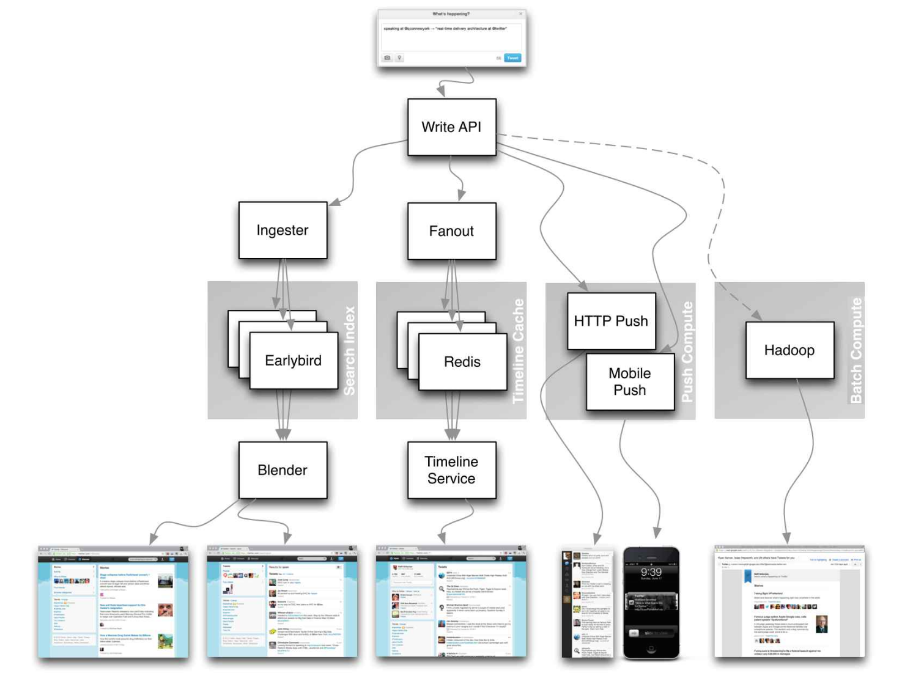
  <br/>
  <i><a href=https://www.infoq.com/presentations/Twitter-Timeline-Scalability>Источник: Twitter timelines at scale</a></i>
</p>

**Не вдавайтесь в мельчайшие подробности, вместо этого:**

* Определите основные принципы, общие технологии и шаблоны, которые встречаются в этих статьях
* Изучите, какие проблемы решаются каждым компонентом, где это работает, а где нет
* Обратите внимание на секции, описывающие полученный опыт и работу над ошибками

| Тип | Система | Ссылки |
|---|---|---|
| Обработка данных | **MapReduce** - распределённая обработка данных от Google | [research.google.com](http://static.googleusercontent.com/media/research.google.com/zh-CN/us/archive/mapreduce-osdi04.pdf) |
| Обработка данных | **Spark** - распределённая обработка данных от Databricks | [slideshare.net](http://www.slideshare.net/AGrishchenko/apache-spark-architecture) |
| Обработка данных | **Storm** - распределённая обработка данных от Twitter | [slideshare.net](http://www.slideshare.net/previa/storm-16094009) |
| | | |
| Хранилище данных | **Bigtable** - распределённая колоночная база данных от Google | [harvard.edu](http://www.read.seas.harvard.edu/~kohler/class/cs239-w08/chang06bigtable.pdf) |
| Хранилище данных | **HBase** - Реализация Bigtable с открытым исходным кодом | [slideshare.net](http://www.slideshare.net/alexbaranau/intro-to-hbase) |
| Хранилище данных | **Cassandra** - распределённая колоночная база данных от Facebook | [slideshare.net](http://www.slideshare.net/planetcassandra/cassandra-introduction-features-30103666)
| Хранилище данных | **DynamoDB** - Документоориентированная база данных от Amazon | [harvard.edu](http://www.read.seas.harvard.edu/~kohler/class/cs239-w08/decandia07dynamo.pdf) |
| Хранилище данных | **MongoDB** - Документоориентированная база данных | [slideshare.net](http://www.slideshare.net/mdirolf/introduction-to-mongodb) |
| Хранилище данных | **Spanner** - Глобально-распределённая база данных от Google | [research.google.com](http://research.google.com/archive/spanner-osdi2012.pdf) |
| Хранилище данных | **Memcached** - Распределённый кэш, хранящийся в памяти | [slideshare.net](http://www.slideshare.net/oemebamo/introduction-to-memcached) |
| Хранилище данных | **Redis** - Распределённая система кэширования с возможностью сохранения и типами данных | [slideshare.net](http://www.slideshare.net/dvirsky/introduction-to-redis) |
| | | |
| Файловая система | **Google File System (GFS)** - Распределённая файловая система | [research.google.com](http://static.googleusercontent.com/media/research.google.com/zh-CN/us/archive/gfs-sosp2003.pdf) |
| Файловая система | **Hadoop File System (HDFS)** - Реализация GFS с открытым исходным кодом | [apache.org](http://hadoop.apache.org/docs/stable/hadoop-project-dist/hadoop-hdfs/HdfsDesign.html) |
| | | |
| Другое | **Chubby** - Система блокировки для слабосвязанных распределённых систем от Google | [research.google.com](http://static.googleusercontent.com/external_content/untrusted_dlcp/research.google.com/en/us/archive/chubby-osdi06.pdf) |
| Другое | **Dapper** - Система отслеживания операций в распределённых системах | [research.google.com](http://static.googleusercontent.com/media/research.google.com/en//pubs/archive/36356.pdf)
| Другое | **Kafka** - Очередь сообщений Pub/sub от LinkedIn | [slideshare.net](http://www.slideshare.net/mumrah/kafka-talk-tri-hug) |
| Другое | **Zookeeper** - Централизованная инфраструктура и сервисы для синхронизации распределённых систем | [slideshare.net](http://www.slideshare.net/sauravhaloi/introduction-to-apache-zookeeper) |
| | Добавьте архитектуру | [Добавить](#содействуйте) |

### Архитектуры компаний

| Компания | Ссылки |
|---|---|
| Amazon | [Amazon architecture](http://highscalability.com/amazon-architecture) |
| Cinchcast | [Producing 1,500 hours of audio every day](http://highscalability.com/blog/2012/7/16/cinchcast-architecture-producing-1500-hours-of-audio-every-d.html) |
| DataSift | [Realtime datamining At 120,000 tweets per second](http://highscalability.com/blog/2011/11/29/datasift-architecture-realtime-datamining-at-120000-tweets-p.html) |
| DropBox | [How we've scaled Dropbox](https://www.youtube.com/watch?v=PE4gwstWhmc) |
| ESPN | [Operating At 100,000 duh nuh nuhs per second](http://highscalability.com/blog/2013/11/4/espns-architecture-at-scale-operating-at-100000-duh-nuh-nuhs.html) |
| Google | [Google architecture](http://highscalability.com/google-architecture) |
| Instagram | [14 million users, terabytes of photos](http://highscalability.com/blog/2011/12/6/instagram-architecture-14-million-users-terabytes-of-photos.html)<br/>[What powers Instagram](http://instagram-engineering.tumblr.com/post/13649370142/what-powers-instagram-hundreds-of-instances) |
| Justin.tv | [Justin.Tv's live video broadcasting architecture](http://highscalability.com/blog/2010/3/16/justintvs-live-video-broadcasting-architecture.html) |
| Facebook | [Scaling memcached at Facebook](https://cs.uwaterloo.ca/~brecht/courses/854-Emerging-2014/readings/key-value/fb-memcached-nsdi-2013.pdf)<br/>[TAO: Facebook’s distributed data store for the social graph](https://cs.uwaterloo.ca/~brecht/courses/854-Emerging-2014/readings/data-store/tao-facebook-distributed-datastore-atc-2013.pdf)<br/>[Facebook’s photo storage](https://www.usenix.org/legacy/event/osdi10/tech/full_papers/Beaver.pdf)<br/>[How Facebook Live Streams To 800,000 Simultaneous Viewers](http://highscalability.com/blog/2016/6/27/how-facebook-live-streams-to-800000-simultaneous-viewers.html) |
| Flickr | [Flickr architecture](http://highscalability.com/flickr-architecture) |
| Mailbox | [From 0 to one million users in 6 weeks](http://highscalability.com/blog/2013/6/18/scaling-mailbox-from-0-to-one-million-users-in-6-weeks-and-1.html) |
| Netflix | [A 360 Degree View Of The Entire Netflix Stack](http://highscalability.com/blog/2015/11/9/a-360-degree-view-of-the-entire-netflix-stack.html)<br/>[Netflix: What Happens When You Press Play?](http://highscalability.com/blog/2017/12/11/netflix-what-happens-when-you-press-play.html) |
| Pinterest | [From 0 To 10s of billions of page views a month](http://highscalability.com/blog/2013/4/15/scaling-pinterest-from-0-to-10s-of-billions-of-page-views-a.html)<br/>[18 million visitors, 10x growth, 12 employees](http://highscalability.com/blog/2012/5/21/pinterest-architecture-update-18-million-visitors-10x-growth.html) |
| Playfish | [50 million monthly users and growing](http://highscalability.com/blog/2010/9/21/playfishs-social-gaming-architecture-50-million-monthly-user.html) |
| PlentyOfFish | [PlentyOfFish architecture](http://highscalability.com/plentyoffish-architecture) |
| Salesforce | [How they handle 1.3 billion transactions a day](http://highscalability.com/blog/2013/9/23/salesforce-architecture-how-they-handle-13-billion-transacti.html) |
| Stack Overflow | [Stack Overflow architecture](http://highscalability.com/blog/2009/8/5/stack-overflow-architecture.html) |
| TripAdvisor | [40M visitors, 200M dynamic page views, 30TB data](http://highscalability.com/blog/2011/6/27/tripadvisor-architecture-40m-visitors-200m-dynamic-page-view.html) |
| Tumblr | [15 billion page views a month](http://highscalability.com/blog/2012/2/13/tumblr-architecture-15-billion-page-views-a-month-and-harder.html) |
| Twitter | [Making Twitter 10000 percent faster](http://highscalability.com/scaling-twitter-making-twitter-10000-percent-faster)<br/>[Storing 250 million tweets a day using MySQL](http://highscalability.com/blog/2011/12/19/how-twitter-stores-250-million-tweets-a-day-using-mysql.html)<br/>[150M active users, 300K QPS, a 22 MB/S firehose](http://highscalability.com/blog/2013/7/8/the-architecture-twitter-uses-to-deal-with-150m-active-users.html)<br/>[Timelines at scale](https://www.infoq.com/presentations/Twitter-Timeline-Scalability)<br/>[Big and small data at Twitter](https://www.youtube.com/watch?v=5cKTP36HVgI)<br/>[Operations at Twitter: scaling beyond 100 million users](https://www.youtube.com/watch?v=z8LU0Cj6BOU)<br/>[How Twitter Handles 3,000 Images Per Second](http://highscalability.com/blog/2016/4/20/how-twitter-handles-3000-images-per-second.html) |
| Uber | [How Uber scales their real-time market platform](http://highscalability.com/blog/2015/9/14/how-uber-scales-their-real-time-market-platform.html)<br/>[Lessons Learned From Scaling Uber To 2000 Engineers, 1000 Services, And 8000 Git Repositories](http://highscalability.com/blog/2016/10/12/lessons-learned-from-scaling-uber-to-2000-engineers-1000-ser.html) |
| WhatsApp | [The WhatsApp architecture Facebook bought for $19 billion](http://highscalability.com/blog/2014/2/26/the-whatsapp-architecture-facebook-bought-for-19-billion.html) |
| YouTube | [YouTube scalability](https://www.youtube.com/watch?v=w5WVu624fY8)<br/>[YouTube architecture](http://highscalability.com/youtube-architecture) |

### Блоги инженерных компаний

> Вопросы могут быть связаны с архитектурой компаний, в которые вы проходите собеседование.

* [Airbnb Engineering](http://nerds.airbnb.com/)
* [Atlassian Developers](https://developer.atlassian.com/blog/)
* [AWS Blog](https://aws.amazon.com/blogs/aws/)
* [Bitly Engineering Blog](http://word.bitly.com/)
* [Box Blogs](https://blog.box.com/blog/category/engineering)
* [Cloudera Developer Blog](http://blog.cloudera.com/)
* [Dropbox Tech Blog](https://tech.dropbox.com/)
* [Engineering at Quora](https://www.quora.com/q/quoraengineering)
* [Ebay Tech Blog](http://www.ebaytechblog.com/)
* [Evernote Tech Blog](https://blog.evernote.com/tech/)
* [Etsy Code as Craft](http://codeascraft.com/)
* [Facebook Engineering](https://www.facebook.com/Engineering)
* [Flickr Code](http://code.flickr.net/)
* [Foursquare Engineering Blog](http://engineering.foursquare.com/)
* [GitHub Engineering Blog](https://github.blog/category/engineering)
* [Google Research Blog](http://googleresearch.blogspot.com/)
* [Groupon Engineering Blog](https://engineering.groupon.com/)
* [Heroku Engineering Blog](https://engineering.heroku.com/)
* [Hubspot Engineering Blog](http://product.hubspot.com/blog/topic/engineering)
* [High Scalability](http://highscalability.com/)
* [Instagram Engineering](http://instagram-engineering.tumblr.com/)
* [Intel Software Blog](https://software.intel.com/en-us/blogs/)
* [Jane Street Tech Blog](https://blogs.janestreet.com/category/ocaml/)
* [LinkedIn Engineering](http://engineering.linkedin.com/blog)
* [Microsoft Engineering](https://engineering.microsoft.com/)
* [Microsoft Python Engineering](https://blogs.msdn.microsoft.com/pythonengineering/)
* [Netflix Tech Blog](http://techblog.netflix.com/)
* [Paypal Developer Blog](https://developer.paypal.com/community/blog/)
* [Pinterest Engineering Blog](https://medium.com/@Pinterest_Engineering)
* [Reddit Blog](http://www.redditblog.com/)
* [Salesforce Engineering Blog](https://developer.salesforce.com/blogs/engineering/)
* [Slack Engineering Blog](https://slack.engineering/)
* [Spotify Labs](https://labs.spotify.com/)
* [Stripe Engineering Blog](https://stripe.com/blog/engineering)
* [Twilio Engineering Blog](http://www.twilio.com/engineering)
* [Twitter Engineering](https://blog.twitter.com/engineering/)
* [Uber Engineering Blog](http://eng.uber.com/)
* [Yahoo Engineering Blog](http://yahooeng.tumblr.com/)
* [Yelp Engineering Blog](http://engineeringblog.yelp.com/)
* [Zynga Engineering Blog](https://www.zynga.com/blogs/engineering)

#### Источники и дополнительные ссылки

Хотите добавить блог? Во избежание дублирования, добавьте его в этот репозиторий:

* [kilimchoi/engineering-blogs](https://github.com/kilimchoi/engineering-blogs)

## В разработке

Заинтересованы в добавлении раздела или в завершении того, что уже в процессе? [Содействуйте](#содействуйте)!

* Распределённые вычисления с MapReduce
* Согласованное хеширование
* Scatter gather
* [Содействие](#содействуйте)

## Благодарность

Источники указаны в самом документе.

Особая благодарность:

* [Hired in tech](http://www.hiredintech.com/system-design/the-system-design-process/)
* [Cracking the coding interview](https://www.amazon.com/dp/0984782850/)
* [High scalability](http://highscalability.com/)
* [checkcheckzz/system-design-interview](https://github.com/checkcheckzz/system-design-interview)
* [shashank88/system_design](https://github.com/shashank88/system_design)
* [mmcgrana/services-engineering](https://github.com/mmcgrana/services-engineering)
* [System design cheat sheet](https://gist.github.com/vasanthk/485d1c25737e8e72759f)
* [A distributed systems reading list](http://dancres.github.io/Pages/)
* [Cracking the system design interview](http://www.puncsky.com/blog/2016-02-13-crack-the-system-design-interview)

## Контактная информация

Сообщайте мне, если вы хотите обсудить любые проблемы, вопросы или комментарии к этому документу.

Моя контактная информация доступна здесь: [GitHub page](https://github.com/donnemartin).

## License

*I am providing code and resources in this repository to you under an open source license.  Because this is my personal repository, the license you receive to my code and resources is from me and not my employer (Facebook).*

    Copyright 2017 Donne Martin

    Creative Commons Attribution 4.0 International License (CC BY 4.0)

    http://creativecommons.org/licenses/by/4.0/
